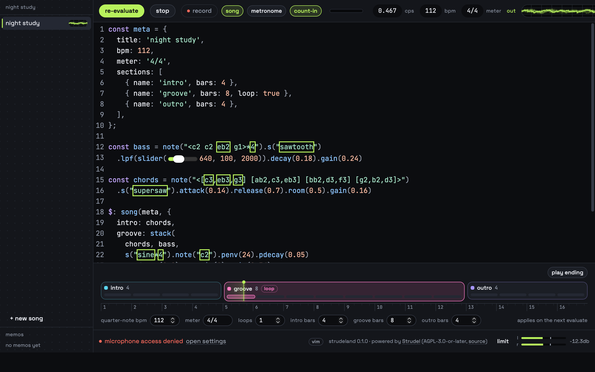

# Strudeland

A macOS app for writing and performing music with [Strudel](https://strudel.cc). Live-code
patterns, arrange them into sections, and keep your songs in a regular folder.



- Edit patterns with live note highlighting, an oscilloscope, and optional Vim keybindings.
- Arrange songs with named sections, loops, and per-song tempo and meter.
- Keep songs, reusable instruments, voice memos, and renders together in a project.
- Export synth arrangements to WAV, MP3, Ogg Vorbis, or Opus.

## Apple Silicon source preview

You’ll need Git, the Xcode Command Line Tools (`xcode-select --install`), and CMake.
CI uses Bun 1.3.11 and Rust 1.94.1 with `clippy` and `rustfmt`.

```sh
git clone https://github.com/rudoi/strudeland.git
cd strudeland
bun install --frozen-lockfile
bun run tauri dev
```

Choose **new project**, select an empty folder, and click **create**. Click **play** to hear
the starter song. Use `⌘S` to save and `⌘↵` to save and evaluate.

## Projects

Songs are plain Strudel scripts in `songs/*.js`. A song’s `meta` header sets its tempo, meter, and
sections. The editor watches the project for changes on disk.

Playing or rendering a song evaluates its JavaScript. Review songs from other people before
running them, and stop playback before applying changes you haven’t reviewed.

### Sharing voice memos

New projects ignore local recordings in Git. For an existing project, add these lines to its
root `.gitignore`.

```gitignore
/recordings/*
!/recordings/.gitkeep
```

Previously tracked files stay in Git until you remove them from the index. Earlier commits may
still contain them. Review recordings and their timing sidecars before sharing a project.

## Command line

Install the CLI to control the running app or work with song files and voice memos from a shell.

```sh
cargo install --locked --path crates/strudeland-cli
strudeland --help
strudeland render songs/main.js --format wav
```

Live playback uses Strudel’s Superdough by default. Offline rendering uses the Rust engine and
supports a subset of Strudel sounds. See the [render guide](crates/strudeland-render/README.md)
for supported exports and limitations.

## Contributing

See [Contributing](CONTRIBUTING.md) for development checks and pull requests. File bugs in
[GitHub Issues](https://github.com/rudoi/strudeland/issues) and report suspected vulnerabilities
[privately](SECURITY.md).

## License

Strudeland is [AGPL-3.0-or-later](LICENSE) and includes
[Strudel](https://codeberg.org/uzu/strudel) by the TidalCycles/uzu community.
See the [third-party notices](THIRD-PARTY-NOTICES.md) for bundled code and assets.
