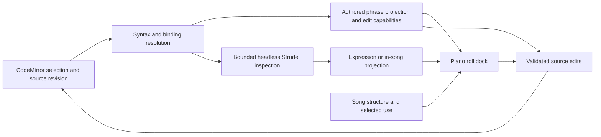

# Selection-driven, meter-aware piano roll

## Goal

Select a Strudel pattern in the editor and see its pitches and rhythm in a built-in piano roll. Move,
resize, add, or delete notes in supported phrases and see the corresponding changes in the editor.
The song script remains the source of truth. The roll follows the pitch range of the selected
material and has a persistent, easy-to-reach **Piano Roll** toggle in the editor toolbar.

## Scope

- The expanded dock follows a single CodeMirror selection. The default view is **Expression**.
  **In song** shows arranged notes in context, including transformations, and links to source when
  known. Visual edits are available from **Expression**. Both views work while playback is
  stopped. A collapsed dock takes up no editor space and suspends
  inspection. The toggle stays visible with an empty selection or while the panel is collapsed.
- The first usable release supports pitch, timing, length, insertion and deletion for simple
  monophonic phrases. Simultaneous authored notes support individual pitch edits when source
  attribution is verified. Expand viewing coverage independently of write-back coverage.
- A reference to a shared binding offers **Edit shared definition**, with source links to affected
  uses and an explanation when the list is incomplete. Selecting an invocation or repetition
  alone never makes it a private copy.
- The first release excludes per-use forks, flattening generated music into replacement source,
  free-form inverses for effects and transformations, velocity and automation editing, and
  changing actual envelopes or sample playback length from the piano roll. Edits update the editor
  buffer. While a song is playing, **Re-evaluate** applies the changes to playback through the
  existing save-and-evaluate flow.

## Architecture

The syntax layer answers which expression was selected, which source nodes may be edited, and
which references are statically visible. The query layer answers what a pattern produces
over a finite interval. The roll carries both results and their source revision. An evaluated
event is an observation. An edit capability is an independently established source operation.

| Contract | Required data |
| --- | --- |
| Selected target | Project and song identity, revision, selected span, resolved expression span, optional definition span, known uses and completeness |
| Window | Mode, use/section anchor, start and end in logical cycles, written meter per bar, seed and controls context where applicable |
| Pitched event | Exact whole and visible intervals, pitch and voice, source contributors when available, use/instance confidence, optional edit capability |
| Source edit | Target and revision, expected text, local replacement ranges, and the authored event effects the candidate must reproduce |

## Technical design

### Selection and binding resolution

Take a snapshot of the active project, song, CodeMirror document revision and UTF-16 selection.
Reuse the editor update hook in [setup.ts](../../src/lib/editor/setup.ts), including state swaps
when the session changes songs. Keep focus changes into the roll from clearing the active target.
Start with one nonempty selection. Resolve an exact expression, variable identifier, complete
pitch atom selection inside a mini literal, or recognized labeled pattern body. Trim trivia
and keep the smallest supported scope that contains the complete selection. Show the resolved
target and its source range before offering edits. An atom selection opens its enclosing pitched
pattern with those atoms selected. Arbitrary ranges spanning unrelated nodes and multiple editor
selections get a clear status. Caret-only inference can follow once selection boundaries are
proven.

Use Acorn with the same script options as the [transpiler](../../vendor/strudel/packages/transpiler/transpiler.mjs).
[format-song.ts](../../src/lib/editor/format-song.ts) already handles mini directives and conservative
literal detection. [note-audition.ts](../../src/lib/editor/note-audition.ts) distinguishes value
children from suffix arguments. Reuse those semantics where they have the same contract.
Classify candidates by lexical bindings and positively identified call positions. A JavaScript
string, a numeric atom, a property key and a note can have the same spelling. A local function
named `note` or a dynamic method call does not inherit the builtin's edit capabilities.

Follow immutable local `const` aliases, respecting scope and shadowing, including a pattern
passed through known section/voice combinators. Retain the definition and the selected use as
separate spans. Use the distinctions in the [glossary](../../GLOSSARY.md) for source use sites
and written pattern occurrences. Collect direct and transitive lexical use sites, including
aliases, labels, and `song(meta, parts)` section references when provable. Mark escapes through callbacks, computed
properties, mutable aliases, object indirection and unclassified calls as potentially affecting
additional uses. Permit edits to an independently verified definition with the uncertainty
displayed. When the definition itself is uncertain, retain inspection and omit write-back. Show
affected known uses before the first shared edit in a selection context, then let successive
gestures use that target until the context changes. When a selected expression transforms a
shared pattern, show the result of that expression. **Edit shared definition** takes the user to
the authored pitches in Expression and retains the selected occurrence as the meter anchor.

### Meter, window and pitch

Keep exact logical-cycle start/end fractions through projection and write-back. In Strudeland
one cycle is one written bar. Use [structure.ts](../../src/lib/strudel/structure.ts) and
[timing.ts](../../src/lib/strudel/timing.ts) for meter and mapping to the reference clock. Use
written bar numbers in the in-song view, and label pattern-local cycles in Expression. Select
the relevant written use as the meter anchor. If a definition is used in multiple sections or
meters, show the selected use next to the meter and let the user switch explicitly. For a
definition without a known use, label the base meter as the preview meter. Edits stay in
bar-relative fractions even if other uses display them against a different beat grid.

Use the written beat as the base horizontal unit of the ruler, measured in quarter-note
equivalents. An eighth note takes the same horizontal space in 4/4 and 7/8 at a given zoom, so
the 7/8 bar is seven-eighths as wide. A bar in meter N/D has N denominator
beat marks spaced 1/N of a cycle apart. In the viewport, favor nearby musical subdivisions
including triplets and offer snap bypass. Treat compound grouping as visual emphasis (for example
two dotted beats in 6/8). Use denominator beats for coordinates. Preserve existing off-grid
events exactly. Perform inverse pixel-to-time conversion against the same bar measurement and
snap to an exact rational in that bar. The [timeline](../../src/lib/project/timeline.ts) has
separate tick conventions for its compact ruler. Share the underlying meter calculations.

Use an initial bounded window of up to four bars, with a shorter window when a finite authored
phrase or section extent is known. Allow window navigation for longer and variable patterns.
View periodic patterns as a window into the pattern. A repeated source atom remains linked
across displayed occurrences. In song, derive the location from the linear arrangement and
section-local mapping in [song.ts](../../src/lib/strudel/song.ts). Use
[queryMetered](../../src/lib/strudel/metered-pattern.ts) to retain the scheduler's per-meter
query controls. If showing a playhead, use `runtime.position()` and verify source revision,
song and displayed use before mapping the live position. Loop wraps follow the written
position. Count-in or unmatched/stale playback has no in-song playhead.

For pitched haps use Strudel's [pitch conversions](../../vendor/strudel/packages/core/util.mjs).
Treat finite positive frequency and fractional MIDI as continuous pitch and show their exact
values in inspection. A raw `n` can be a sample index or scale degree. Give it a piano key only
when a pitched interpretation is established. Bare mini within a recognized pitch producer
inherits that context. Keep overlapping voices distinguishable. Retain full logical span and
clipped visible span, distinguish continuations and preserve true duplicates. Sort for display
by onset and stable occurrence order because Strudel can return haps out of time order. Use the visible
pitches to fit a padded vertical range with a minimum height and scrolling at wide ranges.
Freeze the mapping during a drag, provide edge scroll for out-of-range destinations, and refit
once the edit lands. An empty editor target gives guidance. A supported empty phrase has an
insertable grid with a conventional starting octave.

### Notation support and provenance

The examples below describe the first-release support boundary. Test the display and edit
decisions independently. A transformed expression can show editable source pitches in
Expression when the user selects the source operand, even when its generated result is
inspectable only.

| Strudel form | Expression / in-song inspection | Write-back |
| --- | --- | --- |
| `note("c4 ~ e4")`, MIDI numbers, static backticks, weighted atoms, simple slow sequences for multiple bars | Authored pitch, rests, timing and meter. Compare with Strudel query. | All five operations within the supported phrase grammar. |
| `[c4,e4]`, nested subdivision, `<c4 d4>`, `!`, `*`, `/`, Euclidean suffix, ranges, random choice | Use real mini timing and a bounded evaluation window. Distinguish group, alternate, repeat and generated instances. | Direct pitch replacement of a uniquely verified source leaf, including an individual note in an authored chord. All occurrences of a shared atom update together. Timing of simultaneous notes, arbitrary nesting, generated hits and individual alternate instances stays view-only. |
| `note(60)`, `note(seq('c4','e4'))`, `cat`, `stack`, `timeCat`, explicit pitches in constructors | Query the actual composition. Use AST source ranges even when the runtime has no locations. | Verified direct pitch literals and individually selected supported mini operands. General JS composition rhythm is view-only. |
| `const motif = note(...)`; `motif`; `motif.transpose(12)`; aliases, labels, section reuse | Show the expression or a verified use. Show direct and transformed uses separately when their identities are known. | Edit the shared authored target. Inspect transformed notes in context. Per-use timing or pitch inverse can be added only for an established operation. |
| `n("0 2 4").scale("C4:minor")`, `chord("C^7").voicing()`, arpeggiators | Query degrees, scale-produced pitches and voicings. Link generated events back to their source when known. | Generated pitches stay view-only. Degree- or chord-aware edits require explicit rules. |
| `struct`, `mask`, `fast`, `slow`, `rev`, `every`, `sometimes`, random or callback-generated values | Query finite audible-pattern projections with captured controls and seed. Indicate dynamic or unavailable context. | Editable source operands remain available in Expression. Generated event geometry or a sample of nondeterministic output supplies no write-back capability. |
| `freq`, interpolated text, escaped/normalized strings, tagged languages, stateful or external functions, drum and sample selectors | Inspect pitched output when the host can reproduce it. Report unavailable runtime inputs. Pure percussion has no piano pitch. | Continuous, ambiguous, unsupported and external source stays view-only. |

Bun probes against the pinned Strudel verified that `stack(motif, motif.transpose(12))` can share
one pitch source between two sounding events, `c4!2` reuses one atom, and Euclidean and speed
suffix arguments add their own locations. Applying `.gain("0.5 0.8")` put gain locations before
pitch locations. `.struct("x ~ x x")` produced multiple onsets from the same E4. A chord voicing
produced multiple pitches with one chord token. Quoted JS sequence arguments can emit no
locations, and a double-quoted mini literal with a JavaScript escaped newline produced shifted
locations. These observations establish test cases, including a literal intentionally chosen to
fool a pitch-looking-token heuristic.

The [mini parser](../../vendor/strudel/packages/mini/mini.mjs) distinguishes syntax and emits
positions, and [Hap.combineContext](../../vendor/strudel/packages/core/hap.mjs) merges
contributors. Use mini AST roles and verify exact raw UTF-16 source slices for edits.
A display location may link to a contributor such as a scale, speed or gain, or be unavailable
altogether. Context-only locations never grant an edit. Start with source forms whose raw and
parser coordinates can be checked directly. Keep rewrite support out of normalized and escaped
forms until a verified offset mapping exists.

### Isolated expression inspection

Keep selection changes outside the live REPL. [Runtime.query](../../src/lib/strudel/runtime.ts)
queries the last successful full evaluation, which misses unused definitions and can represent
a different document. [The current host query](../../src/host/main.ts) is an arrangement/render
diagnostic and elides details required by the roll. Extend the headless host with a distinct
inspection request. Reuse its inert audio backend, fresh context and Rust watchdog. Pass current
project instrument pins and evaluate options. Render and playback callers retain their existing
query contracts.

For Expression, use source-aware capture around an eligible expression while evaluating the
file in its lexical scope once. This captures unused declarations that actually execute, and
keeps labels, `all()`, and `song()` semantics intact. Prototype an opt-in hook before choosing
whether it belongs in the existing AST walk or a separate transpilation step. Preserve original
source offsets through the hook. Capture the result of an expression without re-invoking it or
changing call receiver, execution order, short circuiting, direct eval or lvalue semantics.
An in-memory probe with the transpiler's `leave` hook captured an unused initializer and a
transformed reuse with original mini offsets while the final song still produced its unrelated
drum pattern. Evaluate this seam with a request-scoped hook and collision-free lexical helper.
For a selected callee/member/function-body location whose expression is unsafe or never runs,
return an explicit status. Multiple calls at one site may produce distinct instance candidates.
Use a whitelist of instrumentable node roles, with semantic equivalence tests on untouched song
output.

For In song, query the final pattern in the selected written window. Static proven paths and
a separately tested per-use marker can attribute haps to a particular occurrence when note
locations are shared. Probe the marker through `stack`, labels, constructors, value and time
transforms, and the section wrapper. A source link leads back to the specific source expression,
or offers verified contributors when several source ranges explain the event. Any edit starts
from a supported target in Expression. Keep ambiguous events as context with a clear label. When
selection-specific attribution is unavailable, offer the full in-song view with any known
highlights and an attribution status. Do not infer that two identical notes came from the same
use. Compare output with the uninstrumented host for parity. Host slider movement, DOM APIs,
external triggers, live-only randomness or custom UI can prevent parity; identify that in the
view. The in-song projection reflects the inspected buffer, with a separate live playhead where
the evaluated revision matches.

A request has a revision ID, target and use ID, window, pins fingerprint, and seed/controls
context. The response carries exact event arcs, normalized pitch data, source contributors,
instance/use identity where established, and typed failure or truncation status. Send only
bounded, sanitized observations across the desktop bridge. Debounce selection/typing, permit
one active job and one latest pending, discard late replies, and cancel or suppress work on
collapse and song/project change. Bound query window width, total response/events, execution time,
and native memory as supported by the embedding; validate the bounds on dense/custom patterns.
Put the host work off the UI thread. The static path works immediately for simple phrases.
Measure first-open and re-selection latency before enabling automatic headless previews for
trusted evaluated songs. For a draft not yet run, present **Preview expression** when execution
of the full draft is necessary. Prefer a fresh host result for draft semantics after that action.
Check platform coverage for the app's jitless host, and keep static editing available when a
headless capability fails.

### Writing changes

An edit intent contains the gesture, exact source revision, target capability, expected text at
all changed ranges, and source/use snapshot. Preview the gesture locally; commit once on pointer
release or completed keyboard action. Recheck project, active song, revision, target and relevant
pins immediately before dispatch; a concurrent edit, song switch, external reload or stale drag
cancels cleanly. Use the [session](../../src/lib/project/session.ts) range-transaction pattern
from `applyMeta` and `applyInstrument`, with an isolated CodeMirror undo group and existing dirty
and watcher behavior. Keep use selection separate from the changed definition range. Map
selection and focus through the edit and update the roll from the resulting buffer. Undo and
redo update both views through their normal document listener.

- Pitch replacement patches one exact atom or numeric/string literal, preserving spelling style
  when practical, indentation and surrounding notation. Where one token generates several notes,
  explain which other displayed events will change too.
- For initial timing, resizing, addition and deletion, recognize closed monophonic bar phrases
  of direct pitches and rests, with simple per-bar weights. A move or resize preserves other
  onsets, durations and bar length. Rewrite the smallest eligible span with enough rest/weight
  capacity to represent the result, retaining the containing JS expression and sibling bars.
  Use the [transcriber's weighted notation](../../crates/strudeland-transcribe/src/notation.rs)
  as a reference for valid rest and slow-sequence encodings. Tied groups still need an edit rule.
  Encode exact ratios using bounded integer weights. For example, moving a quarter-bar E4 from
  beat 3 to beat 4 in a 4/4 `c4 ~ e4 ~` can write `c4 ~@2 e4`. Delete leaves silence for the
  vacated interval, and insertion can split a rest. Reject unsupported overlap, out-of-phrase
  moves or disproportionate rewrites, with an actionable reason.
- Before dispatch, reparse the candidate and check the intended exact event spans, pitches,
  untouched intervals and enclosing JS parse. Query comparable authored phrases in tests to
  catch mini AST-versus-runtime drift. Explicitly guard mixed-meter bars, tuplets and pattern
  weights whose effective duration is relative to sibling weights. A roll rectangle represents
  the pattern's logical interval. Playback `clip`, envelopes and sample tails can differ.

### UI and accessibility

Put a labeled **Piano Roll** disclosure in [Toolbar.svelte](../../src/components/Toolbar.svelte),
near the editor controls, with `aria-expanded` and `aria-controls`. Use a dock below the editor
and above the arrangement timeline in [App.svelte](../../src/App.svelte). Default to collapsed
on a fresh window, keep the user's choice while switching songs, and keep the toggle reachable
at minimum supported window width. Collapse returns focus to the toggle when the panel had focus.
Use existing Svelte primitives/styles. Provide clickable source links, keyboard selection and
edit commands, zoom/scroll as needed, visible focus, and announced editable/read-only, loading,
empty and stale states. Keep the selection gesture responsive on the editor side. Revisit
remembering dock state across app launches after testing the default.

## Dependencies and delivery order

This is a large cross-cutting workflow. Keep fracture, singletonize and loss check before
sequencing implementation. No new runtime dependency is assumed. Reuse CodeMirror, Svelte,
Acorn, the pinned Strudel packages, and the existing JS/Rust headless host if its inspection
prototype clears the requirements.

1. Prove the source and timing contracts with a notation corpus, exact meter projection and
   fraction round-trip tests. Prove capture semantics, resource limits and response shapes with
   focused host experiments in parallel once the boundaries are specified. Port the support
   table into executable fixtures.
2. Ship the foundation internally as a collapsible Expression dock for authored patterns.
   Connect scope-aware selection, shared-use reporting, auto-fit pitch and meter anchors.
3. Add the five source edits for the supported phrase grammar with candidate verification,
   stale-write protection, and isolated undo/redo. This is the first editing acceptance gate.
4. Add bounded broad Expression inspection and then In song with source/use attribution and
   fallback. Include the in-song view in first-release acceptance. Confirm app usability with
   those capabilities together.

Verify pure syntax, binding, pitch/rhythm, timing and candidate tests under `bun test`. Add
host tests for inactive definitions, scope, single execution, original locations, pathological
queries and errors, same seed, pins and output parity. Rebuild the committed host bundle from
its inputs and run the relevant host/desktop parity and Rust checks. Exercise the panel with
keyboard, minimum-size windows, selection changes during capture, failed/stale results, shared
motifs, play/stop, undo and mixed meter. Release scenarios should cover 4/4 → 7/8 → 6/8, meter
anchoring a reused motif, overlapping chord voices, and blank/frequency/dynamic patterns.
In the shared-motif scenario, `const motif = note("c4 e4")` appears directly in 4/4 and as
`motif.transpose(12)` in 7/8. Selecting the transformed use displays C5 and E5 in Expression.
**Edit shared definition** opens C4 and E4 on the retained 7/8 grid and identifies both uses.
Changing E4 to F4 updates the buffer and the inspected projections. The running song picks up
the change on **Re-evaluate**, sounding F4 in the direct use and F5 in the transposed use.
The cross-bar drag prototype must check exact snapping and unrelated source diffs before
cross-bar dragging becomes a release requirement.

## Risks

- Broad viewing outpaces safe editing because Strudel patterns are executable and often
  many-to-one or one-to-many. Publish capabilities per target and retain the plain code path.
- A capture hook can change meaning if it wraps a receiver, a label or a value whose access has
  side effects. Verify executable semantics and original positions before relying on runtime
  annotations, and surface uncertain instance attribution.
- Changing a shared definition can affect a distant section or a hidden consumer. Show known
  uses, distinguish partial use analysis, and make undo a single step.
- Source precision and time precision fail in different ways. Track exact fractions and raw
  source ranges separately, validate both, and stop a gesture when its source basis changes.
- Dense or unbounded patterns can stall the panel. Establish host and renderer budgets in the
  prototype and exercise timeout recovery and truncated results before broad automatic querying.

## Product decisions and open implementation questions

Confirmed in planning and the first refinement round: Expression first, source navigation from
In song, transformed pitches in Expression with an explicit action to edit the shared definition,
affected uses shown before editing, beat-proportional ruler, all five edits for simple monophonic
phrases, pitch edits for individually attributable simultaneous notes, a toolbar toggle, and
explicit **Re-evaluate** for playback changes.

Proposed defaults for refinement: collapsed on a fresh window and start with nonempty selections.
The capture prototype must determine the minimal safe instrumentation seam, quantify attribution
coverage, and set measured worker and rendering limits. The rhythm prototype must establish
which weights and subdivisions can be serialized with localized, bounded changes. Once both
contracts are measured, decide whether cross-bar reallocation inside a simple multi-bar phrase
belongs in the first geometry capability or follows the within-bar edits.
