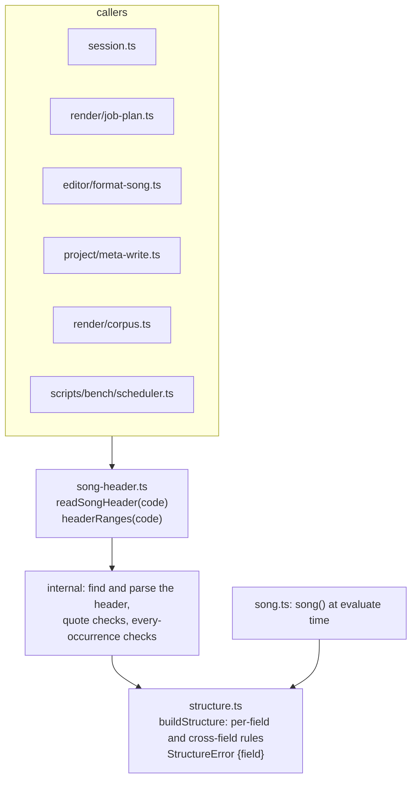

# 0113: one song header module

## Goal

Every module that reads a song header gets everything it needs from one call. Each rule about the
header's values lives in one place. No code reads an error's kind back out of its text.

This is a refactor. Nothing a user, the CLI or the control protocol sees changes, byte for byte.

## Background

The [re-verification](0113-song-header-module/reverify.md) records the evidence on `main` at
8312dd9. In summary:

- **The cross-field rules are written twice.** These are the rules that compare header fields with
  each other: `meta.loop` against a loop section, `meterChanges` against the total bars, and `loops`
  against whether a loop exists. `readHeader` writes them out to attach source positions, and
  `buildStructure` writes them again. One error message is duplicated word for word.
- **Six modules repeat the same steps** (nine call sites). They call `parseMeta`, then
  `staticStructure` or `evaluateOptions`, then build the `"msg (l:c)"` and `"meta: …"` text by hand.
- **`backing.ts` reads the `"meta: "` prefix back** to decide whether a failed evaluate was a header
  error.
- **The rules for single fields are already shared.** `meta.ts` imports `bpmProblem`,
  `meterProblem` and the others from `structure.ts`.
- **`buildStructure` must stay a validator.** `song()` calls it on the evaluated `meta` object,
  which has no source positions.

## Scope

In:

1. **One set of cross-field rules.** `buildStructure` is the only place they live. The reader of
   the parsed header translates a failing field into its source node.
2. **One song header module.** `src/lib/project/meta.ts` becomes
   `src/lib/project/song-header.ts`. It absorbs `evaluate-options.ts` and exposes
   `readSongHeader(code)`. Every caller moves to it.
3. **A typed error kind for a failed evaluate.** The session's internal result names the kind:
   `meta`, `instruments` or `eval`. `backing.ts` reads the kind instead of the prefix. The control
   handler maps the result to the wire shape, which does not change.
4. **`GLOSSARY.md` terms:** song, song header, structure and section. They were added during
   planning.
5. **Rename `EvaluateOptions.expectedArrangement` to `expectedStructure`.** It holds the song's
   structure; in the glossary, "arrangement" means the written order of patterns. The rename
   touches `runtime.ts` (3 uses), `evaluate-options.ts` and 2 test files (`session.test.ts`,
   `runtime-backends.test.ts`). It is the first commit, before `evaluate-options.ts` is folded in.

Out:

- **Any change to visible text or positions.** That includes error messages, the
  `metaError`/`error` fields, and the CLI output.
- **Exposing the error kind on the control wire.** That is follow-up task #137, blocked by this one.
- **The other review candidates.** The song playback module (#114) builds on this task.
- **The default structure built inline** in `runtime.ts:555` and `recording/controller.ts:396`
  (`buildStructure({})`). These read no header.

## Architecture

Two entry points, one rule set:

- **The parsed path:** `readSongHeader` works on text, with positions.
- **The evaluated path:** `song()` works on the evaluated object, without positions.

Both end in `buildStructure`.

`format-script.ts` and `meta-write.ts` keep using `headerRanges` for minimal-diff edits.

## Technical design

### `structure.ts`

- **`StructureError` gains a required `field`.** It names the `meta` key at fault: `bpm`, `meter`,
  `sections`, `loop`, `meterChanges` or `loops`.
  - Each `check(...)` call passes its key, including the one in `withLoops` (`loops`).
  - The thrown `'meta.loop cannot be used with section loop: true'` passes `loop`.
  - The one-argument `new StructureError(msg)` calls in `tests/structure.test.ts` are updated.
- **Messages are unchanged.** `song()` still prefixes them with `song: `.

### `song-header.ts`

The renamed `meta.ts`.

**Public interface:**

- `readSongHeader(code): SongHeader`.
- `headerRanges(code)`, unchanged.
- `LINE_BREAK`, which `meta-write.ts` uses.
- The types `Meta`, `MetaValue`, `MetaError` and `SongHeader`. `Meta` stays the type of
  `EvaluatedSong.meta` in `job-plan.ts`.

The result carries the formatted error texts, so no caller builds them.

**No longer public:** `parseMeta`, `staticStructure`, `evaluateOptions` and `EMPTY_STRUCTURE`. They
become internal or disappear.

**Result shape:**

- On success: `{ ok: true, meta, title, structure, options }`. `options` is what
  `runtime.evaluate` takes today from `evaluateOptions`.
- On error: `{ ok: false, error, structure }`.
  - `error` is `{ message, line, column, pos }` plus two formatted texts, so it offers three forms:
    - `message` alone, as `corpus.ts` shows it today (`meta: ${message}`, no position; pinned in
      `tests/render-corpus.test.ts`);
    - `"msg (l:c)"`, the session's `metaError`, which `StatusBar.svelte` prefixes with `meta: `;
    - `"meta: msg (l:c)"`, as `evaluateBuffer` and the planner show it.
  - `structure` is the default structure.
  - There are no options, so a caller cannot evaluate a song whose header is broken.
  - There is no title, as today, so callers fall back to the file name.
- **A header that fails to parse** (an acorn syntax error) stays `ok: true` with an empty `meta`,
  as today. Evaluating the song reports it.

**Inside:**

- `readHeader` keeps the checks that need source positions or apply only to the parsed header:
  - finding the header;
  - literal-only values;
  - quote checks;
  - per-field checks on every occurrence of a key;
  - range checks on earlier duplicate `loops` keys.
- **It drops its cross-field block.** Once the per-field checks pass, it calls `buildStructure`
  once and resolves the first error in today's order:
  1. A `StructureError` on `loop` or `meterChanges` becomes a `MetaError` at that key's last
     occurrence.
  2. Otherwise, the earlier duplicate `loops` occurrences are range-checked in source order
     (`loopsProblem(value, true)`, as today); the first failure is reported at its node. This runs
     whether `buildStructure` threw on `loops` or succeeded.
  3. Otherwise, a `StructureError` on `loops` becomes a `MetaError` at the last `loops` occurrence.

  The per-field checks still run first. `buildStructure` checks loop, then meter changes, then
  loops, the order `readHeader` uses today. Its bpm, meter and sections checks cannot fire once
  the per-field checks pass, and the `meta` it gets is the same last-wins object `readHeader`
  returns today.
- **The structure from that call is the result's `structure`.** That removes the second
  `buildStructure` call and `staticStructure`'s catch.

### Names (singletonized)

- `type SongHeader = { ok: true; meta: Meta; title: string | undefined; structure: SongStructure;
  options: EvaluateOptions } | { ok: false; error: MetaError; structure: SongStructure }`.
- `title` is `meta.title` when it is a string, else `undefined`; callers keep `titleFrom` for the
  file-name fallback.
- `MetaError` keeps `message`, `pos`, `line` (1-based) and `column` (0-based), and gains two
  getters: `located` (`"msg (l:c+1)"`) and `reported` (`"meta: " + located`).
- The default structure is `buildStructure({})`, built once inside `song-header.ts`.
- The session result is `SessionEvalOutcome = EvalOutcome & { errorKind: EvalErrorKind | null }`,
  with `type EvalErrorKind = 'meta' | 'instruments' | 'eval'`, both exported from `session.ts`.
  `errorKind` is `null` exactly when `ok` is true.

### Callers

| Caller | Today | After |
|---|---|---|
| `session.ts` `derive` | `parseMeta`, `staticStructure`, its own `(l:c)` text | `readSongHeader`: title, structure, error text |
| `session.ts` `evaluateSong` | `parseMeta` again, then `evaluateOptions` | `readSongHeader`: `options`, title |
| `session.ts` `evaluateBuffer` | `"meta: " + metaError`, `error: string` only | the kind plus the same text (below) |
| `session.ts:315` title only | `parseMeta(code).meta.title` | `readSongHeader(code)` title |
| `render/job-plan.ts` | `parsedMeta`, `evaluateOptions`, `staticStructure` fallback | `readSongHeader`; a `PlanJobError('meta', …)` with the same text; `EvaluatedSong.meta` stays |
| `editor/format-song.ts` | `parseMeta`, `staticStructure(meta).meter` | `readSongHeader`: structure meter, `ok` |
| `project/meta-write.ts` | `parseMeta(...).error`, `.meta` (twice in `setMetaValue`) | `readSongHeader`, `ok` and `meta` |
| `render/corpus.ts` | `parseMeta`, plus its own `buildStructure` try/catch | `readSongHeader`; the catch goes; text stays `meta: ${message}`, no position |
| `scripts/bench/scheduler.ts` | `parseMeta`, `staticStructure`, `evaluateOptions` | `readSongHeader` |

`job-plan.ts` is the riskiest caller to get wrong. The engine jobs it produces must stay
byte-identical.

### The error kind

- **Inside the session.** `evaluateBuffer` returns the wire `EvalOutcome` fields plus
  `errorKind: 'meta' | 'instruments' | 'eval' | null`.
  - The session interface types this as a session-level result that extends `EvalOutcome`.
  - The precedence is the one `evaluateBuffer` uses today: a meta error, then an instrument pin
    error, then the runtime's `evalError`, then `'evaluate failed'`.
- **`backing.ts`** maps `errorKind === 'meta'` to its `meta` outcome. Instruments and eval stay
  `eval`, as today. `META_PREFIX` goes.
- **The kind** comes from the same expression as the text: `meta` when the song has a meta error,
  else `instruments` when an instrument pin error is set, else `eval`. When the song is unknown or
  unreadable there is no meta error, so the kind is `instruments` or `eval`.
- **The control handler** maps the session result to the wire `EvalOutcome` field by field in
  `evaluateGuarded`, the single choke point for the `evaluate`, `code set` (`CodeSetResult.evaluated`)
  and play paths. `errorKind` never reaches the socket. Nothing else forwards the session result;
  `backing.ts` is the only other consumer.

### Tests (replace, don't layer)

- **New: `tests/song-header.test.ts`.** One table of header texts. Each row asserts the full result:
  `ok`, structure (or its key fields), options, and the exact error text and position. The
  `parseMeta` and `headerRanges` cases from `tests/meta.test.ts` move here.
- **New: a pairing test.** It runs each cross-field error through both entry points: the header text
  through `readSongHeader`, and the evaluated object through `buildStructure`. It asserts that the
  messages match, which enforces the "both paths agree" claim.
- **Deleted:** `tests/evaluate-options.test.ts` and `tests/meta.test.ts`. Their cases are folded
  into the table above.
- **`tests/structure.test.ts`** keeps the cases on the evaluated object. It gains assertions on
  `StructureError.field`.
- **Moved to `readSongHeader`:** `tests/meta-write.test.ts`, `render-corpus.test.ts`,
  `render-job-plan.test.ts` and `runtime-backends.test.ts`, which call `parseMeta`,
  `staticStructure` or `evaluateOptions` directly today.
- **`tests/session.test.ts`** asserts `errorKind` from `evaluateBuffer` for each kind, and keeps
  its text assertions.
- **`tests/control-handler.test.ts`** asserts the exact key set of the `evaluate` and `code set`
  results (`toEqual` or `Object.keys`), because its `toMatchObject` checks would not catch a leak.
- **Unchanged, run as regression gates:** `tests/format-song*.test.ts`,
  `tests/format-script*.test.ts`, `tests/host-entry.test.ts` (the host's `meta: ` text),
  `tests/app.test.ts`, and `tests/recording-controller.test.ts` (its `meta` kind comes from a
  controller-level fake).
- **`recording-backing.test.ts`** asserts the outcome kind from `errorKind`, including an
  instrument-pin failure.

### Docs

`AGENTS.md` names `meta.ts` ("static `meta` header parse") in the layout section. Update it to
`song-header.ts` and `readSongHeader`. No other doc names these files.

### Regeneration (AGENTS.md)

- `job-plan.ts` is in `PLANNER_FILES` (`scripts/engine/provenance.ts`), and `meta.ts`,
  `evaluate-options.ts`, `structure.ts` and `runtime.ts` are bundled into the headless host. The
  host build hashes whatever it bundles, so the rename needs no config change. `song-header.ts` is
  not added to `PLANNER_FILES` (`tests/engine-provenance.test.ts` pins that list).
- **Every commit keeps `bun test` green.** The host-bundle staleness test fails as soon as a
  bundled file changes, so each commit that touches a bundled file runs `bun run host:build` and
  commits the regenerated `host.js` and `host.inputs.json` with it. The commit that edits
  `job-plan.ts` also runs `bun run engine:refs --write`, because the refs hash that file.
- **Testing stage:** `bun run host:parity` and `bun run host:parity --batch` (required after a
  `job-plan.ts` edit). The jobs must come out byte-identical; any change to job bytes is a bug.
- **Full gate:** `bun test`, `bun run check`, `bun run lint`, `bun run build`, and
  `cargo test --workspace` (the refs staleness test).

## Dependencies

- None open.
- **This task blocks:** #114 (song playback module, which arms sections by name against one trusted
  structure) and #137 (the error kind on the wire).

## Risks

- **Error order or position drift.** The parsed path now gets its cross-field errors from
  `buildStructure`. A header with several problems must still report the same first one, at the
  same node. The table tests pin first-error cases with combined faults, including these two:
  `{ sections: [{ name: 'a', bars: 1 }], loop: { from: 'x', through: 'a' }, loops: 0, loops: 2 }`
  (the loop error wins) and `{ loops: 0, loops: 2 }` (the first `loops` range error wins). The
  pairing test pins the messages.
- **The duplicate `loops` key semantics.** Earlier occurrences are only range-checked; the last one
  is checked against the loop. `buildStructure` sees only the last value, so the
  earlier-occurrence check stays in the reader. Pin it with a test.
- **Planner byte drift.** Guarded by `host:parity` and the engine refs.
- **Hot path.** `derive` runs on every keystroke. It now calls `buildStructure` once instead of
  twice. `evaluateSong` and `setMetaValue` cost the same or less: one `readSongHeader` where they
  used `parseMeta` plus one or two `buildStructure` calls.

## Complexity

Medium: about 12 source and test files, one subsystem (the frontend), and the design decisions
settled in Q&A. Fracture is skipped, so the plan stays one document. Singletonize is a short pass
and the Loss check is light.

## Decisions from planning Q&A

1. **Scope:** the rename (decision 10), then cross-field rules, the song header module and the
   typed error kind: four commits in that order.
2. **Visible behaviour:** every message, position and wire text stays byte-identical.
3. **Regeneration:** `host:build`, `engine:refs --write` and `host:parity` are accepted. A change
   to job bytes is a bug.
4. **Name:** the term is **song header**, recorded in `GLOSSARY.md`.
5. **Rule owner:** `buildStructure` owns the cross-field rules. `StructureError.field` lets the
   parsed path attach each error to its node.
6. **Module:** `meta.ts` becomes `song-header.ts` and absorbs `evaluate-options.ts`.
   `readSongHeader` replaces `parseMeta` and its companions.
7. **Result shape:** success or error. On error there are no options, and the module owns the error
   texts.
8. **Error kind:** internal only. The wire is unchanged; #137 tracks exposing it.
9. **Tests:** replace, don't layer. One table test, and a pairing test for both entry points.
10. **Rename:** `expectedArrangement` becomes `expectedStructure` in this task, in its own commit.
    `runtime.ts` is bundled into the headless host, so the rename is covered by the same
    `host:build`.
