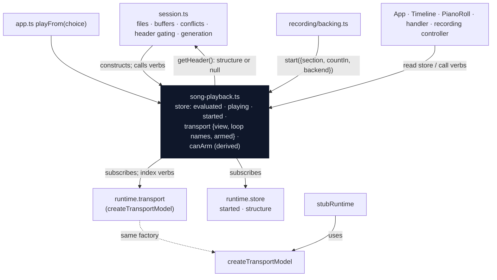

# 0114: a song playback module

## Goal

One module owns "what is playing" and "what is armed". It holds:

- the song whose evaluate is sounding;
- the rule for when the transport resets;
- arming by section name.

Everyone else reads its store and calls its verbs. Nobody recombines `runtime.started` with the
evaluated song, and nobody outside it touches `runtime.transport`.

This is a refactor with one deliberate fix. `strudeland state` will always name the armed section
the timeline shows, which is also the one that plays next (decision 7). Every other user-visible,
CLI and control-protocol output is unchanged.

## Background

The [re-verification](0114-song-playback-module/reverify.md) has the evidence. In summary:

- **"The playing song" is rebuilt in five places** from `runtime.started` and `session.evaluated`:
  `App.svelte`, `Timeline.svelte`, the control handler (twice) and `PianoRoll.svelte`.
- **The transport is reset from six sites:** five in the session, one in backing. The session's
  tests assert the order of those calls (`stubRuntime.resets`), not their outcome.
- **The armed section is an index, read against two different structures.**
  - The Timeline and the recording controller look it up in the song header's structure.
  - The control handler looks it up in the last evaluated structure.
  - `matchingSectionRange` exists only to translate between them.
  - As a result `strudeland state` and the timeline disagree in three cases: nothing evaluated
    yet, the header edited after the last evaluate, and a failed evaluate.
- **The transport's glue lives inside `runtime.ts`.** That is `setSegments`, `change`, the
  index-level verbs, and the rewind on stop. So the test stub can only record calls, and tests
  cannot model the transport.

## Scope

In:

1. **Extract the transport model.** The runtime's transport glue becomes an exported factory in
   `src/lib/strudel/transport.ts`, `createTransportModel(...)`.
   - The runtime uses it, with its scheduler-backed boundary and clock.
   - `stubRuntime` uses it too, with a boundary and clock the test supplies.
   - `tests/runtime.test.ts` stays the conformance suite for it.
2. **Add a song playback module,** `src/lib/project/song-playback.ts`. It owns:
   - the evaluated song;
   - `playing`;
   - `started` (derived);
   - the transport published by section name;
   - the reset-on-song-change policy;
   - arming by name;
   - arm, start, disarm on failure.
3. **The session constructs the module and exposes it as `session.playback`.** The session calls
   the module's verbs and stops touching `runtime.transport`. `SessionState.evaluated` moves into
   the module's store.
4. **Callers move to the module:** App, Timeline, PianoRoll, the control handler, the recording
   controller and backing.
5. **The Timeline's two arm-then-play copies become `app.playFrom(choice)`.**
6. **`matchingSectionRange` moves into the module's name resolution.** Its tests move with it.
7. **`stubRuntime`'s transport becomes the shared model.** `resets()` and the raw
   `setTransport` go, and tests assert published state.
8. **`AGENTS.md` lists `song-playback.ts`.** The glossary already gained "playing song" and
   "armed section" in the plan commit.

Out:

- **Disarming the Timeline's arm when an evaluate fails.** Decision 5 keeps today's behaviour.
- **Making `song()` check its sections against the header.** It adds a new eval error, so it is
  #140.
- **The session's hot-reload rule.** It stays in the session (`session.ts:1016`).
- **The playhead, `canPlayEnding` and the `head` name translation.** They are per-frame
  position, and stay in Timeline (see below).
- **Play/stop arbitration between song, memo and take.** That is #115.

## Architecture



- **Two adapters behind the runtime seam:** the real runtime and `stubRuntime`. Both are built on
  one transport model, so the stub behaves like the runtime instead of recording calls.
- **The module follows the runtime; it does not shadow it.**
  - `started` comes from `runtime.store`.
  - The view and `pendingStart` come from `runtime.transport.store`.
  - The armed names are cleared whenever the runtime reports that no start is pending. That
    covers every stop: the toolbar, auto-stop, the scheduler's own stop, and the recording code.
  - While playing, the loop names are re-mapped on every `runtime.store.structure` change, as the
    handler does today. A hot reload with different sections renames them with no verb call.

## Technical design

### Transport model (`transport.ts`)

- **`createTransportModel({ started, structure, boundary, now })`.** This is the glue moved out of
  `runtime.ts`:
  - `setSegments`, from `:421-456`;
  - `change`, `startFrom`, `loopSection`, `loopRange`, `playEnding` and `reset`, from `:835-890`;
  - the rewind when `started` goes from true to false, from `:639-643`.
- **Its inputs:**
  - `started`: a readable.
  - `structure`: the evaluated structure getter.
  - `boundary`: the next safe bar while playing. It covers the scheduler's `lastEnd`, `toCycle`
    and `pruneAt`, plus mixed-meter timing.
  - `now`.
- **It returns the existing `Transport` interface.** The runtime's own behaviour does not change.
- **The stub** passes a `boundary` and `now` that each test controls.
- **`runtime.ts` and `transport.ts` are bundled into the headless host,** so `bun run host:build`
  runs. Neither is a planner file, so the engine refs are untouched.

### The module's store

```
{
  evaluated: { path, title } | null,      // last successful evaluate; kept on stop
  playing: { path, title } | null,        // evaluated while started
  started: boolean,                       // from runtime.store
  transport: {
    view: { kind: 'song' } | { kind: 'loop'; section: number; through?: number } | { kind: 'release' },
    loop: { section: string; through?: string; names: string[] } | null,   // names: every section in the range
    armed: string | null,                 // non-null exactly when a start is pending
  },
}
```

- **`view` is the raw runtime view, with indices.** The Timeline's `canPlayEnding` and `isLoopPass`
  need it, so they read it here instead of from `runtime.transport`.
- **`canArm`** is a derived store, `(choice) => boolean`, built from the header and the runtime
  stores. The Timeline's menus re-render from it; it replaces `resolveRange`.
- **Accessors outside the store:**
  - `instruments()`, which `pianoRollMatchesLivePins` uses;
  - `removedStops(path)`.

### Verbs and their contracts

1. **`evaluate(path, text, opts, gen) → Promise<boolean>`.** The session calls it after its header
   and instrument gating.
   - **Synchronous until `runtime.evaluate`.** If another song is playing, reset the transport,
     then call `runtime.evaluate`, with no await in between. That keeps the engine's synchronous
     resume inside the user gesture.
   - **On success,** record the evaluated song (`path`, its title, `metaTitle`, `instruments`) if
     `gen` still equals the session's current generation. The session passes a `currentGen()`
     getter at construction, so there is one counter.
2. **`refused()`.** A header or instrument error refused the evaluate: disarm if stopped.
3. **`activeChanged()`.** Disarm if stopped. This is today's `activeTransport`.
4. **`projectChanged()`.** Stop if started, reset, and clear `evaluated`. It runs synchronously
   from `install`.
5. **`renamed(from, to)`.** Synchronous, inside the session's `whileMoving`. If `evaluated` is
   `from`, it retitles to `titleFrom(to, metaTitle)`. `titleFrom` lives in the module, and the
   session imports it.
6. **`removed(path) → { stopped }`.** It runs after `activeChanged()`, as in `deleteTask`.
   - If `evaluated.path === path`: stop if started, clear `evaluated`, and return
     `stopped = started at call time`.
   - Otherwise return `{ stopped: false }`.
7. **`arm(choice)`,** where `choice` is one of:
   - `{ start: name }`;
   - `{ loop: name, through?: name }`.

   It resolves names to indices against the structure in force (see the next section), then calls
   the runtime's index verb, and records the armed names.
7a. **`stopLooping()`.** It keeps today's two behaviours:
   - while stopped, `loopSection(null)` resets the whole transport, an armed start included;
   - while playing, it appends a loop end at the next bar.
8. **`playEnding()`.** A passthrough.
8a. **`headerChanged()`.** The session calls it from `publish()` whenever `active`, `structure` or
    `metaError` changed. While stopped with a pending arm, it re-resolves the armed names through
    the same resolution as `arm()`:
    - same place (index and bar): do nothing;
    - a new place: re-arm there;
    - a name gone, a range broken or reordered, or a `metaError`: disarm.

    It does nothing while playing, or while `start()` is waiting on `runtime.start`. This keeps the
    timeline, `strudeland state` and what plays next on the same section after header edits. It
    was added in Testing, after the stage-003 review found that an arm surviving a failed evaluate
    could otherwise start the section now at the old index.
9. **`start({ section?, countIn, backend }) → { T, cps } | { missingSection } | null`.** This is
   backing's flow:
   - stop if playing;
   - resolve `section` (an arm choice) against `runtime.store.structure`, the evaluated
     structure, with the same resolution as `arm()`;
   - arm, then call `runtime.start` with no await in between;
   - on a failed start, disarm only if the runtime is still stopped.

### Name resolution

- **Structure in force:** the evaluated structure (`runtime.store.structure`) while started. While
  stopped, it is the active song header's structure from `getHeader()`.
  - When the header has a `metaError`, `getHeader()` returns null and nothing can be armed. `canArm` is false and `arm` does
    nothing, matching today's `editableStructure` gate.
- **A start or a single-section loop:** the index of the first section with that name. That is
  today's lookup, so duplicate names keep resolving to the first one.
- **A range** (`loop` plus `through`): take the header's names from `loop` through `through`, and
  check that they appear contiguously and in order in the structure in force. That is today's
  `matchingSectionRange` rule.
- **Published names:**
  - `armed` is the name the module armed, kept until the runtime reports no pending start.
  - While stopped, `loop` holds the names the module armed.
  - While playing, `loop` holds the runtime view's indices mapped through the evaluated structure.

### Wiring

- **The session** constructs the module with:
  - `runtime`, called through the object at call time, so `app.test.ts`'s monkey-patching keeps
    working;
  - `getHeader`;
  - `currentGen`.

  It exposes the module as `session.playback`.
- **`app.ts`** passes `session.playback` to the handler deps, `createBackingStarter`
  (`BackingDeps`) and `RecordingControllerDeps`. It adds `playFrom(choice)`:
  - If a take is active, it arms only, as today. Today `arm()` arms, then `evaluateDoc` returns
    early.
  - Otherwise, if stopped, it arms, then calls `evaluateDoc()`, which keeps the memo and audition
    guards. That is today's order inside the user gesture.
  - If started, it arms only.

### Callers

| Caller | After |
|---|---|
| `App.svelte` / `SongList` | `$pb.playing?.path` |
| `Timeline.svelte` | reads `playing`, `transport` and `canArm`; arms through `app.playFrom`; `stopLooping` and `playEnding` through the module; keeps the playhead, `canPlayEnding` (fed `transport.view`), `playable` and the `head` translation (`$rt.structure`) |
| `PianoRoll.svelte` | `matchesLive` and the playhead gate read `evaluated` and `started` |
| `control/handler.ts` | `state.playing`, `state.started` and `state.transport` (wire shape unchanged; names from the module); `events` reads `evaluated`; `shouldAutoEval` gets `playback.evaluated?.path` |
| `recording/controller.ts` | reads `transport.armed` and `transport.loop` from the store before its stop rewinds the transport |
| `recording/backing.ts` | the section start becomes `playback.start(...)`; the `BackingStarter` interface is unchanged, so `memo-player` is unaffected |
| `session.ts` | calls the verbs; no `runtime.transport`; `SessionState.evaluated` removed; `pianoRollMatchesLivePins` reads `playback.instruments()` |

### Tests (replace, don't layer)

- **New: `tests/song-playback.test.ts`.** Outcome tests through the module's interface, on the
  shared transport model:
  - take-over reset before `runtime.evaluate` is called, in the same tick;
  - switching while stopped disarms;
  - a refused evaluate disarms when stopped;
  - any runtime stop clears the armed names;
  - project change; rename, keeping `metaTitle`; delete and its `stopped` rule;
  - arming by name against the header while stopped and against the evaluated structure while
    playing;
  - range contiguity, moved from `timeline.test.ts`;
  - no arming under a `metaError`;
  - `stopLooping`'s two behaviours;
  - backing's `start`, with disarm on failure and no await before `runtime.start`;
  - `playFrom`'s three guard paths;
  - decision 7's three cases.
- **`tests/helpers/stub-runtime.ts`:** the transport is `createTransportModel`, following the
  stub's `started`. `resets()`, `transportCalls()` and `setTransport` are removed or narrowed.
- **`tests/runtime.test.ts`** stays as the transport model's conformance suite.
- **`tests/session.test.ts`:**
  - About 19 `st().evaluated` assertions move to `playback`.
  - The 23 `resets()` calls become outcome assertions in the module tests.
  - The `transport reset` block and the delete resets move.
- **`tests/control-handler.test.ts`:**
  - Transport tests (`:1074-1118`) become module verbs on the model.
  - The null-structure case at `:1091-1095` is rewritten under decision 7.
  - The unreachable out-of-range-index case goes.
- **Rewritten as outcomes:** `tests/recording-controller.test.ts` (`:592-630`) and
  `tests/recording-backing.test.ts` (`:210-262`).
- **Smaller edits:**
  - `tests/timeline.test.ts` loses the `matchingSectionRange` tests;
  - `tests/export-dialog.test.ts:61` drops `evaluated` from its `SessionState`;
  - `tests/app.test.ts` gets the new wiring.
- **Unchanged:** `tests/memo-player.test.ts`, `memos.test.ts`, `vim.test.ts` and
  `editor-theme.test.ts`.

## Dependencies

- **Builds on:** the song header module (#113, done).
- **Blocks:**
  - #115, play/stop arbitration;
  - #126, runtime internals;
  - #133, timeline view-model;
  - #140, checking sections in `song()`.

## Risks

- **Ordering.** Each verb's contract states its rule: synchronous reset before evaluate, no await
  before `runtime.start`, rename inside `whileMoving`, and removed after `activeChanged`. Tests
  pin each one.
- **Extracting the transport model** could change the runtime's transport behaviour.
  `runtime.test.ts` and `runtime-backends.test.ts` are the guard, together with the mixed-meter
  tests.
- **Stale armed names.** The module clears them from the runtime's own `pendingStart`, never from
  its verbs alone.
- **Recording reads.** The controller reads the store before stopping, so the store must update
  synchronously on stop. Svelte stores are synchronous.
- **Known limitation.** Arming the first section is not observable as a pending start: the
  transport model treats the initial segment list as nothing pending. So the timeline shows no
  "will start at" for it, and `headerChanged` does not re-resolve it. Playback still starts
  there, so display and playback agree.
- **Test churn.** Large but mechanical. The faithful model removes the order-coupled tests rather
  than porting them.

## Complexity

Medium to large: about 12 source files and 10 test files in one subsystem (the frontend), with
subtle ordering. Fracture is skipped. Singletonize and a light Loss check run.

## Decisions

1. **Wiring:** the session constructs the module, exposes it as `session.playback`, and calls its
   verbs. The module reads the header through `getHeader()` and never subscribes to the session.
2. **`evaluated` has one owner:** the module's store. `SessionState.evaluated` goes.
3. **What arming resolves against.** While stopped, the active song header. While playing, and in
   backing's `start`, the evaluated structure. Checking sections in `song()` is #140.
4. **Arm-then-play is one verb.** It is reached through `app.playFrom`:
   - during a take it arms only, as today;
   - while stopped it arms and then evaluates;
   - while playing it arms only.
5. **A failed evaluate keeps the Timeline's arm.** No visible change (user, 2026-11-25).
6. **`playEnding` and `stopLooping` are module verbs.** The playhead, `canPlayEnding` and the
   `head` translation stay in Timeline, reading `transport.view` and `$rt.structure`.
7. **The wire names the armed section the timeline shows.** This covers three cases where it
   differed before:
   - nothing evaluated yet;
   - the header edited after the last evaluate;
   - a failed evaluate.

   Output is byte-identical whenever the header and the evaluated song agree. The three cases are
   pinned, and `control-handler.test.ts:1091-1095` is rewritten (user, 2026-11-25, two answers).
8. **Name:** `src/lib/project/song-playback.ts`, listed in `AGENTS.md`. `GLOSSARY.md` has playing
   song and armed section.
9. **One transport model.** `createTransportModel` in `transport.ts` is shared by the runtime and
   `stubRuntime`, with `runtime.test.ts` as its conformance suite. It replaces "the stub
   re-implements the transport".
10. **One generation counter:** the session's. The module receives `currentGen()`.
