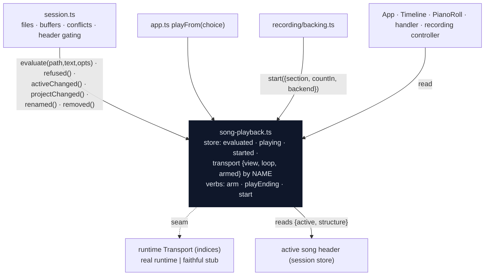

# 0114: a song playback module

## Goal

One module owns "what is playing" and "what is armed". It holds the song whose evaluate is
sounding, the rule for when the transport resets, and arming by section name. Everyone else reads
its store and calls its verbs; nobody recombines `runtime.started` with the session's evaluated
song, and nobody outside it touches `runtime.transport`.

This is a refactor with one deliberate fix. Nothing a user, the CLI or the control protocol sees
changes, except that `strudeland state` names the armed section correctly in one edge case (see
decision 7).

## Background

The [re-verification](0114-song-playback-module/reverify.md) has the evidence. In summary:

- **"The playing song" is rebuilt in five places** from `runtime.started` and
  `session.evaluated`: `App.svelte`, `Timeline.svelte`, the control handler (twice) and
  `PianoRoll.svelte`.
- **The transport is reset from six sites:** five in the session, one in backing.
  - The session's tests assert the order of the calls (`stubRuntime.resets`), not their outcomes.
- **The armed section is an index.** Three readers look it up against different structures:
  - the Timeline and the recording controller use the song header's structure;
  - the control handler uses the evaluated structure.
  - `matchingSectionRange` exists only to translate between them.
- **A live bug follows from that.** Arm a section on song B while stopped, and let B's evaluate
  fail. The timeline and `strudeland state` then name different sections.

## Scope

In:

1. **A song playback module,** `src/lib/project/song-playback.ts`. It owns:
   - the evaluated song (`path`, `title`, header title, instrument snapshot) and its project
     generation;
   - `playing`, the playing song;
   - `started`;
   - the transport, published with section names;
   - the reset-on-song-change policy;
   - arming by section name;
   - arm, start, disarm on failure.
2. **The session drives it.** It calls the module's verbs from `evaluateSong`, a refused evaluate,
   song switch, project change, rename and delete. The session stops touching `runtime.transport`.
3. **`SessionState.evaluated` moves to the module's store.** Every reader moves with it: App,
   Timeline, PianoRoll, the control handler and the recording code.
4. **Arm-then-play becomes one verb.** The Timeline's two copies become `app.playFrom(choice)`. It
   arms by name through the module, then plays through `app.evaluateDoc`, keeping the take, memo
   and audition guards.
5. **Backing's section start becomes `playback.start(...)`:** stop if playing, resolve against the
   evaluated structure, arm, start, disarm on failure.
6. **The control handler reads `playing`, `started` and the named transport from the module.** The
   wire shape is unchanged.
7. **`matchingSectionRange` moves into the module's name resolution.** It is deleted from
   `project/timeline.ts`, and its tests move with it.
8. **`stubRuntime`'s transport becomes a faithful model** built from `transport.ts`'s pure
   functions, so tests assert published state. `resets()` is deleted.
9. **`GLOSSARY.md`:** adds playing song and armed section.

Out:

- **Disarming the Timeline's arm when an evaluate fails** (decision 5: keep today's behaviour).
- **Making `song()` check its sections against the header.** That would add a new eval error; it
  is #140.
- **The session's hot-reload rule** (`path === active && started`). It stays in the session.
- **The playhead and `canPlayEnding`.** They are per-frame position, not playback identity, and
  stay in Timeline.
- **The play/stop arbitration between song, memo and take.** That is #115, which builds on this
  task.

## Architecture



- **Runtime stays the index mechanism behind a real seam.** It has two adapters: the runtime and
  the stub.
- **The module turns names into indices once, against one structure.**
  - While playing, that is the evaluated structure (`runtime.store.structure`).
  - While stopped, it is the active song header's structure.
- **It remembers the names it armed,** so what it publishes never depends on which structure the
  runtime holds at that moment.

## Technical design

### Store

```
{
  evaluated: { path, title } | null,        // last successful evaluate; kept on stop
  playing: { path, title } | null,          // evaluated while started
  started: boolean,
  transport: {
    view: 'song' | 'loop' | 'release',
    loop: { section: string; through?: string } | null,
    armed: string | null,
  },
}
```

Internally it also keeps `metaTitle` and `instruments` for the evaluated song, which the session's
rename and piano-roll pin checks use today.

### Verbs

- `evaluate(path, text, opts) → Promise<boolean>`.
  - If another song is playing, it resets the transport synchronously, before `runtime.evaluate`.
    This is today's take-over rule at `session.ts:1089`.
  - On success, it records the evaluated song, provided the generation still matches.
- `refused()`: a header or instrument error refused the evaluate; disarm if stopped.
- `activeChanged()`: disarm if stopped. This is today's `activeTransport`.
- `projectChanged()`: stop, reset, clear, and bump the generation.
- `renamed(from, to, title)`; `removed(path) → { stopped }`.
- `arm({ start: name } | { loop: name, through?: name } | 'clear')`, and `canArm(...)` for the
  menus.
- `playEnding()`.
- `start({ section?, countIn, backend }) → { T, cps } | { missingSection } | null`. This is
  backing's flow.

### Name resolution

- **A start or a loop of one section:** the section's index, in the structure in force.
- **A range** (`loop` plus `through`): both indices, and the range must be contiguous and forward.
  That is today's `matchingSectionRange` rule.
- **Published names** are the names the module armed. The view while playing is the runtime's
  view index mapped back to names through the evaluated structure, exactly as the handler does
  today.
- **While stopped, `transport.armed` is the armed name for the active song.** That fixes the edge
  case in decision 7.

### Callers

| Caller | After |
|---|---|
| `App.svelte` / `SongList` | `$pb.playing?.path` |
| `Timeline.svelte` | reads `playing`, `transport.armed` and `transport.loop`; arms through `app.playFrom`; keeps `playable`, the playhead and `canPlayEnding` |
| `PianoRoll.svelte` | `matchesLive` reads `evaluated` |
| `control/handler.ts` | `state.playing`, `state.started` and `state.transport` from the module, with the same wire shape; `events` and `codeSet` read `evaluated` and `playing` |
| `recording/controller.ts` | reads `transport.armed` and `transport.loop` by name, still before its stop rewinds the transport |
| `recording/backing.ts` | its section start becomes `playback.start(...)` |
| `session.ts` | calls the verbs; no `runtime.transport`; `SessionState.evaluated` removed |

### Tests (replace, don't layer)

- **New: `tests/song-playback.test.ts`.** Outcome tests through the module's interface:
  - take-over resets;
  - switching while stopped disarms;
  - a refused evaluate disarms when stopped;
  - project change, rename and delete;
  - arming by name against the header while stopped and against the evaluated structure while
    playing;
  - range contiguity;
  - backing's start, with disarm on failure;
  - decision 7's edge case pinned.
- **`tests/helpers/stub-runtime.ts`.** The transport becomes a faithful model built from
  `transport.ts`'s pure functions (`withStartFrom`, `withLoop`, `locate`, the stop rewind).
  `resets()` goes.
- **Moved to the module's tests:** `session.test.ts`'s `transport reset` block and the delete
  resets. The session tests keep only the verbs they call.
- **Rewritten as names:** `control-handler.test.ts` (transport state, `playing`),
  `recording-controller.test.ts`, `recording-backing.test.ts` and `timeline.test.ts`.
- **Updated for `evaluated` moving:** `app.test.ts`.

## Dependencies

- Builds on the song header module (#113, done).
- Blocks #115 (play/stop arbitration), #126 (runtime internals) and #133 (timeline view-model).

## Risks

- **Reset ordering.** The take-over reset must stay synchronous before `runtime.evaluate`.
- **The user gesture.** `runtime.start` must still run inside the gesture
  (`runtime.ts:176-182`), so `playFrom` keeps arm, evaluate and start in today's order.
- **Stale evaluates.** A late evaluate must not repopulate `evaluated` after a project change,
  which is why the module keeps a generation.
- **Recording.** The controller reads the armed section before its stop rewinds the transport.
  Keep that order.
- **The faithful stub could drift from the runtime.** Build it from `transport.ts`'s pure
  functions, not a re-implementation.
- **Test churn.** About 42 `evaluated` assertions in `session.test.ts` move or change.

## Complexity

Medium to large. About 11 source files and 8 test files, one subsystem (the frontend), and subtle
async ordering. Fracture is skipped, so the plan stays one document. Singletonize and a light Loss
check run.

## Decisions

1. **Wiring:** the session holds the module and calls its verbs. The module does not subscribe to
   the session.
2. **`evaluated` has one owner:** the module's store. `SessionState.evaluated` goes.
3. **Arming while stopped resolves against the active song header.** Backing resolves against the
   evaluated structure. `song()` checking sections against the header is out (#140).
4. **Arm-then-play is one verb,** reached through `app.playFrom`, keeping `evaluateDoc`'s guards.
5. **A failed evaluate keeps the Timeline's arm** (user, 2026-11-25). No visible change.
6. **`playEnding` is a module passthrough.** The playhead and `canPlayEnding` stay in Timeline.
7. **The armed name on the wire is the one armed on the active song** (user, 2026-11-25). In the
   failed-evaluate edge case, `strudeland state` now names B's armed section instead of A's index
   lookup. Pinned by a test; normal output is byte-identical.
8. **Name:** `src/lib/project/song-playback.ts`. `GLOSSARY.md` gains playing song and armed
   section.
9. **`stubRuntime`'s transport is a faithful model** built from `transport.ts`'s pure functions.
