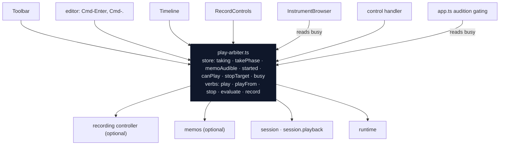

# 0115: one play/stop arbiter for song, memo and take

## Goal

One module decides what play, stop, evaluate, section arming and record mean while a song, an
audible memo, a take or an audition is sounding. The toolbar, the editor shortcuts, the Timeline,
the recording controls, the instrument browser and the control handler all call it. Nobody
re-derives "taking" or "memo audible", and nobody calls `runtime.stop()` directly.

Three visible changes, all approved by the user on 2026-11-25:

1. **Cmd/Ctrl-. stops like the toolbar.** During a take it ends and saves the take; otherwise it
   stops the memo and the song.
2. **The Timeline's section items are disabled** while a take or an audible memo's song backing
   plays, with help text saying why.
3. **Cmd-Enter flashes the editor only when the evaluate runs.**

Everything else is unchanged, including the control wire protocol and CLI output.

## Background

The [re-verification](0115-play-stop-arbitration/reverify.md) has the evidence.

### Current behaviour

"Take" is `takeRunning`: starting, count-in, recording or stopping.

| Action \ state | idle | song playing | audible memo (alone) | memo with song backing | take running |
|---|---|---|---|---|---|
| Toolbar play / Cmd-Enter | save if dirty, evaluate, autostart | save, re-evaluate | stop memo, save, evaluate, start | stop memo (stops its song), save, evaluate, start | refused (Cmd-Enter still flashes) |
| Toolbar stop | disabled | stop song | stop memo | stop memo, then song | end and save the take (no-op while starting or stopping) |
| Cmd/Ctrl-. | `runtime.stop` | stop song | **memo keeps playing** | **song stops, memo plays on** | **stops the take's backing; recording continues** |
| Control `eval`/`play` | no save, evaluate, autostart | as idle | stop memo, evaluate, start | stop memo, evaluate, start | evaluate with `autostart:false` |
| Control `stop` | `{wasPlaying:false}` | `{wasPlaying:true}` | stops the memo, `{wasPlaying:false}` | `{wasPlaying:true}` | end the take |
| Timeline playFrom | arm, evaluate if it resolves | arm (jump at the next bar) | arm, then play stops the memo | **arm: jumps the backing** | **arm; with song backing, jumps it mid-take** |
| Record | start a take | the take stops the song | stop memo first | stop memo (and its song) first | the button is stop |

Auditions are already subordinate everywhere. Every runtime evaluate, start or stop fires
`onPlaybackRequest`, which silences them.

## Scope

In:

1. **A play arbiter,** `src/lib/play-arbiter.ts`. It owns every rule in the table and sits over:
   - the recording controller (optional);
   - memos (optional);
   - the session, including `session.playback`;
   - the runtime.
2. **Callers move to it:**
   - `app.ts`: `evaluateDoc`, `playFrom`, the audition gating and `playRequests`;
   - `Toolbar.svelte`;
   - `editor/setup.ts` (Cmd-Enter and Cmd-.);
   - `Timeline.svelte`;
   - `RecordControls.svelte`;
   - `InstrumentBrowser.svelte`;
   - `control/handler.ts`, where the `ControlPlayback` bag becomes the arbiter.
3. **The three approved visible changes** above.
4. **`GLOSSARY.md`:** adds take and audible memo, done in the plan commit. **`AGENTS.md`:** lists
   `play-arbiter.ts`.

Out:

- **Any control wire or CLI change.** That covers `strudeland stop`'s report after a memo (#141)
  and refusing an eval of another song during a take (#142). Both stay explicit tested rows.
- **Hot reload into a take's or a memo's backing** (`session.ts:1009`). It stays in the session,
  as a known row.
- **The take-start no-op** while starting or stopping. It stays.

## Architecture

- **The handler's `ControlPlayback` seam already has two adapters:** the app's and
  `NO_PLAYBACK`. It becomes the arbiter's interface. An arbiter built without recording or memos
  replaces `NO_PLAYBACK`.
- **Dependency category: in-process.** The recording controller is local-substitutable through
  the fake recording API.

## Technical design

### Store

Every field is derived from the recording controller's store, the memo player's store and
`runtime.store`:

- `taking`: `takeRunning(phase)`.
- `takePhase`: the recording phase, for help copy.
- `memoAudible`: the memo is loading or playing.
- `started`.
- `canPlay`: `!taking`.
- `stopTarget`: `'take' | 'memo' | 'song' | null`. Stop acts on the take first, then the memo
  (which stops its own song), then the song. It drives the toolbar's stop button state and its
  copy.
- `busy`: `taking || memoAudible`. It drives audition gating, the instrument browser, and the
  Timeline's disabling while the runtime is started.

### Verbs and their contracts

1. **`play(): boolean`.** The user's play: the toolbar and Cmd-Enter.
   - **During a take,** it is refused and returns false, so the editor does not flash.
   - **Otherwise,** it silences auditions, bumps `playRequests`, stops the memo, then calls
     `session.saveAndEvaluate()`.
   - **Synchronous up to the save:** nothing awaits before it, so the gesture holds. The capture
     phase `onGesture` → `resumeAudio` in `App.svelte` stays.
2. **`playFrom(choice): boolean`.** The Timeline. If `busy` and the runtime is started, it is
   refused and returns false (approved change 2). Otherwise it keeps today's `app.playFrom`:
   - during a take: arm only;
   - while stopped: arm, then `play()`;
   - while started: arm only.
3. **`stop(): { stopped: 'take' | 'memo' | 'song' | null; wasPlaying: boolean }`.** The toolbar,
   Cmd-. and control `stop`.
   - **During a take:** `recording.stop()`, which is a no-op while starting or stopping.
   - **Otherwise:** stop the memo, then `runtime.stop()` if the runtime is still started.
   - **`wasPlaying` keeps the control `stop` result exactly:**
     - it is true when the song or a take was playing;
     - it stays false when only a memo was audible (#141 tracks changing that).
4. **`evaluate(path): Promise<EvalOutcome>`.** Control `eval`, `play` and `code set`.
   - It stops the memo and never saves.
   - During a take it passes `{ autostart: false }` to `session.evaluateBuffer`.
   - It returns the session outcome, and the handler maps it to the wire as today.
   - Another song evaluated during a take takes over the backing, as today (#142).
5. **`record(choice)`.** It stops the memo, then calls `recording.record(choice)` synchronously,
   which keeps `resumeAudio` inside the gesture.

### Callers

| Caller | After |
|---|---|
| `app.ts` | builds the arbiter; `evaluateDoc` → `arbiter.play`; `playFrom` → `arbiter.playFrom`; audition gating reads `busy`; `takeActive`, `memoActive` and the `playRequests` counter move in; `hooks.onEvaluate` → `play`, and a new `hooks.onStop` → `stop` |
| `editor/setup.ts` | Cmd-Enter flashes only when `onEvaluate` returns true; Mod-. and Ctrl-. call the `onStop` hook when one is given, else `runtime.stop` (tests and the plain editor) |
| `Toolbar.svelte` | reads the arbiter's store; play → `play()`; stop → `stop()`; the copy text stays in the component |
| `Timeline.svelte` | items call `arbiter.playFrom`; they are disabled with help text when `busy && started` (approved change 2) |
| `RecordControls.svelte` | record → `arbiter.record` |
| `InstrumentBrowser.svelte` | reads `busy` and `started` from the arbiter |
| `control/handler.ts` | `ControlPlayback` is replaced by the arbiter; `evaluateGuarded` → `arbiter.evaluate`; `stop` → `arbiter.stop`; wire unchanged |

### Tests (replace, don't layer)

- **New: `tests/play-arbiter.test.ts`.** One table over small `Pick<>` fakes, using the stub
  runtime and the fake recording API.
  - States: idle, song, memo alone, memo with song, take (each phase), audition.
  - Actions: `play`, `stop`, `evaluate`, `playFrom`, `record`.
  - Every row from the Current behaviour table is a named case, with the three approved changes
    and the two kept quirks (#141, #142) as explicit rows.
- **`tests/control-handler.test.ts`:** the "during memo playback and a take" block becomes one
  wiring test with a fake arbiter.
- **`tests/app.test.ts`:** the playFrom and take tests move to the arbiter. One integration test
  through the fake recording API stays.
- **`tests/setup.test.ts`:** Cmd-. calls the stop hook; Cmd-Enter flashes only when the evaluate
  runs.

## Dependencies

- **Builds on:** the song playback module (#114, done).
- **Blocks:** #123 (shell module), #136 (app seams), #141, #142.

## Risks

- **User gesture.** `play`, `stop` and `record` call through synchronously. Nothing awaits
  before `runtime.evaluate`, `runtime.start` or `resumeAudio`.
- **Recording order.** Stop the memo, then record. The controller reads its arm before its
  rewind.
- **Test monkeypatching.** The arbiter calls `memos.stopPlayback` and `session.saveAndEvaluate`
  through the objects at call time.
- **Teardown.** The arbiter's subscriptions are released in `app.destroy`.

## Complexity

Medium: about 13 files in one subsystem (the frontend). Fracture is skipped. Singletonize and a
light Loss check run.

## Decisions

1. **Name:** `src/lib/play-arbiter.ts`. The glossary adds take and audible memo.
2. **Toolbar play and Cmd-Enter during a take are refused.** Control evaluates with
   `autostart:false`. They stay two explicit rows.
3. **Save stays per entry point.** `play()` saves, `evaluate(path)` never does. These are two
   verbs, not `play({save})`.
4. **Cmd/Ctrl-. stops like the toolbar** (user).
5. **Cmd-Enter flashes only when the evaluate runs** (user).
6. **Control eval of another song during a take keeps taking over the backing** (user: kept, #142).
7. **Control `stop` after a memo keeps `wasPlaying:false`** (user: kept, #141).
8. **Stop while a take is starting or stopping stays a no-op.**
9. **Timeline section items are disabled while busy and the runtime is started** (user).
10. **"Stop the memo first" moves into `arbiter.record`.**
11. **Audition gating reads the arbiter's `busy`.**
12. **Stop calls `runtime.stop()` only when started,** everywhere. While stopped no audition can
    sound, so nothing is lost.
13. **Hot reload into a take's or memo's backing stays in the session,** as a known row.
