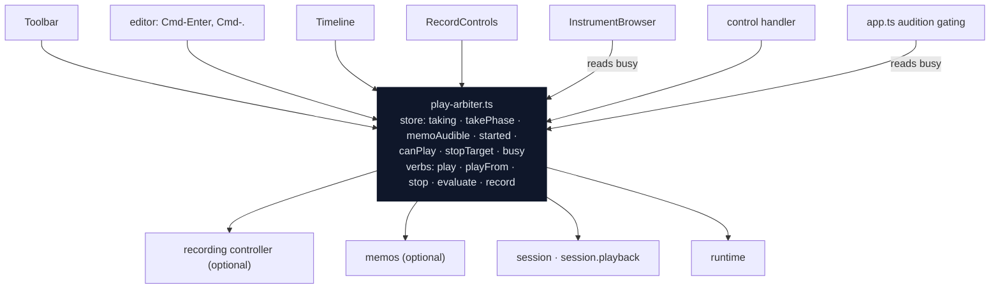

# 0115: one play/stop arbiter for song, memo and take

## Goal

One module decides what play, stop, evaluate, section arming and record mean while a song, an
audible memo, a take or an audition is sounding. The toolbar, the editor shortcuts, the Timeline,
the recording controls, the instrument browser and the control handler all call it. Nobody
re-derives "taking" or "memo audible", and no UI or control entry point calls `runtime.stop()`
directly. Internal calls inside the song playback, backing, recording and memo modules stay.

Three visible changes, all approved by the user on 2026-11-25:

1. **Cmd/Ctrl-. stops like the toolbar.** During a take it ends and saves the take; otherwise it
   stops the memo and the song.
2. **The Timeline's section items are disabled** while a take or an audible memo's song backing
   plays, with help text saying why.
3. **Cmd-Enter flashes the editor only when the evaluate runs.**

Everything else is unchanged, including the control wire protocol and CLI output.

## Background

The [re-verification](reverify.md) has the evidence.

### Current behaviour

"Take" is `takeRunning`: starting, count-in, recording or stopping.

| Action \ state | idle | song playing | audible memo (alone) | memo with song backing | take running |
|---|---|---|---|---|---|
| Toolbar play / Cmd-Enter | save if dirty, evaluate, autostart | save, re-evaluate | stop memo, save, evaluate, start | stop memo (stops its song), save, evaluate, start | refused (Cmd-Enter still flashes) |
| Toolbar stop | disabled | stop song | stop memo | stop memo, then song | end and save the take (no-op while starting or stopping) |
| Cmd/Ctrl-. | `runtime.stop` (silences auditions, cancels an in-flight autostart) | stop song | **memo keeps playing** | **song stops, memo plays on** | **with song backing: stops it; recording continues** (metronome keeps running) |
| Control `eval`/`play` | no save, evaluate, autostart | as idle | stop memo, evaluate, start | stop memo, evaluate, start | evaluate with `autostart:false` |
| Control `stop` | `runtime.stop`, `{wasPlaying:false}` | `{wasPlaying:true}` | stops the memo, `{wasPlaying:false}` | `{wasPlaying:true}` | end the take; `wasPlaying` = runtime started (true only with song backing) |
| Timeline playFrom | arm, evaluate if it resolves | arm (jump at the next bar) | arm, then play stops the memo | **arm: jumps the backing** | **arm; with song backing, jumps it mid-take** |
| Record | start a take | the take stops the song | stop memo first | stop memo (and its song) first | the button is stop |

Auditions are already subordinate everywhere. Every runtime evaluate, start or stop fires
`onPlaybackRequest`, which silences them.

## Scope

In:

1. **A play arbiter,** `src/lib/play-arbiter.ts`. It owns every rule in the table and sits over:
   - the recording controller (optional);
   - memos (optional);
   - the session, including `session.playback`;
   - the runtime.
2. **Callers move to it:**
   - `app.ts`: `evaluateDoc`, `playFrom`, the audition gating and `playRequests`;
   - `Toolbar.svelte`;
   - `editor/setup.ts` (Cmd-Enter and Cmd-.);
   - `Timeline.svelte`;
   - `RecordControls.svelte`;
   - `InstrumentBrowser.svelte`;
   - `control/handler.ts`, where the `ControlPlayback` bag becomes the arbiter.
3. **The three approved visible changes** above.
4. **`GLOSSARY.md`:** take and audible memo were added in the plan commit. **`AGENTS.md`:**
   lists `play-arbiter.ts`.

Out:

- **Any control wire or CLI change.** That covers `strudeland stop`'s report after a memo (#141)
  and refusing an eval of another song during a take (#142). Both stay explicit tested rows.
- **Hot reload into a take's or a memo's backing** (`session.ts:1009`). It stays in the session,
  as a known row.
- **The take-start no-op** while starting or stopping. It stays.

## Architecture

- **The handler's `ControlPlayback` seam already has two adapters:** the app's and
  `NO_PLAYBACK`. It becomes the arbiter's interface. An arbiter built without recording or memos
  replaces `NO_PLAYBACK`.
- **Dependency category: in-process.** The recording controller is local-substitutable through
  the fake recording API.

## Technical design

### Construction

`createPlayArbiter({ session, runtime, recording?, memos?, stopAuditions })`.

- **`app.ts`** keeps `stopAuditions` (it is also the runtime's `onPlaybackRequest`, built before
  the arbiter) and passes it in. It releases the arbiter with `arbiter.destroy()` in
  `app.destroy`, before `memos.destroy()` and `recording.destroy()`.
- **The arbiter calls every dependency through its object at call time:** `session.playback.arm`,
  `session.saveAndEvaluate`, `memos.stopPlayback`, `runtime.stop`. `tests/app.test.ts`
  monkey-patches these.
- **The control handler** takes `Pick<PlayArbiter, 'evaluate' | 'stop'>` in place of
  `ControlPlayback`.
  - Without one, it builds `createPlayArbiter({ session, runtime, stopAuditions: () => {} })`,
    replacing `NO_PLAYBACK`.
  - The handler's wiring test passes a fake.

### Store

Every field is derived from the recording store, the memo player store and `runtime.store`:

- `taking`: `takeRunning(phase)`.
- `takePhase`.
- `memoAudible`: the memo is loading or playing.
- `started`: `runtime.store.started`.
- `canPlay`: `!taking`.
- `stopTarget`: the take, else the memo, else the song, else null. A memo cannot play during a
  take (`memos.ts:184-188`), so `take` always wins.
- `stopEnabled`: `started || taking || memoAudible`. This is today's toolbar predicate.
- `busy`: `taking || memoAudible`.
- `canPlayFrom`: `!(busy && started)`. This is approved change 2.
- `auditionsAvailable()` (a function, read at call time): `playRequests === 0 &&
  runtime.canAudition() && !taking && !memoAudible`. This is exactly today's `app.ts:141`, and
  the `playRequests` counter moves into the arbiter.

**Side effects the arbiter owns:** entering a take or an audible memo calls `stopAuditions()`,
as `app.ts:232-239` does today.

The **InstrumentBrowser** keeps its own copy predicate, `started || memoAudible || taking`, read
from the store, so its `busyHelp` text is unchanged.

### Verbs and their contracts

1. **`play(): boolean`.** The user's play: the toolbar and Cmd-Enter.
   - **During a take,** it returns false and does nothing.
   - **Otherwise,** it calls `stopAuditions()`, does `playRequests++`, calls
     `memos.stopPlayback()`, then `session.saveAndEvaluate().finally(() => playRequests--)`, and
     returns true.
   - It returns true even when there is no active song (`saveAndEvaluate` does nothing then),
     matching today.
   - **Synchronous up to the save.** `saveAndEvaluate` may await a write when the song is dirty,
     as today. `App.svelte`'s capture-phase `onGesture` → `resumeAudio`, `prepareNoteAudition`
     and the rest of `App.svelte` stay untouched.
2. **`playFrom(choice): boolean`.** The Timeline.
   - **If `!canPlayFrom`,** it returns false and does nothing.
   - **Otherwise it keeps today's `app.playFrom`:** read `started` from `session.playback.store`,
     arm through `session.playback.arm`, then call `play()` only if the arm succeeded and the
     runtime was stopped.
     - During a take, `play()` returns false, so the arm stays (today's behaviour).
     - With an audible memo alone, the runtime is stopped, so it arms and then `play()` stops the
       memo, as today.
3. **`stop(): { stopped: 'take' | 'memo' | 'song' | null; wasPlaying: boolean; done: Promise<void> }`.**
   The toolbar, Cmd-. and control `stop`.
   - `wasPlaying` is `runtime.store.started` read on entry, before anything stops, in every
     branch. This is exactly the wire value today. Callers never derive it from `stopped`.
   - **During a take,** it calls `recording.stop()` synchronously. `done` is that promise. The
     call does nothing while the take is starting or stopping.
   - **Otherwise,** it calls `memos.stopPlayback()`, then `runtime.stop()` **unconditionally**.
     - This keeps today's control and Cmd-. semantics. The runtime's stop counter cancels an
       in-flight evaluate's autostart, and `onPlaybackRequest` silences auditions.
     - The toolbar's stop button is disabled while nothing is started, taking or audible, so
       nothing changes for the toolbar.
     - `done` is resolved.
   - **Throws propagate:** `control-handler.test.ts:728` expects `INTERNAL_ERROR` when
     `runtime.stop` throws.
4. **`evaluate(path): Promise<SessionEvalOutcome>`.** Control `eval`, `play` and `code set`.
   - It calls `memos.stopPlayback()`, then `session.evaluateBuffer(path, taking ? { autostart:
     false } : undefined)`. It never saves and never goes through `play()`.
   - Another song evaluated during a take takes over the backing, as today (#142).
5. **`record(choice)`.** It calls `memos.stopPlayback()`, then `recording.record(choice)`, both
   synchronously, so `resumeAudio` stays inside the gesture.
6. **`destroy()`.** It releases the arbiter's subscriptions.

### Editor hooks (`editor/setup.ts`)

- **`onEvaluate?: () => boolean | void`.** `evaluateCommand` flashes unless the hook returns
  exactly `false`. Void hooks still flash, so `tests/setup.test.ts:57` and the
  `editor-hooks.test.ts` and `vim.test.ts` hooks pass unchanged.
- **`onStop?: () => void`.** Mod-. and Ctrl-. call it when given, else `runtime.stop()`, as today.
  The fallback tests (`editor-hooks.test.ts:153`, `vim.test.ts:206`, `setup.test.ts:48`) stay.
- **`app.ts` wires them:** `onEvaluate: () => arbiter.play()` and `onStop: () => void
  arbiter.stop()`.

### Timeline (approved change 2)

- **The section items** (start here, loop this section, and each "through …") are disabled when
  `!$arbiter.canPlayFrom`.
- **Help text precedence in each item:**
  1. the resolve failure (`!target`/`!range`: "Re-evaluate the song …") comes first, as today;
  2. then the new busy text: "Stop the take first." or "Stop the memo first.", chosen by
     `stopTarget`;
  3. then the existing branches.
- **Per state:**
  - **Memo alone:** the runtime is stopped, so the items stay enabled. A click arms, and play
    stops the memo, as today.
  - **Memo loading with song backing, or a take `starting`:** the runtime is not started yet, so
    the items stay enabled until the song starts. That matches the predicate.
  - **A take with a metronome or no backing:** the items stay enabled, and today's "taking" help
    applies.
  - **A take or memo with song backing, started:** the items are disabled.
- **Out of approved change 2, unchanged:** `play ending` and `stop looping` still act on a
  backing song. They are known rows.

### Callers

| Caller | After |
|---|---|
| `app.ts` | builds the arbiter. `evaluateDoc` → `arbiter.play`; `playFrom` → `arbiter.playFrom`. Audition gating → `arbiter.auditionsAvailable()`. `takeActive`, `memoActive`, `playRequests` and the take/memo `stopAuditions` subscriptions move in. Hooks are wired as above. `beforeProjectChange` (stop the memo, then await `recording.stop()`) stays as it is, pinned by `app.test.ts:592-602` |
| `editor/setup.ts` | the flash contract and `onStop` hook above |
| `Toolbar.svelte` | reads `canPlay`, `stopEnabled`, `stopTarget` and `taking`. Play → `play()`, stop → `stop()`. The copy text stays in the component |
| `Timeline.svelte` | items call `arbiter.playFrom`. Disabled by `canPlayFrom`, with the help precedence above. Its own `taking` reads the arbiter |
| `RecordControls.svelte` | record → `arbiter.record` |
| `InstrumentBrowser.svelte` | reads `started`, `memoAudible` and `taking` from the arbiter, with the same copy |
| `PianoRoll.svelte` | its `takeRunning` playhead check reads `arbiter.taking` |
| `control/handler.ts` | `ControlPlayback` is replaced by `Pick<PlayArbiter, 'evaluate' \| 'stop'>`. `evaluateGuarded` → `arbiter.evaluate`. `stop` → `arbiter.stop`, awaiting `done`, with the reply unchanged |

**Internal calls that stay outside the arbiter:** these are not UI or control entry points.

- `runtime.stop()` in `song-playback.ts`, `recording/backing.ts`, `recording/controller.ts` and
  `audio/memo-player.ts`. A memo alone stops the song inside the memo player.
- `memos.stopPlayback()` in `MemoList.svelte` (the row toggle) and `StatusBar.svelte` (dismissing
  a player error).

### Tests (replace, don't layer)

- **New: `tests/play-arbiter.test.ts`.** One table over small `Pick<>` fakes, using the stub
  runtime and the fake recording API.
  - **States:** idle, song, memo alone, memo with song, take (song backing, metronome only, and
    each phase), audition, an in-flight evaluate.
  - **Actions:** `play`, `stop`, `evaluate`, `playFrom`, `record`.
  - **Every row of the Current behaviour table is a named case,** with the three approved
    changes and the two kept quirks (#141, #142) as explicit rows.
  - **Specific rows:**
    - `wasPlaying` for: take with song, take with metronome, a take starting, memo alone, memo
      with song;
    - stop cancelling an in-flight autostart;
    - stop silencing an audition while idle;
    - `auditionsAvailable` during a pending play.
- **`tests/control-handler.test.ts`:** the "during memo playback and a take" block (`:549-594`)
  becomes one wiring test with a fake arbiter.
  - `:588` and `:605` keep asserting the unconditional stop counter.
  - `:728` still expects `INTERNAL_ERROR`.
- **`tests/app.test.ts`:** the playFrom and take tests (`:608-655`, `:670-680`) move to the
  arbiter. One integration test through the fake recording API stays. The tests that monkey-patch
  through the app (`:40`, `:230`, `:269-300`, `:371`, `:394`, `:569`, `:592-654`) still pass.
- **`tests/setup.test.ts`:** Cmd-. calls `onStop` when given. Cmd-Enter does not flash when
  `onEvaluate` returns `false`. `editor-hooks.test.ts` and `vim.test.ts` stay unchanged.

## Dependencies

- **Builds on:** the song playback module (#114, done).
- **Blocks:** #123 (shell module), #136 (app seams), #141, #142.

## Risks

- **User gesture.** `play`, `stop` and `record` call through synchronously. Nothing awaits
  before `runtime.evaluate`, `runtime.start` or `resumeAudio`.
- **Recording order.** Stop the memo, then record. The controller reads its arm before its
  rewind.
- **Test monkeypatching.** The arbiter calls `memos.stopPlayback` and `session.saveAndEvaluate`
  through the objects at call time.
- **Teardown.** The arbiter's subscriptions are released in `app.destroy`.

## Complexity

Medium: about 13 files in one subsystem (the frontend). Fracture is skipped. Singletonize and a
light Loss check run.

## Decisions

1. **Name:** `src/lib/play-arbiter.ts`. The glossary adds take and audible memo.
2. **Toolbar play and Cmd-Enter during a take are refused.** Control evaluates with
   `autostart:false`. They stay two explicit rows.
3. **Save stays per entry point.** `play()` saves, `evaluate(path)` never does. These are two
   verbs, not `play({save})`.
4. **Cmd/Ctrl-. stops like the toolbar** (user).
5. **Cmd-Enter flashes only when the evaluate runs** (user).
6. **Control eval of another song during a take keeps taking over the backing** (user: kept, #142).
7. **Control `stop` after a memo keeps `wasPlaying:false`** (user: kept, #141).
8. **Stop while a take is starting or stopping stays a no-op.**
9. **Timeline section items are disabled while busy and the runtime is started** (user).
10. **"Stop the memo first" moves into `arbiter.record`.**
11. **Audition gating is `arbiter.auditionsAvailable()`,** exactly today's predicate, with
    `playRequests` moved in.
12. **Outside a take, stop calls `runtime.stop()` unconditionally,** as control and Cmd-. do
    today. That cancels an in-flight evaluate's autostart and silences auditions. The toolbar's
    stop is disabled when idle, so it is unaffected. (Refine corrected an earlier "only when
    started" rule, which would have changed behaviour.)
13a. **`play ending` and `stop looping` stay outside approved change 2,** as known rows.
14. **The toolbar's stop of a memo playing alone now calls `runtime.stop()` too** (user, 2026-11-25,
    found in stage 002). As with Cmd-. and `strudeland stop` today, that clears a stale "audio
    error" notice.
13. **Hot reload into a take's or memo's backing stays in the session,** as a known row.
