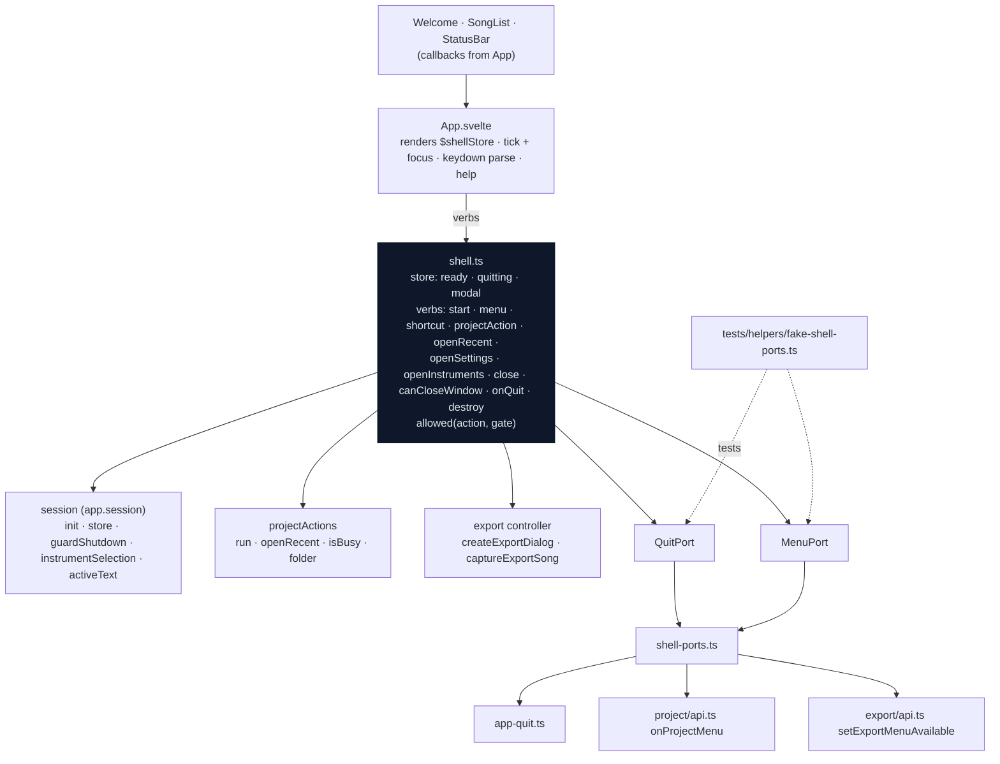

# 0123: the app shell, out of App.svelte

## Goal

One module, `src/lib/shell.ts`, owns what the window does around the editor:

- which dialog is open (settings, the instrument browser, export) and where focus goes back to;
- whether a Quit is being decided, and the Quit ordering;
- whether the window may close (the predicate `session.init` is handed);
- whether a menu item, shortcut or welcome button acts now: one gate table;
- the native Export Audio item's availability;
- registering the menu and Quit listeners, with their destroyed re-checks.

`App.svelte` renders from the shell's store and calls its verbs. It keeps the DOM: `tick()` and
focusing, `onGesture`, the keydown parsing, help start and reset, and `app.destroy`.

**Nothing visible changes.** Menu enablement, shortcut behaviour, Quit and window-close
outcomes, focus and copy stay exactly as they are. The one place where the new shape cannot
reproduce today's state (two dialogs open at once) is unreachable today; see Decisions.

## Background

The [re-verification](reverify.md) has the evidence, with file and line at
`f7861f5`, and the behaviour that must stay identical. In short:

- `App.svelte` (330 lines) holds four pieces of modal state (`newSongOpen`, `instruments`,
  `settings`, `exportDialog`), three flags (`projectsReady`, `nativeMenuReady`, a plain-`let`
  `quitting`), the Export Audio sync effect, `onAppQuit` with its nested `finally`, and the
  listener registration in `onMount`.
- The gate is `actionBlocked()` plus a different extra condition at each caller. The
  differences are real behaviour (reverify, "The gate") and stay.
- `listenForAppQuit`, `replyToAppQuit`, `onProjectMenu` and `setExportMenuAvailable` each have
  one caller, `App.svelte`.
- Nothing tests the Quit ordering, the gate, a menu action during Quit or behind a dialog, the
  menu sync or the window-close predicate.
- Window close and Quit differ in four ways today (reverify (a)-(d)). They stay as they are;
  unifying them is filed as **#152**.

## Scope

In:

1. `src/lib/shell.ts`: `createShell`, its store, verbs, the gate table `allowed`, and the
   `QuitPort` and `MenuPort` types.
2. `src/lib/shell-ports.ts`: the Tauri side of the two ports. It only re-exposes the four
   existing adapter functions, so the "only X calls Tauri" rules hold unchanged.
3. `tests/helpers/fake-shell-ports.ts` and `tests/shell.test.ts`; one test in
   `tests/ipc-adapters.test.ts` that the Tauri ports call through to the existing adapters.
4. `App.svelte` moved onto the shell, with nothing left behind.
5. Docs: an `AGENTS.md` layout line, the "Application Quit" line, and a `GLOSSARY.md` term.

Out:

- **Any change to the gates or to window close vs Quit** (#152).
- **`createApp`, the play arbiter, `onGesture`, `prepareNoteAudition`, `resumeAudio`, StatusBar
  notices and the preview graph** (#136's boundary). The shell takes `app.session`; `createApp`
  is untouched.
- **Rust**: `src-tauri/src/lib.rs`, `app_quit.rs`, `QuitState` (#135's boundary). No command,
  event or kind changes, so `ipc:build` is not run.
- **Window close itself.** It stays in `session.init` (`session.ts:1305-1325`); the shell only
  supplies `canCloseWindow`.
- **The export controller's lifetime end.** `ExportAudio.svelte` disposes it on unmount and
  restores focus to the element focused before it opened, as today.
- **`newSongOpen`.** It stays component state, bound into `SongList` and `NewSong`.
- **`matchShortcut`** (`project/ui.ts`) and the keydown handler's `preventDefault` and
  `stopPropagation`. The handler stays in `App.svelte` and calls `shell.shortcut`.
- **`createProjectActions`.** `App.svelte` creates it, passes it in, and destroys it in the
  `onMount` cleanup as today.

## Architecture



- **Seams.** The two ports are the only new ones. Each has two adapters: the Tauri one in
  `shell-ports.ts` and the fake. The session, project actions and export controller are
  in-process and used for real in the tests (the session over `fakeProjectApi`, the export
  controller over a mock `ExportApi`, as `export-dialog.test.ts` does).
- **Why a separate `shell-ports.ts`.** `shell.ts` must import cleanly under `bun test`, without
  the Tauri mocks. The adapter is two object literals over existing functions, and it makes no
  Tauri call of its own: `app-quit.ts`, `project/api.ts` and `export/api.ts` stay the only
  modules that call Tauri for Quit, the project menu and the export menu item.
- **No DOM in the shell** beyond holding an opener as an opaque `HTMLElement`. The menu's
  settings path needs today's `document.activeElement`, so `createShell` takes an
  `activeElement` function (App passes the DOM read). Focusing, and waiting for `tick()`, stay
  in App.

## Technical design

### Construction

```ts
createShell({
  session,        // ShellSession = Pick<Session, 'init' | 'store' | 'guardShutdown' | 'instrumentSelection' | 'activeText'>
  projectActions, // ReturnType<typeof createProjectActions>
  exportApi,      // ExportApi
  quit,           // QuitPort
  menu,           // MenuPort
  activeElement,  // () => HTMLElement | null
}): Shell
```

```ts
interface QuitPort {
  listen(handle: (id: number) => void): Promise<() => void>; // listenForAppQuit
  reply(id: number, approved: boolean): Promise<void>;       // replyToAppQuit
}
interface MenuPort {
  listen(handle: (action: ProjectMenuAction) => void): Promise<() => void>; // onProjectMenu
  setExportAvailable(available: boolean): Promise<void>;                    // setExportMenuAvailable
}
```

`shell-ports.ts` exports `quitPort` and `menuPort`, built from those four functions with no
wrapping logic.

`createShell` subscribes to `session.store` at once and keeps the latest snapshot. Every gate
reads the snapshot and `projectActions` at call time. A Svelte store calls its subscriber
synchronously inside `subscribe`, so `createShell` initialises every field it holds (the state,
`stopped`, the menu-attached flag, `lastSent`, the pending-sync flag) before it subscribes; the
first callback then runs against complete state.

`createShell` only constructs. It never calls `session.init`; `start()` is the one caller, so the
close hook `session.init` registers once (`closeHookRegistered`, `session.ts:509`, checked at
`:1307`) is the one carrying `canCloseWindow`.

### State

```ts
type Modal =
  | { kind: 'settings'; opener: HTMLElement | null }
  | { kind: 'instruments'; root: string; selection: InstrumentSelection | null; opener: HTMLButtonElement }
  | { kind: 'export'; song: ExportSong; controller: ReturnType<typeof createExportDialog> };

interface ShellState { ready: boolean; quitting: boolean; modal: Modal | null }
```

- `shell.store` is a readable store of `ShellState`. The shell itself is not a store (no
  `subscribe` on `Shell`): App binds `const shellStore = shell.store` and reads `$shellStore`
  everywhere. `shell.quitting` is a synchronous getter over the same local value, read inside
  closures (`canCloseWindow`, the gate), as the plain `let` is today; it is true as soon as
  `onQuit` starts, before any await.
- `ready` is today's `projectsReady`: set once `session.init` resolved, the shell was not
  stopped, and `session.store.available` is true. It never goes back to false.
- One `modal` slot replaces three variables. See Decisions for why this is behaviour-identical.

### The gate table

`allowed(action: ShellAction, gate: Gate): boolean`, exported and pure. Inside `createShell` a
private `gate(): Gate` builds the current gate from the snapshot, the local state and
`projectActions`, and a private wrapper `const can = (a: ShellAction) => allowed(a, gate())` is
what the verbs call. `allowed` always takes two arguments.

```ts
type ShellAction =
  'newProject' | 'openProject' | 'settings' | 'exportAudio' | 'newSong' | 'openRecent' | 'instruments';
interface Gate {
  quitting: boolean; modal: boolean; busy: boolean; ready: boolean;
  project: boolean; active: boolean; naming: boolean;
}
```

It encodes today's preconditions exactly. "blocks" means the action is refused when the
condition holds; "needs" means it is refused unless it holds; "-" means it is not read.

| action | quitting | modal | busy | ready | project | active | naming | today |
|---|---|---|---|---|---|---|---|---|
| `newProject`, `openProject` | blocks | blocks | - (`run` drops it) | needs | - | - | - | `runProjectAction` :86-88 |
| `settings` | blocks | blocks | blocks | - | - | - | - | `openSettings` :90-93 |
| `exportAudio` | blocks | blocks | blocks | needs | needs | needs | - | `onMenuAction` :107 |
| `newSong` | blocks | blocks | - | - | needs | - | blocks | `onKeydown` :194-196 |
| `openRecent` | - | - | - (`openRecent` drops it) | - | - | - | - | Welcome `onrecent` :224 |
| `instruments` | - | blocks (unreachable today) | - | - | needs | - | - | `openInstruments` :53-56 |

The table carries a comment: the differences between rows are deliberate (today's behaviour,
reverify "The gate"), and whether they should agree is filed for review (#152 covers the
shutdown side; the rows are the place to change if the user decides).

`naming` is `get(projectActions.folder) !== null`; `busy` is `projectActions.isBusy()`.

### Verbs

1. **`start(): () => void`.** Today's `onMount` body without help:
   - `session.init(canCloseWindow)` (the only call to `init`), then, unless stopped or the
     snapshot is not `available`: `ready = true`;
   - `await menu.listen((a) => shell.menu(a))`; if stopped meanwhile, call the unlisten and
     return; else keep it and mark the menu attached, then send the current Export Audio
     availability (below);
   - `await quit.listen((id) => { if (!stopped) void onQuit(id).catch(console.error) })`; if
     stopped meanwhile, call the unlisten, else keep it;
   - the chain ends in `.catch(console.error)`.

   The order is today's: `ready` is true before `menu.listen` is called, and `menu.listen` has
   resolved before `quit.listen` is called. The returned stop sets stopped and calls whichever
   unlisten functions it holds. It is idempotent.
2. **`menu(action: ProjectMenuAction)`.** `settings` → `openSettings(activeElement())`;
   `exportAudio` → if `can('exportAudio')`, `captureExportSong(snapshot,
   session.activeText())` and, when it returns a song, `modal = { kind: 'export', song,
   controller: createExportDialog(song, exportApi) }`; anything else → `projectAction(action)`.
3. **`shortcut(kind: AppShortcut): boolean`.** `openProject` → `projectAction('openProject')`,
   returns false. `newSong` → returns `can('newSong')`; App sets `newSongOpen = true` on
   true. App still `preventDefault`s and `stopPropagation`s every matched key first.
4. **`projectAction(action: ProjectAction)`.** If `can(action)`, `void projectActions.run(action)`.
   The menu, the shortcut and Welcome's new and open buttons all come here.
5. **`openRecent(path)`.** `void projectActions.openRecent(path)`, ungated (the table's row).
6. **`openSettings(opener: HTMLElement | null)`.** If `can('settings')`, `modal = settings`. StatusBar's
   button passes itself; the menu passes `activeElement()`. App's `activeElement` is
   `document.activeElement instanceof HTMLElement ? document.activeElement : null`, today's check.
7. **`openInstruments(opener: HTMLButtonElement)`.** If `can('instruments')`, `modal = { kind:
   'instruments', root: snapshot.project.root, selection: session.instrumentSelection(),
   opener }`.
8. **`close(kind, applied = false): FocusTarget`**, where `FocusTarget = 'editor' |
   HTMLElement | null`. If `modal?.kind !== kind`, returns null and does nothing. Otherwise
   `modal = null` and returns: settings → its opener; instruments → `'editor'` if applied, else
   its opener; export → null (ExportAudio restores focus itself in its unmount cleanup, to the
   element focused before it opened, which runs after `close('export')` has returned null). The
   mismatch null is unreachable today: InstrumentBrowser calls `onclose` only from its own
   buttons and Escape while mounted, and its `onclose(true)` after an apply is guarded by
   `mounted`, so a browser unmounted by the root-change drop never calls it. App keeps today's
   two close handlers, each reading the target from `close`:
   - settings: `await tick()`, then focus the opener if `isConnected`;
   - instruments: `void tick().then(...)`, then `app.focusEditor()` for `'editor'`, else
     `opener?.focus()`;
   - export: `onclose={() => shell.close('export')}`.
9. **`canCloseWindow(): boolean`.** `!quitting && (modal?.kind === 'export' ?
   modal.controller.canClose() : true)`. The controller's `canClose` is false while an export
   is not idle and while its quit state is set (ask, waiting, result, settling), which is the
   "quit pending" case.
10. **`onQuit(id): Promise<void>`.** Today's `onAppQuit`, line for line:
    - if quitting: `await quit.reply(id, false)` and return;
    - `quitting = true`; take the export controller if the modal is export;
    - `approved = false`; in `try`: if no controller or `await controller.requestQuit()`,
      `approved = await session.guardShutdown()`;
    - `finally { try { await quit.reply(id, approved) } finally { controller?.finishQuit();
      quitting = false } }`.

    The store's `quitting` changes with the local value.
11. **`destroy()`.** Calls the stop if `start` ran, and releases the `session.store`
    subscription. Idempotent: a second call does nothing and throws nothing. It does not dispose
    an export controller.

### Subscriptions

The `session.store` subscription does two things after updating the snapshot:

- **Instruments drop.** If the modal is instruments and its `root` is not
  `snapshot.project?.root`, `modal = null`, with no focus move (today's effect :62-64).
- **Export Audio sync.** `exportAvailable = ready && project !== null && active !== null`.
  Before the menu attaches nothing is sent. A store change, `ready` changing and the attach
  each call a private `scheduleSync()`, which queues one `queueMicrotask` if none is pending.
  The microtask clears the pending flag and, if the menu is attached and `exportAvailable`
  differs from `lastSent`, records `lastSent = exportAvailable` and then calls
  `menu.setExportAvailable(lastSent).catch(console.error)`.

  This matches today's `$effect`, which Svelte flushes in a microtask: a flip and back inside
  one task compares equal at the flush and sends nothing, so call counts stay identical.
  `lastSent` starts `undefined`, so the first microtask after the attach always sends, `false`
  included (today the effect runs once when `nativeMenuReady` turns true, whatever the value).
  `lastSent` is recorded before the send, so a rejected send is logged and not retried, as
  today's effect does not retry.

### App.svelte after the move

- Creates `projectActions` as today, then `const shell = createShell({ session, projectActions,
  exportApi, quit: quitPort, menu: menuPort, activeElement })`.
- Binds `const shellStore = shell.store` and renders from `$shellStore`: `ready={$shellStore.ready}`
  on Welcome. For the dialogs it adds `const modal = $derived($shellStore.modal)` and renders
  `{#if modal?.kind === 'settings'}`, `'instruments'` and `'export'` blocks, so svelte-check
  narrows the plain identifier `modal` to read `modal.song`, `modal.root` and the rest (a store
  read like `$shellStore.modal` is not narrowed across the block). The instruments render guard
  stays: `{#if modal?.kind === 'instruments' && modal.root === $store.project?.root}`.
- `onMount`: `startHelp`, `const stopShell = shell.start()`; cleanup: `stopShell()`,
  `stopHelp()`, `projectActions.destroy()`. Today's cleanup sets `destroyed`, stops help,
  destroys the project actions and only then unlistens; `stopShell()` first moves the stopped
  flag and the unlistens ahead of the other two. That is intentional (nothing can be handled
  between them, and none of the three reads another) and invisible.
- `onDestroy` and `import.meta.hot?.dispose`: `shell.destroy()`, then `app.destroy()`.
- Removed: `projectsReady`, `nativeMenuReady`, `quitting`, `settings`, `instruments`,
  `exportDialog`, `exportAvailable`, the two effects, `actionBlocked`, `runProjectAction`,
  `onMenuAction`, `onAppQuit`, and the imports of `app-quit`, `onProjectMenu`,
  `setExportMenuAvailable`, `createExportDialog` and `captureExportSong`.

## Tests

New `tests/shell.test.ts`. Existing tests (`export-dialog`, `session`, `project-actions`,
`app`) are unchanged.

**Harness.** A real session constructed as `control-handler.test.ts:54-63` does it (happy-dom,
`fakeProjectApi`, `stubRuntime`, `isTauri: () => true`, `attachView`), but **without** its
`await session.init()` at `:64`: `init` registers the close hook only once
(`closeHookRegistered`), so a harness that called it first would leave `shell.start()`'s
`init(canCloseWindow)` without a hook carrying the predicate. Only `shell.start()` calls `init`.
`createProjectActions` over a mock
`ProjectSession` (as `project-actions.test.ts`) so calls are observable; a mock `ExportApi` (as
`export-dialog.test.ts:35-42`) with a held `start`; the fake ports.

**`tests/helpers/fake-shell-ports.ts`.** `fakeShellPorts()` returns `{ quit, menu, log,
emitMenu(action), emitQuit(id), holdMenuListen, holdQuitListen, replyFails }`. `log` records
`menu.listen`, `menu.unlisten`, `quit.listen`, `quit.unlisten`, `reply:<id>:<approved>` and
`exportAvailable:<bool>`. The holds are deferreds the listens await, to test a stop that
lands first. `replyFails` makes `reply` reject.

Cases:

1. **Quit while exporting waits, then guards unsaved, then replies approved.** A dirty song and
   a running export. `onQuit(1)`: the dialog is in `ask`; `answerQuit('wait')`; finish the
   export; the dialog is in `result`; `answerQuit('continue')`; the fake's unsaved prompt
   answers `save`. A recorded order: `requestQuit` settles, then `confirmUnsaved`, then
   `reply:1:true`, then the controller's quit is null. `quitting` is false at the end.
2. **Menu exportAudio during Quit is ignored.** With the unsaved prompt held, `emitMenu
   ('exportAudio')` leaves `modal` null; so do `settings`, `openProject` and `newProject`
   (`run` not called).
3. **newSong shortcut while export is open does nothing.** `shortcut('newSong')` is false.
4. **A second Quit replies false** while the first is held; the first then completes.
5. **A throwing reply still clears quitting and finishQuit runs.** `replyFails`: `onQuit`
   rejects, `quitting` is false, the controller's quit is null.
6. **Export menu availability.** Not sent before the menu attaches (hold `menu.listen`, open
   a song: nothing logged). On attach: `exportAvailable:true`. Closing the active song or
   switching to an empty project sends `false`; reopening sends `true`; an unchanged value
   sends nothing. Not ready (`isTauri: () => false`): never attaches, never sends.
7. **canCloseWindow** is false while quitting, while an export runs, and while the
   controller's quit is pending (settling before `finishQuit`); true otherwise. One case runs
   it through the real session's close handler (`fake.closeHandlers[0]`) to show `start`
   handed it to `init`.
8. **The gate table.** For every action, a base gate where it is allowed (or the closest one
   for `instruments`), then each of quitting, modal, busy, not ready, no project, no active,
   naming flipped alone, against the table above. Stated explicitly: `openRecent` is allowed
   in every gate state, and `settings` is allowed while not ready. Plus the verbs: each action
   through its verb with each modal kind open (settings, instruments, export) is refused or
   acts per its row.
9. **stop() before the listeners resolve unregisters them.** Hold `menu.listen`, stop,
   release: `menu.unlisten` logged, `quit.listen` never called. Same with `quit.listen` held:
   `quit.unlisten` logged. An emitted Quit after stop is not handled. Stop before `init`
   resolves uses a stub `ShellSession` (the `Pick` type: a writable store with `available:
   true`, an `init` that returns a held deferred, the other three members unused): stop, then
   release `init`: no listen at all, `ready` stays false. The stub, not a hold in
   `fakeProjectApi`, because the real session's `init` awaits several fake calls and the case
   only needs `init` itself held.
10. **Instruments modal dropped on root change.** Open instruments, open another project: the
    modal is null. A store change with the same root keeps it.
11. **close** returns the opener for settings, `'editor'` or the opener for instruments, null
    for export and for a kind that is not open (and leaves the open modal alone).
12. **openInstruments with another modal open** does nothing (see Decisions).
13. **Shortcuts.** `shortcut('openProject')` calls `run('openProject')` when allowed and
    nothing when blocked (quitting, a modal), returning false both times.
    `shortcut('newSong')` is true only with a project open and no NewProject naming; busy and
    not ready do not block it.
14. **The menu's settings opener** is what `activeElement()` returns at the menu event (an
    element, then null); the shell does not read the DOM itself. App's `activeElement` keeps
    today's `instanceof HTMLElement` check.
15. **`quitting` is observable synchronously.** Right after calling `onQuit(1)` (not awaited)
    with the unsaved prompt held, `shell.quitting` and the store's `quitting` are true; after
    the prompt answers and the reply settles, both are false.
16. **start ordering.** With the ports' log and a `ready` read inside the fake `menu.listen`:
    `ready` is true when `menu.listen` is called, and `menu.listen` is logged (and resolved)
    before `quit.listen`.
17. **double destroy** is safe: a second `destroy()` throws nothing, logs no second unlisten,
    and a later store change sends nothing.

`tests/ipc-adapters.test.ts` gains one test that the ports call through to the adapters (not
identity). It dynamic-imports `shell-ports.ts` after the file's existing `mockTauriCore` and
`mockTauriModule('@tauri-apps/api/event', …)` mocks, then asserts: `quitPort.reply(3, true)`
records `{ cmd: 'app_quit_reply', args: { id: 3, approved: true } }`;
`menuPort.setExportAvailable(true)` records `export_audio_set_available` with `{ available:
true }`; `quitPort.listen` and `menuPort.listen` register through the mocked `listen` (the
unlisten each returns bumps the file's `unlistened` counter). The "only X calls Tauri" rule for
the shell has no test of its own; the stage's `rg` validations are its only guard.

## What must not change

The reverify's "Behaviour that must stay identical" list, in full: native menu enablement,
shortcut preconditions and key handling, every Quit outcome, window close, and focus. And:

- no Rust, no `ipc/bindings.ts` change, no `createApp` or play-arbiter change;
- no component other than `App.svelte` changes;
- every gate row as in the table.

The manual smoke list in the stage file checks the visible half on a real build.

## Rejected

- **Disabling native menu items while a dialog or Quit is up.** Visible change; today they are
  silently ignored.
- **Moving window close into the shell.** It is registered once by `session.init`
  (`closeHookRegistered`) and its tests live in `session.test.ts`; moving it would churn those
  tests for no behaviour gain. The shell owns the predicate, which is the part that was
  untested.
- **The shell disposing the export controller.** ExportAudio disposes it and restores focus on
  unmount; doing it in `close` too would dispose twice and split one lifetime across two
  owners.
- **One unified gate.** It would change at least four rows (reverify "The gate"). Kept as a
  table so the decision is in one place.
- **Splitting into two stages** (shell with quit and gates first, listener start and sync
  second). The first stage would need interim verbs that the second deletes: a `setReady` for
  App's `onMount`, an instruments-drop verb for App's effect, and App passing the ports'
  functions around directly. `ready`, the menu attach and the sync are one piece of state.
  One stage, one commit, no dead code between commits.
- **A `shell-ports.ts`-free design** (shell.ts importing the adapters itself). `shell.ts` would
  pull `@tauri-apps/api/event` into `bun test` and need the Tauri mocks.

## Decisions

- **One modal slot.** Today `instruments`, `settings` and `exportDialog` are three variables.
  Settings and export are gated on the other two. Instruments is not gated, but its button is in
  `SongList`, and each of the three dialogs calls `showModal()` in its `onMount`
  (`Settings.svelte:26`, `InstrumentBrowser.svelte:66`, `ExportAudio.svelte:85`), which makes
  the rest of the page inert. So two dialogs are never open at once today. NewProject also
  opens with `showModal()` (`NewProject.svelte:25`), but it is not in the slot: it follows
  `projectActions.folder`, and today `actionBlocked` does not read it (only the `newSong`
  shortcut checks naming), so it stays outside the slot and outside `modal` in the gate. In the shell `openInstruments` does nothing while another modal is open, rather than
  replacing it (replacing an export modal would orphan a running controller). Unreachable, so
  not visible; pinned by test 12.
- **Focus on a disconnected opener.** Kept per kind in App exactly as today (settings checks
  `isConnected`, instruments does not).
- **`openRecent` goes through the shell,** ungated, so every entry point that the table
  describes is a shell verb.
- **`ShellSession` is a `Pick` of `Session`,** so the shell's real dependency surface is
  visible in its type.

## Risks

- **Subscription order.** The shell's `session.store` subscription and App's `$store` both
  react to one emit. The instruments render guard stays in App, so a render between the two
  never shows a dialog for another root.
- **Test flakiness around held promises.** The cases use deferreds and the `flush` helper, as
  `session.test.ts` does; no timers.

## Dependencies

#115 (play arbiter) is merged. #135 and #136 own the neighbouring boundaries and are not
touched. #152 is the follow-up for window close vs Quit.

## Open questions

None. The gate differences and window close vs Quit are #152's to decide.
