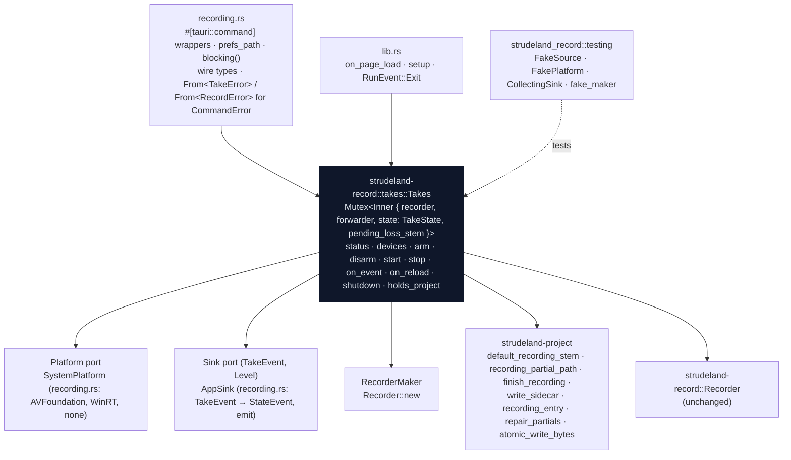

# 0125: take states, out of the app crate

## Goal

The take lifecycle becomes one state enum and one type, `Takes`, in a new `takes` module of
`strudeland-record`. The lifecycle covers arm, disarm, start, stop, the endings Rust handles by
itself, reload, quit and the repair skip. `src-tauri/src/recording.rs` keeps the wire types, the
permission code for each OS, the Tauri adapters and the commands.

Today the state is five fields of `Inner` (`recording.rs:304-314`), and only some combinations of
them are valid. `drop_ended` has to be called by hand on every way out of the ended state (four
call sites). The channel fallback is written twice. The 63 lifecycle tests compile the whole
Tauri app crate.

**Nothing visible changes.** The following all stay byte-identical:

- every `recording://state` payload and its order;
- `recording://level`;
- every command result, error kind and message;
- every sidecar, including `app.version`;
- every file outcome;
- every threading rule.

The six known quirks stay too (#155). A characterization transcript is written before any edit,
and later stages leave its expected JSON unchanged.

## Background

[reverify.md](0125-take-states/reverify.md) has the evidence at `d38b30e`: the field table, the
event table for every flow, the call sites to keep, the threading rules and the quirks. In
short:

- `Inner` holds `recorder`, `forwarder`, `stream_denied`, `armed`, `take`, `ended` and
  `lost_stem`. Five combinations of `armed`/`take`/`ended` are reachable (reverify table).
  `stream_denied` is meaningful only in idle.
- `drop_ended` (`:371`) is called by `arm` (`:850`), `disarm` (`:904`), `start` (`:943`, after
  `recorder.start` succeeds) and `finalize_running` (`:1044`, used by reload and quit).
- The channel fallback `device.channels == 0 || prefs.channel < device.channels` appears in
  `resolve_selection` (`:514-518`) and in `arm`'s explicit-device branch (`:826-830`).
- `lost_stem` is set by `ended_by_itself` on `Ended::DeviceLost` (`:421`) and taken by `failed`
  (`:433`). It can outlive `ended`.
- `build_sidecar` writes `env!("CARGO_PKG_VERSION")` (`:554`), the app's 0.1.2. In another crate
  that would silently become 0.1.0, so the version is passed in.
- Only four tests assert a full event sequence (`:1904`, `:1920`, `:1940`, `:2025`).
- `strudeland-record` has `strudeland-project` only as a dev-dependency. `strudeland-project`
  does not depend on record, so there is no cycle. `strudeland-live` depends on record. The CLI
  does not.

## Scope

In:

1. **A transcript test** in the app crate that pins every flow's events, results, files and key
   sidecar fields as inline JSON (stage 001). The existing test fakes move to a shared test rig
   file.
2. **The state enum `TakeState`**, one `leave` and one `saved_channel`, in place in
   `recording.rs` (stage 002).
3. **The `takes` module in `strudeland-record`** (stage 003): `Takes`, its ports, `TakeError`,
   `TakeEvent`, sidecar building, prefs and the repair skip. Also in stage 003:
   - `strudeland-project` becomes a normal dependency, and `serde` and `serde_json` are added;
   - the lifecycle tests move to the record crate, and the app keeps the wire and adapter tests;
   - the shared fakes go in `strudeland_record::testing`;
   - docs: the AGENTS.md voice memo layout bullet, and a takes section in the record README.

Out:

- **Any quirk fix** (#155): a `recorder.stop()` error drops the take; a permission refusal emits
  `idle` while the stream stays armed; a failed re-arm goes idle silently; disarm emits `idle`
  when already idle; a no-op re-arm emits `armed`; a `Failed` queued after a disarm emits an extra
  `idle + error`.
- **The recorder's `Event` shape.** `Event::Failed` keeps `{ arm_id, error }`. `TakeEnded` keeps
  its `TakeResult`.
- **The lock's scope.** It is held across arm (the recorder's arm), start (up to the 2 s start
  timeout) and stop, as today.
- **The webview** (`src/lib/recording/`, `controller.ts`), `src/lib/ipc/bindings.ts`,
  `strudeland-project`'s recording code, the recorder itself (`recorder.rs`, `writer.rs`,
  `source.rs`), the CLI.
- **`ipc:build`.** No command name or parameter, `*_EVENT` const or `CommandErrorKind` changes.

## Architecture



- **Seams.** Three ports, all of which exist today (`recording.rs:250-269`). Only the event
  type `Sink` carries changes: it gets the domain `TakeEvent` and the record crate's `Level`. The
  app's adapters stay in `recording.rs`. The fakes move to `strudeland_record::testing`, so the
  record tests and the app's transcript share them.
- **One resolver instead of `ProjectState`.** `start` is the only lifecycle verb that needs the
  open project. It takes a `resolve: impl FnOnce() -> Result<Arc<Project>, E>` and calls it at
  exactly today's point. `ProjectState` stays in the app.
- **Strings stay where they are visible.** The domain types carry data. `recording.rs` maps them
  to the wire shapes, and the transcript pins the mapping.

## Technical design

### Module layout (stage 003)

```
crates/strudeland-record/src/takes/mod.rs      Takes, the ports, TakeState, Inner, the verbs, the forwarder, repair_on_open
crates/strudeland-record/src/takes/error.rs    TakeError
crates/strudeland-record/src/takes/sidecar.rs  TakeMeta, build_sidecar, OnInvalid, write_sidecar_or_fallback, publish, publish_fallback, complete_ended, bar1_frame
crates/strudeland-record/src/takes/prefs.rs    Prefs, parse_prefs, read_prefs, write_prefs, resolve_selection, saved_channel
crates/strudeland-record/src/takes/tests.rs    the lifecycle tests (unit module: private access, as today)
```

`lib.rs` adds `pub mod takes;`. `testing` adds `FakePlatform`, `CollectingSink` and
`fake_maker`.

### The state

```rust
enum TakeState {
    /// No stream. `stream_denied`: the last arm's stream open was refused (desktops without an
    /// in-app prompt report `denied` from it).
    Idle { stream_denied: bool },
    Armed(ArmedInput),
    Recording { armed: ArmedInput, take: Take },
    /// A take Rust finalized by itself, or a stop whose publish failed; kept for the webview's stop.
    Ended { armed: Option<ArmedInput>, ended: EndedTake },
}

struct Inner {
    recorder: Option<Recorder>,
    forwarder: Option<JoinHandle<()>>,
    state: TakeState,
    /// The bridge between a `TakeEnded(DeviceLost)` and the `Failed` the recorder sends right
    /// after it: the stem the `Failed`'s idle event carries. Set only by `ended_by_itself` on
    /// `DeviceLost`, taken by every `Failed` (before the stale-id check, as today). It can
    /// outlive the `Ended` state when a stop or disarm runs in between, so it is not part of it.
    pending_loss_stem: Option<String>,
}
```

`ArmedInput`, `Take`, `TakeMeta` and `EndedTake` keep their fields. `ArmedInput.device` becomes
a `DeviceInfo`, which has exactly `InputDevice`'s six fields, and the app maps it. `TakeMeta`
gains `app_version: String`, copied from the config at start, so the publish helpers stay free
functions.

How the reverify's rows map onto the enum:

| armed | take | ended | state |
|---|---|---|---|
| None | None | None | `Idle { stream_denied }` |
| Some | None | None | `Armed` |
| Some | Some | None | `Recording` |
| Some | None | Some | `Ended { armed: Some }` |
| None | None | Some | `Ended { armed: None }` |

`stream_denied` outside idle is always `false`: every path out of idle goes through a successful
arm, which sets it `false`. So `disarm`, reload and quit leave `Idle { stream_denied: x }`
unchanged, and send every other state to `Idle { stream_denied: false }`. That matches today,
where they never touch the flag.

### `leave` and `saved_channel`

- **`leave(inner, next)`** replaces `inner.state` with `next`. If the old state was `Ended` with
  an unpublished take, it publishes that take with the fallback sidecar (`publish_fallback`,
  which logs a failure).
- **`settle_ended(inner)`** is `drop_ended`'s replacement. It is written once:
  `Ended { armed, .. }` goes to `leave(armed.map(Armed).unwrap_or(Idle { stream_denied: false }))`,
  and any other state is left alone. `arm`, `disarm` and `finalize_running` call it where they
  call `drop_ended` today. `start` reaches the same effect by calling
  `leave(Recording { .. })` after `recorder.start` succeeds.
- **`stop` never goes through `leave` with its own take.** It moves the `EndedTake` out of the
  state first, as `inner.ended.take()` does today (`:985`). A successful publish then marks it
  published, so "leaving Ended except through a successful stop" falls out of ownership, not a
  flag.
- **`saved_channel(device: &DeviceInfo, prefs: &Prefs) -> u16`** is
  `if device.channels == 0 || prefs.channel < device.channels { prefs.channel } else { 0 }`.
  `resolve_selection` and `arm`'s explicit-device branch both call it.

### Transitions (each one today's code, re-expressed)

- **`status(prefs)`** reads the permission before the lock. A state counts as armed when it is
  `Armed`, `Recording` or `Ended { armed: Some }`. `stream_denied` is read only from `Idle`.
  `Recording` gives the stem and elapsed time. The idle channel comes from the prefs.
- **`devices(prefs)`** behaves as `input_devices` plus `resolve_selection` do now: the armed
  input's channels and rate fill an exclusive device whose channels are 0.
- **`arm(prefs, device_id, channel)`**:
  - `requesting` set gives busy (pending).
  - `Recording` gives busy.
  - `ensure_permission` runs outside the lock. A refusal emits `idle + error` and leaves the state
    alone: an armed stream stays armed (#155).
  - Then the device list, the selection (`saved_channel`) and the channel range check.
  - Under the lock: `Recording` gives busy; `settle_ended`; `ensure_recorder`;
    `arm_with_id`. A stream refusal gives `Idle { stream_denied: true }`, any other error
    `Idle { stream_denied: false }`, and neither emits an event (#155). Success gives
    `Armed(new)`.
  - The prefs are written after the lock, only when an argument was given.
  - Then it emits `armed`, even for a no-op re-arm (#155), and returns the status.
- **`disarm(prefs)`**: `Recording` gives busy. Otherwise `settle_ended`, then `recorder.disarm()`,
  then the state goes to idle (keeping `stream_denied` from `Idle`). It emits `idle`, even when
  already idle (#155).
- **`start(resolve, song_stem, fields)`**, in today's check order:
  1. `Recording` gives busy.
  2. No armed input (`Idle`, `Ended { armed: None }`) or no recorder gives not armed.
  3. `resolve()`.
  4. `default_recording_stem`, then `recording_partial_path`, then the timestamp.
  5. `recorder.start(&path)`. On error the state is untouched, an ended take included.
  6. `leave(Recording { .. })`, which publishes an unpublished ended take, then the `recording + stem`
     event.
- **`stop(fields)`**:
  - From `Recording`: with no recorder, not armed, and the take is dropped as today (unreachable).
    Then `recorder.stop()`. On error the take is dropped, the state becomes `Armed`, there is no
    event and the error is returned (#155). On a device loss result the state becomes
    `Ended { armed: None }`, otherwise `Ended { armed: Some }`.
  - From `Ended`, which includes the state just made: the `EndedTake` is moved out and the event
    state comes from `armed`.
  - Then `complete_ended`. On Ok the state is `Armed` or `Idle { false }` and the event is
    `state + stem`. On Err an unpublished take goes back into `Ended` and the event is
    `state + stem + error`. From `Idle` or `Armed` the result is no take.
- **`on_event(event)`** dispatches as `forward` does now:
  - `Level` goes to the sink without the lock;
  - a non-user `TakeEnded` goes to `ended_by_itself`;
  - `Failed` goes to `failed`;
  - anything else is ignored.

  The forwarder thread holds a `Weak<Takes>` and calls it.
- **`ended_by_itself`**: only `Recording` whose take path matches (`take_if`). It publishes the
  fallback and moves to `Ended { armed: Some }`, then:
  - `Cap` emits `armed + stem + limitReached`;
  - `WriteError` emits `armed + stem + other "the take could not be written: …"`;
  - `DeviceLost` sets `pending_loss_stem` and emits nothing.
- **`failed(arm_id, error)`**:
  1. Takes `pending_loss_stem`.
  2. Returns if the state's armed input exists and has another id.
  3. Clears the armed input: `Armed` goes to `Idle { false }`, `Ended { Some }` to
     `Ended { None }`, and `Idle` and `Ended { None }` stay.
  4. Emits `idle + error (+ stem)`. A queued `Failed` after a disarm therefore emits it again
     (#155).

  `Recording` with a matching id is unreachable: the recorder sends `TakeEnded` before `Failed`,
  and `start` sets the take under the lock the forwarder waits for. It emits the same event and
  keeps the state, the closest representable form of today's `armed = None` beside a take.
- **`on_reload()`**: a no-op in `Idle`, which leaves the recorder untouched. Otherwise
  `finalize_running` (`settle_ended`, then stop and publish a running take), `recorder.disarm()`
  and `Idle { false }`. No events.
- **`shutdown()`**: `finalize_running`, armed cleared, recorder and forwarder taken under the
  lock, then shut down and joined outside it. No events. A second call is harmless.
- **`holds_project(root)`**: `Recording` or `Ended` whose `meta.project.root() == root`.
  `repair_on_open(&Takes, &Project) -> RepairOutcome` moves too, checking `holds_project` under
  the lock and repairing after it.

### The ports and the config (stage 003)

```rust
pub trait Platform: Send + Sync {            // unchanged
    fn permission(&self) -> Permission;
    fn has_permission_prompt(&self) -> bool { true }
    fn request_permission(&self);
    fn devices(&self) -> Result<Vec<DeviceInfo>, RecordError>;
}
pub trait Sink: Send + Sync {
    fn state(&self, event: TakeEvent);
    fn level(&self, level: Level);
}
pub type RecorderMaker = Box<dyn Fn() -> (Recorder, Receiver<Event>) + Send + Sync>;  // unchanged
pub struct TakesConfig { pub app_version: String }

impl Takes {
    pub fn new(platform: Box<dyn Platform>, sink: Arc<dyn Sink>, maker: RecorderMaker, config: TakesConfig) -> Arc<Takes>;
    pub fn status(&self, prefs: &Path) -> TakeStatus;
    pub fn devices(&self, prefs: &Path) -> Result<Devices, TakeError>;
    pub fn arm(self: &Arc<Self>, prefs: &Path, device_id: Option<String>, channel: Option<u16>) -> Result<TakeStatus, TakeError>;
    pub fn disarm(&self, prefs: &Path) -> Result<TakeStatus, TakeError>;
    pub fn start<E: From<TakeError>>(&self, resolve: impl FnOnce() -> Result<Arc<Project>, E>,
                                     song_stem: Option<&str>, fields: TakeStart) -> Result<String, E>;
    pub fn stop(&self, fields: Option<TakeStop>) -> Result<RecordingEntry, TakeError>;
    pub fn on_event(&self, event: Event);
    pub fn on_reload(&self);
    pub fn shutdown(&self);
    pub fn holds_project(&self, root: &Path) -> bool;
}
```

- **The prefs path stays a per-call argument.** `prefs_path(&app)` is fallible, and today its
  error comes before anything else.
- **`start` is generic over the resolver's error.** `ProjectState::current_for`'s `CommandError`
  passes through untouched, and every other failure converts with `From<TakeError>`.
- **Domain types.** The app maps each one to its wire type:
  - `TakeStart { tempo, backing }` and `TakeStop { output, tempo, backing, bar1_host_ns,
    clock_offset_ns, output_stamps }`, from `StartFields` and `StopFields`;
  - `TakeStatus { state, permission, device: Option<DeviceInfo>, channel, stem, elapsed_seconds }`;
  - `Devices { devices: Vec<DeviceInfo>, selected: Option<Selection { device_id, channel }> }`;
  - `TakeEvent { state, stem, error: Option<TakeError> }`;
  - `RepairOutcome`, which moves unchanged.
- **`RecState` and `Permission` move into `takes`** with `#[derive(Serialize)]` and
  `#[serde(rename_all = "camelCase")]`. The app re-exports them and has no mirror enums. Their
  wire text is unchanged, and `status_and_event_wire_shapes` pins it. `Permission::from_raw`
  moves with the type. As public items of a library they need no `dead_code` allowance, so the
  `cfg_attr(not(macos), allow(dead_code))` attributes go.
- **The app version** comes from `fn takes_config() -> TakesConfig` in `recording.rs`
  (`env!("CARGO_PKG_VERSION")` of `strudeland-app`). `system_state` and the app's test rig both
  call it, so the app test that pins `app.version` exercises the production path.

### `TakeError`

`#[derive(Debug, Clone, thiserror::Error)]`. Each variant's `Display` is exactly the message
of the `CommandError` it maps to today, so the log lines that print a message stay identical.

| variant | Display | `CommandError` kind |
|---|---|---|
| `Busy` | `a take is in progress` | `busy` |
| `PermissionPending` | `a microphone access request is pending` | `busy` |
| `NotArmed` | `the recorder is not armed` | `other` |
| `NoTake` | `no take in progress` | `other` |
| `PermissionRefused(Permission)` | `microphone access denied` (denied, not determined), or the restricted text (`…on this mac` / `…by the system`, cfg'd) | `permissionDenied` |
| `ChannelOutOfRange { channel, channels }` | `channel {channel} is out of range for {channels} channels` | `other` |
| `LimitReached` | `recording stopped at the length limit` | `limitReached` |
| `WriteFailed(String)` | `the take could not be written: {0}` | `other` |
| `Record(Arc<RecordError>)` | the `RecordError`'s own text | the `RecordError` table |
| `Memo(Arc<ProjectError>)` | the `ProjectError`'s own text | `CommandError::for_memos` |

- **Why two variants are `Arc`s.** `RecordError` and `ProjectError` are not `Clone`, but a failed
  stop sends the same error in the event and in the result, as `e.clone()` does today
  (`:1004`).
- **The two tables in `recording.rs`.** `fn record_error(&RecordError) -> CommandError` holds
  today's `From<RecordError>` table, including the macOS `DeviceBusy` split.
  `impl From<RecordError> for CommandError` calls it. The four overridden texts (`AlreadyRecording`,
  `NotArmed`, `StartTimeout`, `PermissionDenied`) come from the matching `TakeError` variant's
  `Display`, so each text is written once. `impl From<TakeError> for CommandError` is the one
  table above.
- **The only `command_error.rs` edit.** `for_memos` gains a by-reference form,
  `pub fn for_memo_error(e: &ProjectError) -> Self`, and `for_memos(e)` calls it. Output is
  unchanged, and the existing `project_errors_for_memos` test covers it.
- **Logs.** The two log lines that print `e.message` (`:666`, `:1001`) only ever print memo
  errors, whose `Display` is the same text. The ones that print a `RecordError` with `{e}` keep
  doing so.

### The app after stage 003

`recording.rs` keeps:

- `LEVEL_EVENT` and `STATE_EVENT`, `PREFS_FILE` and `prefs_path`;
- the wire types (`InputDevice`, `RecordingStatus`, `InputSelection`, `DevicesResult`,
  `StartFields`, `StopTiming`, `StopFields`, `StartResult`, `LevelEvent`, `StateEvent`), with
  `From` conversions both ways as needed;
- `record_error` and the two `From` tables;
- `mod permission` and `SystemPlatform`;
- `AppSink`, whose `state` emits `StateEvent::from(event)` and whose `level` emits a
  `LevelEvent`;
- `takes_config`, `system_state`, `RecorderState(pub Arc<Takes>)` and `blocking`;
- the 11 commands; `recording_start` passes `|| projects.current_for(&root)`;
- `project_for`, the four library commands, `repair_in_background` and `host_now_ns`.

`lib.rs` calls `recorder.0.on_reload()` and `recorder.0.shutdown()`; `setup` is unchanged.

## Tests

- **Stage 001: the transcript** (`src-tauri/src/recording/transcript.rs`). It runs one fresh rig
  per flow over every row of the reverify event table, plus the failed-publish retry and the
  ended-take settles: arm, start, disarm, reload and quit. Each step records:
  - `serde_json::to_value` of the command result (`{"ok": …}` or `{"err": {kind, message}}`);
  - every `StateEvent` emitted since the previous step;
  - the `recordings/` listing;
  - for stops, the entry and the key sidecar fields.

  The expected value is one inline JSON constant between marker comments. Volatile values are
  normalized, and nothing else is. From stage 002 on, that constant may not change: a gate diffs
  it against the stage-001 commit.
- **Stage 002** rewrites only the tests that read `Inner`'s fields, and adds `leave` and
  `saved_channel` tests.
- **Stage 003** moves the lifecycle tests to `crates/strudeland-record/src/takes/tests.rs` as
  transition tables over `FakeSource`, `FakePlatform` and `CollectingSink`, with
  `app_version: "test"`, and deletes them from the app. The app keeps about 16 tests: the wire
  shapes, the error table, the bundle and capability checks, the library commands, the
  background repair, the transcript, and one stop test that pins `app.version` to the app's
  version. The full mapping is in [003](0125-take-states/003-takes-module.md).

## What must not change

- Every row of the reverify event table, every command result and error text, and the sidecar
  fields, `app.version` included. Also the file outcomes: the partial, `stem.wav` plus
  `stem.json`, a failed publish that leaves the partial, and the repair skip.
- The six quirks (#155).
- The threading rules:
  - the forwarder's `Weak`;
  - the forwarder is joined outside the lock in shutdown;
  - levels go out without the lock;
  - `ensure_permission` runs outside the lock behind `requesting`;
  - the stale `arm_id` check and the `take_if` path match;
  - poison recovery;
  - the lock is held across arm, start and stop.
- `src/lib/ipc/bindings.ts`, every command signature, `CommandErrorKind`.

## Rejected

- **A pure reducer** (`(state, input) -> (state, effects)`). Several transitions depend on
  blocking recorder calls made under the lock, such as `arm_with_id`, `start` (up to 2 s) and
  `stop`. The reducer would need those results as inputs, which splits every verb in two and
  opens interleavings the lock rules out today.
- **A new crate** (`strudeland-takes`). It would work and is an acceptable alternative. It adds a
  manifest, a README and a licence check for about 900 lines that only `strudeland-record`'s
  types feed. The module keeps the recorder and its lifecycle together.
- **A Tauri-free module inside `src-tauri`.** The tests would still compile the app crate, its
  Tauri build script and the V8 download, so the main gain is lost.
- **Reshaping `Event::Failed` to carry the take**, which would remove `pending_loss_stem`. It
  removes interleavings that are reachable today: a stop or disarm between `TakeEnded` and
  `Failed`. That is a visible change, so the field stays and is documented.
- **Narrowing the lock.** It would let commands interleave with a blocking recorder call. Out of
  scope for a zero-change refactor.
- **Mirror enums for `RecState` and `Permission` in the app.** They would add two copies with
  identical wire text. Deriving `Serialize` in `takes` costs one dependency, which
  `strudeland-project` already brings.

## Decisions

- **The prefs file format moves to `takes::prefs`.** `PREFS_FILE` and `prefs_path` stay in the
  app. `status`, `devices` and `arm` read the prefs, so the lifecycle needs them.
- **`repair_on_open` moves next to `holds_project`.** Only `repair_in_background`, which spawns
  on Tauri's runtime, stays in the app.
- **The lifecycle tests live in the unit module `takes/tests.rs`, not `tests/`.** Some assert
  private state: the joined forwarder, the arm id, and the recorder not yet being built. Keeping
  that access avoids widening the public API for tests.
- **The write-error flow is injected.** `FakeSource` cannot make the writer fail, so the
  transcript and its record twin inject `Event::TakeEnded` with `Ended::WriteError` for the
  running take's path. That pins the event and the publish. The real recorder's take runs on
  until quit, so that flow's frame counts are normalized.
- **The restricted text and the `DeviceBusy` kind are platform-dependent.** The transcript
  normalizes the restricted text to `<restricted>` and leaves `DeviceBusy` out. The error-table
  test pins both per platform, with `cfg`.

## Dependencies

- `strudeland-record` gains:
  - `strudeland-project` as a normal dependency, removed from `dev-dependencies`;
  - `serde = { version = "1.0.229", features = ["derive"] }`;
  - `serde_json = { version = "1.0.154", features = ["float_roundtrip"] }`.

  All three are already in `Cargo.lock` at those versions. Only the record package's dependency
  list changes, and the lock change is committed (CI runs `--locked`).
- `strudeland-live` now pulls `strudeland-project` in through record. It uses none of it.

## Risks

- **A flaky transcript.** Async events (the cap, a device loss) are waited for explicitly, and
  every other step is synchronous. The forwarder's ignored events (`TakeEnded(User)`,
  `Disarmed`, `Armed`) emit nothing. Running it 20 times in stage 001 is part of the gate.
- **Code behind `cfg`, which the macOS gates cannot see.** This covers the restricted text in
  `takes/error.rs`, the `DeviceBusy` split in `recording.rs`, the permission module for each OS
  and the removed `dead_code` allowances. Each stage reasons them through, tries a Windows-target
  clippy of `strudeland-record` where the target is installed, and leaves the last word to the
  PR's Windows and Linux CI.
- **A silent `app.version` change.** The app's stop test pins `env!("CARGO_PKG_VERSION")` of
  `strudeland-app` through `takes_config()`. The transcript normalizes the app's version to a
  token, so any other value (0.1.0, `test`) shows up as a diff.

## Open questions

None. #155 holds the quirk decisions.
