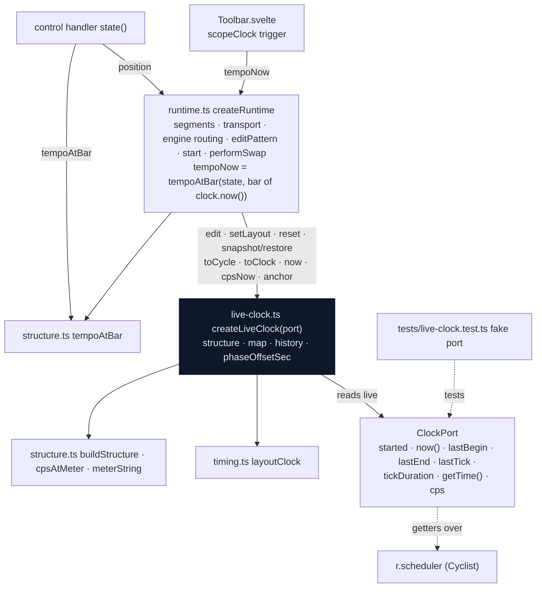

# 0126: the runtime's live clock, out of the closure

## Goal

Two small moves inside `src/lib/strudel/`, with **nothing visible changing**:

1. **One tempo formula.** The pure `tempoAtBar` in `structure.ts` returns `{ cps, bpm, meter }`,
   the tempo the toolbar and `strudeland state` show today. `Runtime.tempoNow()` applies it at
   the audible bar for the Toolbar; the `state` method applies it to the position it already
   reads. Neither computes it by hand any more.
2. **One live clock.** `src/lib/strudel/live-clock.ts` owns what `createRuntime` keeps today as
   loose closure variables: the live structure, the layout map, the tempo-edit history and the
   phase offset, and the maths over them (`toCycle`, `toClock`, the audible reference, the
   audible cps, the edit rebase). It reads the scheduler through a narrow `ClockPort`, so it is
   tested with a fake port instead of only end to end through `repl`.

Displayed tempo and meter, the `state` wire values, the playhead, timing, drawing, sound and
engine switching stay identical. The toolbar's one-animation-frame differences are recorded
under Decisions.

## Background

The [re-verification](0126-runtime-clock/reverify.md) has the evidence at `5605397`. In short:

- `createRuntime` (`runtime.ts:238-1129`) is one closure. The live clock state is
  `segments`, `liveStructure`, `clock`, `audibleHistory` and `phaseOffsetSec` (:335-349) with
  `toCycle`/`toClock` (:350-357), `audibleReference` (:358-384, which reads Cyclist internals),
  `audibleCps` (:385-394, Strudel's `getCps` via `setCpsFunc` at :546), `setLiveLayout`
  (:395-400) and `scheduledAnchor` (:401-404).
- Three places move clock fields as loose values: `editPattern`'s save and undo (:469-493) and
  its history push and phase rebase (:494-515); `start`'s save and restore (:926-930,
  :958-966) and its 6-field `from` (:905-912); `performSwap`, which builds that `from`
  (:881-888).
- The clock is tested only through `repl`: `tests/runtime-backends.test.ts` :556, :590 and the
  clock half of :540.
- `Toolbar.svelte` (:24-37, :93-99) and `handler.ts` `state()` (:297-322) each compute
  `meterAtBar(structure, position().located.songBar)`, `cpsAtMeter(rs.cps, rs.meter, meter)` and
  `bpmFromCps(rs.cps, rs.meter)` by hand. That is the **scheduled** tempo at the audible bar.
- **User decision (2026-11-26):** keep showing the scheduled tempo. The audible tempo is #156.

## Scope

In:

1. `tempoAtBar` and the `Tempo` type in `structure.ts`; `Runtime.tempoNow()`, read by the
   Toolbar; `state()` calls `tempoAtBar` on its own `position()`; `stubRuntime` and the
   `editor-hooks` and `setup` test literals gain `tempoNow` (for the `Runtime` type).
2. `src/lib/strudel/live-clock.ts`: `createLiveClock(port)`, `ClockPort`, `LiveClock`,
   `ClockSnapshot`; `runtime.ts` moved onto it.
3. Tests: one `tempoNow` test in `runtime-backends.test.ts`; `tests/live-clock.test.ts` replacing
   the clock-maths end-to-end tests.
4. Docs: an `AGENTS.md` layout mention of `live-clock.ts` (the live clock is an internal module
   concept, so it stays out of the song-language `GLOSSARY.md`); one `GLOSSARY.md` term, **Shown
   tempo**.
5. The host bundle rebuilt (`runtime.ts`, `structure.ts` and the new `live-clock.ts` are host
   inputs).

Out:

- **The audible tempo** (#156). `tempoNow` returns exactly today's values.
- **The engine router** (`activeId`, `desired`, `pendingSwap`, `swapTo`, `performSwap`'s
  sequencing, the evaluate rollback; #157). `performSwap` only changes the shape of the `from`
  it builds.
- **The constant-meter playhead jump** after a tempo edit (#158). It stays as it is.
- **`segments`.** It stays in the runtime: the transport owns it (`setSegmentSource`, the
  transport boundary, `pruneAt`). It is not in the clock snapshot (see Rejected).
- **Other tempo readers** (recording, backing, memo player, `song-playback.ts`, `event-edits.ts`,
  `memo-ui.ts`, StatusBar, Timeline, piano roll, `control/events.ts`). They read the reference
  tempo or the static structure on purpose (reverify) and do not move.
- `timing.ts`, `transport.ts`, `song.ts`, `metered-pattern.ts`: not edited. No `PLANNER_FILES`
  file changes (`src/lib/strudel/timing.ts` is one; it is untouched), so `engine:refs` is not run.
- The wire (`state.json`, `methods.rs`, `protocol.ts`): unchanged.

## Architecture



- **Seam.** `ClockPort` is the only new one. Its production adapter is an object of getters over
  `r.scheduler`, built in `runtime.ts` (still the only module that talks to `repl()`); its test
  adapter is a plain mutable object in `tests/live-clock.test.ts`.
- **No Strudel import in `live-clock.ts`.** It imports `timing.ts`, `structure.ts` and the
  `Segment` type from `transport.ts` only (a type import; `timing.ts`, by contrast, imports
  values from `transport.ts`).
- **Where `tempoNow` lives.** In the runtime, not the clock: it reads `state.cps`, `state.meter`,
  `state.structure` and `state.started` (the last successful evaluate's values, set in
  `afterEval`) and the transport's `segments`, none of which the clock owns. The clock's part is
  `now()`. The formula is the pure `tempoAtBar` in `structure.ts`, beside `cpsAtMeter`,
  `bpmFromCps` and `meterAtBar`, so the runtime and `state()` share it.
- **Who calls `tempoNow`.** Only the Toolbar. `state()` already reads `runtime.position()` for
  the playhead, so it applies `tempoAtBar` to that same position: meter and playhead keep coming
  from one clock read, as today.

## Technical design

### Stage 001: `tempoNow`

```ts
// structure.ts
export interface Tempo { cps: number; bpm: number; meter: Meter }
/** The evaluate's tempo at song bar `bar` (null: at its own meter). */
export function tempoAtBar(cps: number, meter: Meter, s: SongStructure | null, bar: number | null): Tempo {
  const at = bar !== null && s?.meterChanges ? meterAtBar(s, bar) : meter;
  return { cps: cpsAtMeter(cps, meter, at), bpm: bpmFromCps(cps, meter), meter: at };
}

// runtime.ts, on the Runtime object
tempoNow() {
  const s = state.structure;
  const bar = state.started && s?.meterChanges ? (locate(now(), s, segments)?.songBar ?? null) : null;
  return tempoAtBar(state.cps, state.meter, s, bar);
}
```

- **Today's formula, exactly.** Both callers take the located meter only while started, only
  when the structure has `meterChanges` (truthiness, as both check today), and only when
  `located` is non-null; otherwise `rs.meter`. cps is `cpsAtMeter(rs.cps, rs.meter, meter)`, bpm
  is `bpmFromCps(rs.cps, rs.meter)`, unrounded.
- **Rounding stays at the call sites.** The Toolbar shows `tempo.cps.toFixed(3)`,
  `String(Math.round(tempo.bpm))` and `meterString(tempo.meter)`; `state()` sends `cps:
  tempo.cps` (unrounded), `bpm: Math.round(tempo.bpm)` and `meter: meterString(tempo.meter)`.
- **No state change.** `tempoNow` calls `now()` and `locate`, never `position()` or `pruneAt`.
  `locate` with the unpruned segment list gives the same `Located` as `position()` does after
  pruning: `prune` keeps the last segment at or before the cut and every later one, and the cut
  is `HISTORY_CYCLES` behind the cycle located.
- **Toolbar.** `playingMeter`, `meter` and `bpm` are replaced by one `tempo` state:

  ```svelte
  let tempo = $state.raw(runtime.tempoNow());
  $effect(() => {
    const { started, structure } = $rt; // re-runs on every runtime store change, as today
    tempo = runtime.tempoNow();
    if (!started || !structure?.meterChanges) return;
    return scopeClock.subscribe(() => (tempo = runtime.tempoNow()));
  });
  ```

  The scope clock does not call a subscriber on subscribe (`clock.ts`), so the effect samples
  once itself; see Decisions for the one-frame consequence.
- **`state()`** keeps `const position = rs.started ? runtime.position() : null` (the playhead
  needs it, and it keeps pruning there), then computes `const tempo = tempoAtBar(rs.cps,
  rs.meter, rs.structure, position?.located?.songBar ?? null)` from that one read. It does not
  call `tempoNow` (that would be a second `now()`, a few microseconds later). This equals
  today's expression: `position` is non-null only while started, and `tempoAtBar` takes the
  located meter only when `located` is non-null and the structure has `meterChanges`.
  `bpmFromCps`, `cpsAtMeter` and `meterAtBar` leave `handler.ts` (no other use in the file;
  `meterString` stays: :388), and `tempoAtBar` joins its `structure.ts` import.
- **Stubs.** `stubRuntime` gains
  `tempoNow: () => { const s = get(store); return tempoAtBar(s.cps, s.meter, s.structure,
  s.started && s.structure?.meterChanges ? (pos.located?.songBar ?? null) : null); }`. It is
  needed only for the `Runtime` type: no handler path calls it. The control-handler pins
  (:170-205, :208-217, :1189-1214) hold unchanged and exercise the real `tempoAtBar` through
  `state()`. The `editor-hooks.test.ts` (:46) and `setup.test.ts` (:17-42) literals (`satisfies
  Runtime`) each gain `tempoNow: () => ({ cps: 0.5, bpm: 120, meter: { num: 4, den: 4 } })`.

### Stage 002: the live clock

```ts
export interface ClockPort {
  readonly started: boolean;   // sch.started
  now(): number;               // sch.now()
  readonly lastBegin: number;  // sch.lastBegin, raw
  readonly lastEnd: number;    // sch.lastEnd, raw
  readonly lastTick: number;   // sch.lastTick
  readonly tickDuration: number; // sch.clock.duration
  getTime(): number;           // sch.getTime()
  readonly cps: number;        // sch.cps
}

export interface ClockHistoryEntry {
  end: { cycle: number; clock: number };
  map: LayoutClock | null;
  cps: number;
  referenceMeter?: Meter;
}

export interface ClockSnapshot {
  structure: SongStructure | null;
  map: LayoutClock | null;
  history: readonly ClockHistoryEntry[];
  phaseOffsetSec: number;
}

export interface LiveClock {
  readonly structure: SongStructure | null; // today's liveStructure
  readonly map: LayoutClock | null;         // today's clock
  readonly phaseOffsetSec: number;
  toCycle(reference: number): number;
  toClock(cycle: number): number;
  audibleReference(): number;
  /** max(0, toCycle(audibleReference())): today's `now`. */
  now(): number;
  /** Today's `audibleCps`; Strudel's getCps. */
  cpsNow(): number;
  /** Today's `scheduledAnchor`: { cycle: toCycle(Number(lastEnd)), clock: Number(lastEnd) }. */
  anchor(): { cycle: number; clock: number };
  /** Today's `setLiveLayout` without the `segments` assignment (the runtime keeps that). */
  setLayout(segments: readonly Segment[], anchor?: { cycle: number; clock: number }): void;
  /** :494-515: anchor, history push, phase rebase, structure, layout. Returns the anchor. */
  edit(e: {
    structure: SongStructure | null; // the `structure` editPattern already read (registeredStructure())
    meter: Meter;                    // pending.meter
    nextCps: number;                 // pending.cps
    codeSetCps: boolean;
    segments: readonly Segment[];
  }): { cycle: number; clock: number } | undefined;
  /** The stopped install: phase offset 0, history empty. Keeps structure and map. */
  reset(): void;
  snapshot(): ClockSnapshot;
  restore(s: ClockSnapshot): void;
}
```

- **The bodies move verbatim.** Every expression keeps its operand order and its `Number(...)`
  coercions where today's code has them (`audibleReference` and `scheduledAnchor` wrap
  `lastEnd`; the transport's `horizon` and `performSwap` pass the raw `lastEnd`). The tests
  compare with `toBeCloseTo(…, 10)` and must not need a looser tolerance.
- **`edit` keeps today's order:** the anchor (`port.started ? anchor() : undefined`); if anchored
  and (`map` or the new structure has `meterChanges.length`): `audibleReference()` **before** the
  history filter and push (the entry records the old `map`, `port.cps` and the old structure's
  meter); the phase rebase unless `codeSetCps`; the new structure (or the built one for code
  without `song()` whose anchor has `cycle !== clock`); **then** `setLayout(segments, anchor)`.
  The imminent-conflict check (:516-522) stays in `editPattern`, using the returned anchor and
  `liveClock.map`.
- **History arrays are never mutated after they are published.** `history` is typed
  `readonly ClockHistoryEntry[]`, so `edit` builds the next array locally and publishes it:

  ```ts
  const next = history.filter((h) => h.end.clock > audible);
  if (next.at(-1)?.end.clock !== a.clock) next.push({ end: a, map, cps: port.cps, referenceMeter: structure?.meter });
  history = next;
  ```

  This is behaviour-identical to today's filter-then-push (the filter already returned a new
  array, and nothing reads `history` between the two). A snapshot holds the array by reference,
  as today's `previous` does; a test pins that a later edit leaves a held snapshot unchanged.
- **Closures, not methods.** `createLiveClock` returns an object of arrow functions with getters
  for the three fields, so `setCpsFunc(liveClock.cpsNow)` and `now: liveClock.now` work unbound.
- **The port is lazy.** `createLiveClock(port)` reads nothing from the port while constructing;
  the runtime builds it where the clock variables are today (:335-349), before `const r =
  repl(...)`, with getters that read `r.scheduler` when called.
- **`meteredPlayback` and the drawing pattern read live.** `editPattern` passes
  `liveClock.structure` (captured, as `liveStructure` is today), `() => liveClock.map` and `() =>
  liveClock.phaseOffsetSec`; `drawingScheduler` captures the structure
  at get time and reads `liveClock.map!` inside the `Pattern` closure, exactly as `clock!` is read
  today.

**Runtime call sites after the move:**

| today | after |
|---|---|
| `setLiveLayout(next, anchor)` | stays a two-line helper: `segments = next; liveClock.setLayout(next, anchor)` |
| `scheduledAnchor()` | `liveClock.anchor()` |
| `toCycle`, `toClock`, `audibleReference()` | `liveClock.toCycle`, `.toClock`, `.audibleReference()` |
| `now` | `liveClock.now` |
| `setTime(() => toCycle(audibleReference()))` | `setTime(() => liveClock.toCycle(liveClock.audibleReference()))` (unclamped, as today) |
| `setCpsFunc(audibleCps)` | `setCpsFunc(liveClock.cpsNow)` |
| `liveStructure?.meterChanges?.length` in the `setCps` override | `liveClock.structure?.meterChanges?.length` |
| editPattern :469-493 (4 clock fields of 9 saved) | `previous = { clock: liveClock.snapshot(), evaluatedPattern, unseededPattern, playbackPattern, playError, schedulerPattern }`; undo calls `liveClock.restore(previous.clock)` |
| editPattern :494-515 | `const anchor = liveClock.edit({ structure, meter: pending.meter, nextCps: pending.cps, codeSetCps, segments })` (`structure`: the one editPattern read at its top) |
| imminent check :516-522 (`clock`) | `liveClock.map` (also in `clock.toCycle(...)` and `queryMetered(..., clock, ...)`); `r.scheduler.clock.duration` stays |
| `playbackPattern = clock && liveStructure ? meteredPlayback(seeded, liveStructure, () => clock, () => phaseOffsetSec, …)` | `liveClock.map && liveClock.structure ? meteredPlayback(seeded, liveClock.structure, () => liveClock.map, () => liveClock.phaseOffsetSec, …)` |
| transport `install` | `setLiveLayout(next, started ? liveClock.anchor() : undefined); if (!started) liveClock.reset();` |
| transport `horizon` | `liveClock.toCycle(r.scheduler.lastEnd)` |
| `performSwap` `cycleTime(toCycle(handoff))` | `cycleTime(liveClock.toCycle(handoff))`, `handoff` the raw `sch.lastEnd` as today |
| `performSwap` `from` | `{ ...liveClock.snapshot(), segments, anchor: liveClock.anchor(), cycle: Math.max(0, handoff - early), onsetsFrom: handoff }` |
| `start` save (:926-929) | `const saved = { ...liveClock.snapshot(), segments }` |
| `start` applying `from` (:946-952) | `liveClock.restore({ ...from, structure: liveClock.structure }); setLiveLayout(from.segments, from.anchor); r.scheduler.lastEnd = from.cycle` |
| `start` rollback (:960-964) | `segments = saved.segments; liveClock.restore({ ...saved, structure: liveClock.structure }); r.scheduler.lastEnd = 0` |
| `cycleTime` | `liveClock.toClock(cycle)` |
| `tempoNow` | unchanged: its `now()` is `const now = liveClock.now` |

`start`'s parameter type becomes `from?: ClockSnapshot & { segments: readonly Segment[]; anchor:
{ cycle: number; clock: number }; cycle: number; onsetsFrom: number }`.

**Why `start` restores with `structure: liveClock.structure`.** Today `start` saves and restores
segments, map, phase and history, never the structure, and applies `from`'s segments, anchor,
phase and history, never a map or structure. The map from `restore` is overwritten by
`setLiveLayout` straight after, and keeping the current structure makes both paths restore
exactly today's fields, also in the (practically unreachable) case where an evaluate's
`editPattern` installs a new structure while a start is awaiting and that start then fails.
`editPattern`'s undo restores all four fields, as today.

### Tests

**Stage 001** adds one test after `runtime-backends.test.ts:590`, `tempoNow reports the
scheduled tempo at the audible bar` (fake runtime, `MIXED_SONG`):

- right after the autostarting evaluate: `{ cps: 0.5, bpm: 120, meter: { num: 4, den: 4 } }`;
- `tick(22)` (the :590 test's 3/8 point): meter `{ num: 3, den: 8 }`, cps `toBeCloseTo(4 / 3,
  10)`, bpm `120`;
- a live `evaluate(MIXED_SONG, { cps: 1.5 })` right there: bpm `360` at once (the scheduled
  tempo, before the audio reaches the edit), meter still `{ num: 3, den: 8 }` (the audible bar),
  so cps `toBeCloseTo(4, 10)` (360 bpm over a 1.5-quarter bar). The meter is pinned explicitly,
  not through `cpsAtMeter` of the returned meter; if it is not 3/8, stop and report;
- `rt.stop()`: `{ cps: 1.5, bpm: 360, meter: { num: 4, den: 4 } }` (the reference values);
- a constant-meter song (`SONG`) playing: always its own meter, unrounded bpm.

The control-handler pins and the wire examples do not change.

**Stage 002** adds `tests/live-clock.test.ts` over a fake port: a plain mutable object whose
`now()` follows `Cyclist.now` (`cyclist.mjs:153-159`: 0 while stopped, else `lastBegin +
(getTime() - lastTick - tickDuration) * cps`) and a `tick()` helper that advances it as
`cyclist.mjs:56-60` does at constant cps: `lastBegin = lastEnd; lastEnd += tickDuration * cps;
lastTick += tickDuration`, with the fake time stepping with `lastTick` (zyklus's `phase`, which
advances by `duration` per callback). After an `edit()` the test sets `port.cps = nextCps`
itself, as the runtime's `afterEval` does through `setCps`. Expected values are worked out by
hand from seconds and cps, as the :556 test does, never by calling the clock's own functions.
Cases:

1. Stopped and without a map: `toCycle`/`toClock` are the identity, `now()` is `max(0,
   port.now())`, `cpsNow()` is `port.cps`.
2. A constant-meter tempo edit while playing rebases the phase by `anchor.clock / oldCps -
   anchor.clock / newCps`; with `codeSetCps` it does not; stopped there is no anchor and no
   rebase.
3. Repeated live tempo edits on a mixed-meter structure (the :556 scenario, two edits inside one
   lookahead): `now()` follows the reference clock at each old tempo until that edit's anchor
   sounds, then at the new one, `toBeCloseTo(…, 10)`.
4. `cpsNow()` follows the audible meter and tempo across an edit of both (the :590 scenario).
   In the 3/8 bar at 0.5 cps and 4/4: `4 / 3` (120 bpm over 1.5 quarters). The edit sets meter
   2/4 and cps 1.5 (then `port.cps = 1.5`): still `4 / 3` until the anchor sounds, then
   `cpsAtMeter(1.5, 2/4, 3/8)` = `2` (180 bpm over 1.5 quarters) in the 3/8 bar, then
   `cpsAtMeter(1.5, 2/4, 4/4)` = `0.75` (180 bpm over 4 quarters) in bar 3.
5. A meter edit keeps `now()` at the anchor (the :540 clock check).
6. History: entries at or before the audible reference are dropped at the next edit; an edit at
   the same anchor clock is not pushed twice; the entry records the old map, the port's cps and
   the old structure's meter.
7. Code without `song()`: an anchor with `cycle !== clock` builds a structure at the evaluate's
   meter; an equal one leaves the structure null.
8. `setLayout`: no map for a constant-meter structure anchored with `cycle === clock`; a map for
   `meterChanges` or an offset anchor; none without a structure.
9. `snapshot`/`restore`: after an edit, restoring the earlier snapshot gives back the same
   `toCycle`, `toClock`, `now()`, `cpsNow()`, `phaseOffsetSec`, `structure` and `map`; a held
   snapshot's history is unchanged by later edits.
10. `reset` empties the history and zeroes the phase, keeping structure and map.
11. Reads change nothing: `snapshot()` is deep-equal (same references) before and after
    `now()`, `cpsNow()`, `audibleReference()`, `toCycle`, `toClock` and `anchor()`.

It **replaces** in `runtime-backends.test.ts`: :556 (deleted); :590 shrunk to the wiring
(`core.getCps()` is the clock's `cpsNow`: `0.5`, then `4 / 3` after `tick(22)`; the edit to
2/4 at cps 1.5 stays, and `tick(3)` after it gives `toBeCloseTo(2)`, so the runtime's `edit()`
wiring stays covered; `rt.scheduler.cps` after `rt.stop()`). :540 stays whole, its
`rt.position().cycle` check included, as the runtime-level counterpart of case 5. Every other
test in the mixed-meter block (:452-712: `MIXED_HEADER` at :452, the first test at :459), the
engine-switch tests and the stage 001 `tempoNow` test stay as they are.

## What must not change

- The toolbar's cps, bpm and meter readouts and the `state` method's `cps`, `bpm`, `meter`,
  `playhead` and `started` values; `state.json` and `methods.rs`.
- Every timing, onset, drawing and getCps value the existing tests pin, at their current
  tolerances.
- Engine switching while stopped and playing (`performSwap`, drain, the hand-off cycle).
- Behaviour of a failed evaluate and a failed start (what they restore).

## Rejected

- **Showing the audible tempo now.** The user chose to keep the scheduled tempo (reverify,
  Decision). Filed as #156.
- **Splitting the engine router out now.** Low payoff for the churn; filed as #157.
- **Segments in the clock snapshot.** The transport owns them: `editPattern`'s undo does not
  restore segments today, so including them would change rollback after a transport install
  during an evaluate.
- **Fixing the constant-meter playhead jump** after a tempo edit. Visible; filed as #158.
- **`tempoNow` on the clock.** It reads the runtime state and the transport's segments, which
  the clock does not own; the clock supplies `now()`.
- **`state()` calling `tempoNow`.** It would read the clock a second time after `position()`,
  so a bar line between the two reads could split meter from playhead. `state()` applies
  `tempoAtBar` to its own position instead, so the handler pins exercise the real formula and
  the stub's `tempoNow` only satisfies the type.
- **Pruning in `tempoNow`.** It must change no state; see Risks.

## Decisions

- **One-frame toolbar differences, accepted.** Today the meter is sampled only on scope frames
  while a mixed-meter song plays, and cps/bpm follow the runtime store at once with the last
  sampled meter. The new effect resamples `tempoNow()` on every runtime store change too: an
  evaluate, a start or stop, `patch({ live })` when the Rust stats change (up to once per
  `AUTO_STOP_MS` on the rust engine), `limiterAvailable`, `outputError`, `engineWarnings`,
  `tempoOverride` and any other patched field. On each, the values shown are those of a fresher
  frame than the last scope frame; they differ only when a meter-changing bar line passed since
  that frame. Two examples: (a) after an evaluate
  lands mid-play, the meter is fresh at once instead of up to one frame old, which differs only
  when a meter-changing bar line passed within that frame; (b) when playback starts in a bar
  whose meter differs from the reference meter (an armed section in another meter), the
  toolbar shows that meter at once instead of one frame of the reference meter. Both settle to
  identical values within one animation frame. Reproducing the old transient would need the
  Toolbar to keep computing cps from the store by hand, which is what this removes.
- **The structure part of `restore` in `start`** keeps the current structure, so `start`'s
  rollback and `from` stay field-for-field today's (Technical design).
- **`tempoAtBar` in `structure.ts`** (a host input, not a `PLANNER_FILES` file), so the runtime,
  `state()` and the stub share it without importing Strudel.

## Risks

- **The Toolbar no longer prunes.** It called `position()` every scope frame. Pruning still
  happens in Timeline (every frame while started, whenever a song is active), the piano roll,
  `state()` and the auto-stop interval (songs with sections). So when no song is active (no
  Timeline pruning), a prune may happen up to `AUTO_STOP_MS` later than the toolbar's frame would
  have done it. Unpruned segments only grow with transport installs (arming, loops), never per
  tick, and a prune re-anchors a map equal to the old one within float error.
- **TDZ.** The port's getters read `r`, declared after the clock is created. Nothing may read
  the port during construction; the host's runtime (`src/host/main.ts`) constructs one per
  request, so `cargo test -p strudeland-host` and `host:parity` catch a construction-time read.

## Dependencies

#156 (audible tempo), #157 (engine router) and #158 (playhead jump) are filed follow-ups and
are not touched. No dependency on unmerged work.

## Open questions

None. The one-frame toolbar differences are recorded as accepted; if the user wants the old
transient kept exactly, stage 001's Toolbar step is the place to change.
