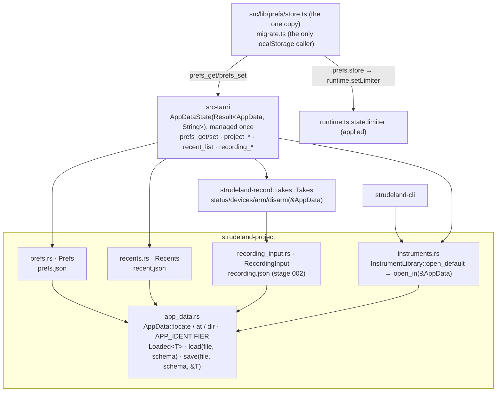

# 0128: one home for the app data documents

## Goal

The app data dir gets one owner, `AppData` in a new `app_data` module of `strudeland-project`.
It locates the dir without Tauri and holds the one way a document there is loaded and saved:
missing, corrupt, unreadable and wrong-schema files all give the defaults, the file stays where
it is, and the caller gets a problem string to log. `prefs.json`, `recent.json` and
`recording.json` move onto it, and each keeps its file name and its exact bytes. The instrument
library builds its directory from it. The limiter preference moves out of `localStorage` and
into `prefs.json`, so `src/lib/prefs/store.ts` becomes the only frontend copy of every
preference.

Today:

- the app data dir is resolved in three places (`src-tauri/src/project.rs:239-244`,
  `src-tauri/src/recording.rs:427-432`, `crates/strudeland-project/src/instruments.rs:442`);
- there are three load and save implementations with two bad-file policies. `prefs.json` and
  `recent.json` fall back silently. `recording.json` logs and leaves the file in place;
- the limiter is the only preference outside `prefs.json`. `src/lib/audio/limiter-pref.ts` reads
  it from `localStorage`, and a runtime-store subscriber in `src/lib/app.ts:116-125` writes it.

**Visible changes are limited to the ones the user accepted** ([reverify.md](0128-app-prefs/reverify.md),
"User decisions"):

- the limiter persists in `prefs.json`. In a plain browser (`bun run dev`) it no longer survives
  a reload, like every other pref there;
- the limiter is known once `prefs_get` resolves, a few milliseconds after launch. A play
  pressed inside that window can start unlimited;
- a failed limiter save shows the existing "prefs: …" notice;
- the stored `localStorage` value migrates once and the key is removed only after a successful
  save;
- a corrupt `prefs.json` or `recent.json` now logs a warning to stderr.

Nothing else changes. Every command name, parameter, result, error kind, event and
`bindings.ts` line stays the same. `recording.json` and `recent.json` keep their bytes exactly.
`prefs.json` keeps its bytes until stage 003, which adds one field, `"limiter"`.

## Background

[reverify.md](0128-app-prefs/reverify.md) holds the evidence at `8c13c8c`: the store table, the
three lookups, the identifier tests and the data-safety reasoning. In short:

- `Prefs::load` (`prefs.rs:43-50`) and `Recents::load` (`recents.rs:45-61`) swallow every
  failure. Both `save`s create the parent, write pretty JSON with a trailing `\n` and publish
  atomically through `project::atomic_write`.
- `takes::prefs::read_prefs` (`crates/strudeland-record/src/takes/prefs.rs:40-52`) logs
  `recording: ignoring <path>: <error>` or `recording: cannot read <path>: <error>` and gives the
  defaults. `write_prefs` (`:54-66`) is the same pretty, atomic, newline-terminated writer.
  `PrefsFile` has no `#[serde(default)]`: a file without `channel` is invalid.
- `Takes::status/devices/arm/disarm` take `prefs_path: &Path` and read the file on every call.
  Only `arm` writes it, and only when it was given an explicit device or channel. A failed write
  is logged as `recording: cannot save <path>: <error>` and the arm still succeeds
  (`takes/mod.rs:642-651`).
- The app transcript `src-tauri/src/recording/transcript.rs` pins the `recording.json` text
  byte for byte. Its `prefs` flow has four `"prefs file"` steps. Its frozen region (`:414-1207`)
  and its expected block (`:1209-8146`) never change to absorb a difference.
- `InstrumentLibrary::open_default` (`instruments.rs:441-453`, doc comment at `:440`)
  canonicalizes `dirs::data_dir()`, creates `com.rudoi.strudeland` and then `instruments`
  through `checked_directory` and `create_directory` (`mkdirat` on Unix). If there is no data dir, it fails with
  `instrument "instruments": cannot locate user data directory`. The CLI
  (`crates/strudeland-cli/src/run.rs:220`, `run/mcp.rs:92`) and the app
  (`src-tauri/src/instruments.rs:17,38,64`) call it.
- Tauri's `app_data_dir()` is `dirs::data_dir().join(identifier)`, and `tauri.conf.json` sets no
  `appDirectoriesOverride`. So a Tauri-free lookup gives the same path on every OS.
- `prefs_set` replaces the whole object. The frontend sends `{...initialLoad, ...edits}`
  (`store.ts:57-58`). `bindings.ts` types it as `{ prefs: unknown }`, so a new `Prefs` field needs
  no `ipc:build`. `scripts/ipc/build.ts:69-70` skips `State<…>` and `AppHandle` parameters, so
  swapping one for the other changes no binding.
- `state.levels.limiter` on the control socket reports `runtime`'s `state.limiter`, the applied
  value. It does not change.

## Scope

In:

1. **Stage 001, `AppData` and the document machinery.** `crates/strudeland-project/src/app_data.rs`
   holds `AppData`, `Loaded<T>`, the private `load`/`save` pair and `APP_IDENTIFIER` (moved
   from `instruments.rs`). `Prefs` and `Recents` move onto it. `InstrumentLibrary::open_default`
   builds on it. The app resolves `AppData` once into managed state, and `app_data_file` and
   `recents_path` go away. The app logs every returned problem. A new
   `ProjectError::NoDataDir` gets its `CommandError` row. The `prefs.rs` and `recents.rs` tests
   that covered the shared behaviour are replaced by machinery tests and per-document byte tests.
2. **Stage 002, `RecordingInput`.** `crates/strudeland-project/src/recording_input.rs` holds the
   `recording.json` document on the same machinery. `takes::prefs` keeps only
   `resolve_selection` and `saved_channel`. `Takes` takes `&AppData` instead of `prefs_path`.
   `recording.rs` loses `prefs_path` and `PREFS_FILE`.
3. **Stage 003, the limiter in prefs.** Rust and TS `Prefs` gain `limiter`. The store gains
   `limiter()`, `setLimiter` and `edited`. `StatusBar` toggles through prefs, and `app.ts`
   applies prefs to `runtime.setLimiter`. `src/lib/prefs/migrate.ts` moves the old value once.
   `limiter-pref.ts` is deleted.

Each stage updates the `AGENTS.md` lines it makes stale (see Decisions: no separate docs stage).

Out:

- a CLI `prefs` command (the user said no);
- any change to the recording input's behaviour: when it is read, when it is written, the channel
  fallback, the log-only save failure;
- the instrument commands' error texts. They keep calling `InstrumentLibrary::open_default`;
- `src/lib/ipc/bindings.ts`. No command, event, argument key or error kind changes. `ipc:build`
  is run only as a check that it writes nothing;
- the control protocol and its wire examples;
- gating play on the prefs load;
- `GLOSSARY.md`. "App data" is plumbing, not song language.

## Architecture



- **One seam, the file.** Every document is a plain serde type plus a file name and a schema
  number. The machinery is private to the crate. Each document exposes `load(&AppData) ->
  Loaded<Self>` and `save(&self, &AppData)`.
- **Documents stay separate.** `prefs.json`, `recent.json` and `recording.json` remain three
  files with three owners, so `prefs_set`'s whole-object replace never touches the recording
  input or the recents list.
- **The caller logs.** `Loaded::problem` is a sentence. The app prints it with a prefix for its
  document (`prefs: `, `recents: `, `recording: `), so `recording.json`'s log lines keep their
  current form.

## Technical design

### `app_data.rs` (stage 001)

```rust
pub(crate) const APP_IDENTIFIER: &str = "com.rudoi.strudeland";   // moved from instruments.rs

#[derive(Debug, Clone, PartialEq, Eq)]
pub struct AppData { dir: PathBuf }

impl AppData {
    /// `dirs::data_dir()/com.rudoi.strudeland`. No I/O: nothing is created or canonicalized.
    pub fn locate() -> Result<AppData, ProjectError>;   // None → ProjectError::NoDataDir
    /// An explicit dir (tests, and any caller that already knows the dir).
    pub fn at(dir: impl Into<PathBuf>) -> AppData;
    pub fn dir(&self) -> &Path;
    pub(crate) fn file(&self, name: &str) -> PathBuf;   // dir.join(name)
}

/// A loaded document: the value, and what was wrong with the file when it gave the defaults.
#[derive(Debug, Clone, PartialEq, Eq)]
pub struct Loaded<T> { pub value: T, pub problem: Option<String> }

/// The on-disk shape of every document.
#[derive(Serialize, Deserialize)]
struct OnDisk<T> { schema: u32, #[serde(flatten)] value: T }

pub(crate) fn load<T: DeserializeOwned + Default>(file: &Path, schema: u32) -> Loaded<T>;
pub(crate) fn save<T: Serialize>(file: &Path, schema: u32, value: &T) -> Result<(), ProjectError>;
```

**The bad-file policy**, written once in `load`:

| File | `value` | `problem` |
|---|---|---|
| missing (`NotFound`) | `T::default()` | `None` |
| unreadable (any other read error, including a directory in its place) | `T::default()` | `cannot read <path>: <io error>` |
| not JSON (including invalid UTF-8), wrong shape, missing `schema` | `T::default()` | `ignoring <path>: <serde error>` |
| `schema` is not the document's | `T::default()` | `ignoring <path>: schema must be <n>` |
| valid | parsed value | `None` |

- `load` reads with `fs::read` and parses with `serde_json::from_slice`, as `read_prefs` does
  today, so an invalid-UTF-8 `recording.json` keeps its `ignoring <path>: <serde error>` text
  instead of becoming a `cannot read` I/O error.
- `load` never writes, renames or deletes. The bad file stays until something saves over it. A
  later save still replaces it, as today: `touch_and_save` after a corrupt `recent.json`,
  `prefs_set` after a corrupt `prefs.json`, an arm with arguments after a corrupt
  `recording.json`.
- The schema is compared after a full parse, as all three readers do today.
- Unknown keys are ignored: `OnDisk` and the documents have no `deny_unknown_fields`.
- Whether a missing key defaults is the document's choice. `Prefs` keeps
  `#[serde(default)]`; `RecordingInput` and the recents list do not, so their required keys stay
  required.

**`save`** creates the parent with `fs::create_dir_all` (an error is `ProjectError::io(parent,
e)`), serializes `OnDisk { schema, value }` with `serde_json::to_string_pretty`, appends `\n` and
publishes it through `project::atomic_write`. A serialization failure stays a panic
(`expect("app data documents always serialise")`), as `prefs.rs:61` and `recents.rs:136` do
today. `#[serde(flatten)]` serializes through a map, and serde_json prints a map exactly as it
prints a struct, so the bytes are unchanged. `Prefs` already uses `flatten` today. The
per-document byte tests pin this.

**`ProjectError::NoDataDir`**, `#[error("cannot locate the user data directory")]`. In
`src-tauri/src/command_error.rs` it joins the `K::Other, None` row, with a case in that table's
test. No kind is added.

### Prefs and Recents (stage 001)

- `prefs.rs`: `Prefs` keeps its fields, attributes and `PREFS_FILE`. `PREFS_SCHEMA` stays 1.
  `Prefs::load(app: &AppData) -> Loaded<Prefs>` and `Prefs::save(&self, app: &AppData) ->
  Result<(), ProjectError>` call the machinery. `PrefsFile` is deleted.
- `recents.rs`: `pub const RECENTS_FILE: &str = "recent.json"` moves here from
  `src-tauri/src/project.rs:29`. A private `RecentsDoc { projects: Vec<PathBuf> }`
  (`Default`, no `serde(default)`) replaces `RecentsFile`. `Recents` keeps its `file` and
  `entries`, its dedupe-and-cap on load, `touch`, `prune`, `open_each`, `save` and the
  best-effort policy. The constructors and helpers take `&AppData`:
  - `Recents::load(app) -> Loaded<Recents>`;
  - `Recents::touch_and_save(app, root) -> Option<String>`, which returns the load problem;
  - `Recents::load_pruned(app) -> Loaded<Recents>`;
  - `Recents::list(app) -> Loaded<Vec<RecentProject>>`.

  `save` and `save_best_effort` are unchanged: a failed recents write is still dropped silently.
- `lib.rs` adds `mod app_data;` and `pub use app_data::{AppData, Loaded};`, plus `RECENTS_FILE`
  in the `recents` re-export. The crate doc gains "the app data dir and its documents".

### The instrument library (stage 001)

- `InstrumentLibrary::open_in(app: &AppData) -> Result<Self, ProjectError>` is today's
  `open_default` body over `app.dir()`'s parent and file name. It creates and canonicalizes the
  parent, then runs `checked_directory(base)`, `create_directory(base, name)`, `checked_directory`
  again, `create_directory(app, INSTRUMENTS_DIR)` and `open_store`. If `app.dir()` has no parent
  or file name, it returns `invalid(INSTRUMENTS_DIR, "cannot locate user data directory")`.
- `open_default()` is `AppData::locate()`, with `NoDataDir` mapped to the same
  `invalid(INSTRUMENTS_DIR, "cannot locate user data directory")` as today, followed by
  `open_in`. Its signature and every error text stay the same, so the CLI and the instrument
  commands are not touched.
- `default_directory_matches_desktop_identifier` (`instruments.rs:1169-1175`) moves to
  `app_data.rs` with `APP_IDENTIFIER`, with the same assertions.
  `crates/strudeland-ctl/src/path.rs:9` keeps its own copy and its own test (see Rejected).

### The app (stage 001)

- `src-tauri/src/project.rs` gains `pub struct AppDataState(Result<AppData, String>)`, with
  `AppDataState::locate()` (from `AppData::locate()`, the error as its `Display`) and
  `fn get(&self) -> Result<&AppData, CommandError>` (`CommandError::other(message)`). A missing
  data dir still lets the app start, and each command that needs the dir then fails with kind
  `other`, as today.
- `lib.rs` registers `.manage(project::AppDataState::locate())` with the other `.manage` calls.
  The builder runs it once before `setup`, and no command can run earlier.
- `app_data_file`, `recents_path` and `RECENTS_FILE` are deleted. The plain functions
  `install`, `create_project`, `open_project` and `open_last` take `app_data: &AppData` instead
  of `recents_file: &Path`. The commands that called `recents_path(&app)?` or `app_data_file`
  take `app_data: State<'_, AppDataState>` and call `app_data.get()?` first, at the same point.
  The generator skips `State` parameters, so `bindings.ts` is unchanged. `project_last`,
  `recent_list` and `prefs_get` drop their now-unused `app: AppHandle` unless they still need it
  for the watcher (`project_create`, `project_open` and `project_last` do).
- One helper, `fn logged<T>(what: &str, loaded: Loaded<T>) -> T`, prints
  `eprintln!("{what}: {problem}")` and returns the value. `prefs_get` uses it as `prefs`, and the
  recents paths as `recents`. `install` and `open_last` log the `touch_and_save` and
  `load_pruned` problems the same way.
- The module doc's "take the state and the recents file path" becomes "take the state and the
  app data".

### `RecordingInput` (stage 002)

```rust
// crates/strudeland-project/src/recording_input.rs
pub const RECORDING_INPUT_FILE: &str = "recording.json";
const RECORDING_INPUT_SCHEMA: u32 = 1;

/// The saved input choice. Channel 0-based.
#[derive(Debug, Clone, Default, PartialEq, Eq, Serialize, Deserialize)]
#[serde(rename_all = "camelCase")]          // no serde(default): `channel` stays required
pub struct RecordingInput { pub device_id: Option<String>, pub channel: u16 }

impl RecordingInput {
    pub fn file(app: &AppData) -> PathBuf;
    pub fn load(app: &AppData) -> Loaded<RecordingInput>;
    pub fn save(&self, app: &AppData) -> Result<(), ProjectError>;
}
```

- The field order (`deviceId`, `channel`) and `"deviceId": null` for `None` (no
  `skip_serializing_if`) keep today's bytes: `{"schema": 1, "deviceId": …, "channel": …}`
  pretty-printed with a trailing `\n`.
- `strudeland-record`'s `takes/prefs.rs` keeps `resolve_selection` and `saved_channel`, now over
  `&RecordingInput`. `Prefs`, `PrefsFile`, `parse_prefs`, `read_prefs`, `write_prefs` and
  `PREFS_SCHEMA` are deleted, along with `pub use prefs::{Prefs, write_prefs}` in
  `takes/mod.rs`.
- `Takes::status`, `devices`, `arm` and `disarm` take `app: &AppData` in place of `prefs_path:
  &Path`, and `armed_status` follows. They read at exactly today's points with a private
  `fn read_input(app) -> RecordingInput`, which logs `recording: {problem}`, the same text as
  today's two `eprintln!`s, and returns the value. `arm` saves at today's point under today's
  condition. A save error logs `recording: cannot save {RecordingInput::file(app)}: {e}` and the
  arm still succeeds.
- `src-tauri/src/recording.rs` deletes `PREFS_FILE` and `prefs_path`. The four commands read
  `app.state::<AppDataState>().get()?.clone()` where `prefs_path(&app)?` is today, before
  `blocking`, so that error still comes first.
- `strudeland_record::testing::TakesRig` gains `pub fn app_data(&self) -> AppData`
  (`AppData::at(dir.join("data"))`). `prefs()` stays, returning
  `RecordingInput::file(&self.app_data())`, the same `dir/data/recording.json`, because the
  transcript's frozen `prefs_text` calls it.

### The limiter (stage 003)

Rust:

- `Prefs` gains `pub limiter: bool` after `piano_roll_open`, with a doc comment ("The master
  safety limiter"). The struct's `#[serde(default)]` makes it `false` when absent. A saved
  `prefs.json` gains `"limiter": …` as its last key. This is the one intended byte change.

TS:

- `src/lib/prefs/api.ts`: `Prefs.limiter: boolean`; `DEFAULT_PREFS.limiter = false`.
- `src/lib/prefs/store.ts`:
  - `limiter(): boolean` and `setLimiter(on): Promise<boolean>`;
  - `edited(key: keyof Prefs): boolean`, true once this session called that key's setter;
  - every setter now resolves to whether its save landed: `true` after `api.set` resolved,
    `false` after it failed or when there is no api. It still never rejects. The callers that
    `void` the promise are unaffected. `app.toggleVim` returns `prefs.setVim(...)` as its
    `Promise<void>` (`app.ts:71,256-259`, `StatusBar.svelte:41`), which a `Promise<boolean>`
    does not satisfy, so it becomes
    `async toggleVim() { const saved = prefs.setVim(!prefs.vim()); view?.focus(); await saved; }`
    and both `Promise<void>` signatures stay.
- `src/components/StatusBar.svelte`: `onlimiter={prefs.setLimiter}`. The meter still shows
  `$rt.limiter`.
- `src/lib/app.ts`:
  - delete the `limiter-pref` import, `limiter: loadLimiter()`, `savedLimiter` and the limiter
    lines of the runtime subscriber, which keeps only the scope clock;
  - the existing `prefs.store.subscribe` (`app.ts:199-205`) gains
    `if (limiter !== get(runtime.store).limiter) runtime.setLimiter(limiter)`. The guard keeps
    other pref changes from sending a `playback_limiter` each time;
  - after `const ready = prefs.load()`, when `prefsApi` is non-null:
    `void ready.then(() => migrateLimiter(prefs, () => globalThis.localStorage))`. `ready`
    itself is unchanged.
- `src/lib/strudel/runtime.ts`: no code change. The doc comments on `limiter` and `setLimiter`
  say it is the applied value, set by the app from prefs. The `limiter` option stays because
  `runtime-levels.test.ts` uses it.
- `src/lib/audio/limiter-pref.ts` is deleted.

**`src/lib/prefs/migrate.ts`** is the only `localStorage` caller in `src/`:

```ts
/** Moves the old `localStorage` limiter value into prefs once. Never rejects. */
export async function migrateLimiter(
  prefs: PrefsStore,
  storage: () => Pick<Storage, 'getItem' | 'removeItem'> | undefined,
): Promise<void>;
```

| Case | Prefs | Key |
|---|---|---|
| `storage()` or `getItem` throws, or there is no storage | untouched | untouched |
| key absent | untouched | absent |
| key is neither `'1'` nor `'0'` (read as off today, and off is the default) | untouched | left |
| `prefs.edited('limiter')` (the user toggled before the load), and `await prefs.setLimiter(prefs.limiter())` resolves `true` | the user's value wins, saved again (an identical object) | removed |
| `prefs.edited('limiter')`, and that save fails | the user's value for this session, "prefs: …" notice | kept, so the next launch retries |
| `'1'` / `'0'`, `setLimiter(v)` resolves `true` | `limiter = v`, saved | removed |
| `'1'` / `'0'`, the save fails | `limiter = v` for this session, "prefs: …" notice | kept, so the next launch retries |
| `removeItem` throws | as above | left; `console.error`, never thrown |

The caller passes `null` for `prefsApi` in a plain browser, and `app.ts` then never calls
`migrateLimiter`, so the key stays for a later desktop launch.

## Tests

Replace, don't layer: a test whose subject moved is deleted where it was and rewritten against
the new owner.

- **Stage 001.**
  - `app_data.rs`, the machinery, over a private test document `Doc { flag: bool, name:
    Option<String> }`:
    - missing gives the default and no problem;
    - corrupt (`""`, `"{"`, `"[]"`) gives the default and an `ignoring <path>: ` problem, and the
      bytes are unchanged afterwards;
    - unreadable (a directory in the file's place) gives a `cannot read <path>: ` problem;
    - wrong schema (`2`, `0`, `"1"`, missing) gives the default, and the `2` case's problem is
      exactly `ignoring <path>: schema must be 1`;
    - unknown keys are ignored;
    - save creates the parent;
    - save is atomic: after two saves only the one file is left, holding the second value;
    - save errors: a parent that is a file gives `ProjectError::Io`, and a target that is a
      directory gives `Err`;
    - exact bytes for a `Doc`;
    - `locate()` equals `dirs::data_dir().unwrap().join(APP_IDENTIFIER)`, and the identifier
      matches `tauri.conf.json` with no `appDirectoriesOverride` (moved from `instruments.rs`).
  - `prefs.rs` keeps only what is specific to `Prefs`:
    - `missing_keys_default`;
    - the four defaults;
    - a byte test pinning today's exact text for the all-true value
      (`"{\n  \"schema\": 1,\n  \"vim\": true,\n  \"auditionNotes\": true,\n  \"formatOnSave\": true,\n  \"pianoRollOpen\": true\n}\n"`)
      and for the default. That text loads back as the value and re-saves byte-identically.

    `missing_file_gives_defaults`, `corrupt_file_gives_defaults`,
    `unreadable_file_gives_defaults`, `wrong_schema_gives_defaults`, `unknown_fields_are_ignored`,
    `save_creates_the_parent_dir`, `round_trip_writes_pretty_json_with_a_newline` and
    `save_error_is_returned` are deleted: the machinery tests cover them.
  - `recents.rs` keeps every recents behaviour test, moved onto `AppData::at(tmp)`:
    - dedupe and cap on load, `touch`, `prune`, `open_each`, `list`;
    - `touch_and_save` ignores a failed write;
    - `load_pruned` writes back only when it pruned;
    - camel-case `RecentProject`.

    `missing_file_loads_empty`, `other_schema_loads_empty` and
    `save_leaves_no_temp_file_and_overwrites` are deleted. `corrupt_file_loads_empty` shrinks
    to the shapes specific to recents (`{"schema":1}` and `{"schema":1,"projects":[1]}` give an
    empty list with a problem). `save_creates_the_parent_and_round_trips` becomes the byte
    test: exactly `"{\n  \"schema\": 1,\n  \"projects\": [\n    \"/p/b\",\n    \"/p/a\"\n  ]\n}\n"`.
    `save_reports_an_unwritable_parent` stays, because it checks the `Recents::save` path.
  - `instruments.rs`: `open_in` over `AppData::at(tmp.join("data/com.rudoi.strudeland"))`
    creates `…/instruments` and lists no entries.
  - `src-tauri/src/project.rs`: `Env` builds `AppData::at(tmp/data)`, and `env.recents()` stays
    the file path `tmp/data/recent.json`, so every assertion keeps its text.
    `command_error.rs`'s table test gains the `NoDataDir` row. The one `recording.rs` edit in
    this stage is the `open_project` call in its test
    `opening_a_project_repairs_it_in_the_background` (`:962-963`), which passes
    `&AppData::at(rig.tmp.path())`.
  - **Characterize first.** Write the two per-document byte tests against today's `prefs.rs`
    and `recents.rs` before any other edit. They must pass unchanged on `8c13c8c`'s code. After
    that their literals never change in this stage.
- **Stage 002.**
  - `recording_input.rs`:
    - today's exact text `"{\n  \"schema\": 1,\n  \"deviceId\": \"coreaudio:abc\",\n  \"channel\": 3\n}\n"`
      loads as `{Some("coreaudio:abc"), 3}` and re-saves byte-identically;
    - `deviceId: null` round-trips;
    - `{"schema":1,"channel":2}` loads `{None, 2}`;
    - `{"schema":1,"deviceId":"x"}` (no channel) gives the defaults, not `"x"`, with a problem;
    - the six bad texts of today's `prefs_parse_errors_give_defaults` give the defaults with an
      `ignoring <path>: ` problem that contains the serde message without its position. The
      schema case gives exactly `…: schema must be 1`. Each bad file is still in place with its
      bytes.

    These replace `prefs_parse_errors_give_defaults` and `prefs_round_trip` in
    `takes/prefs.rs`.
  - `takes/prefs.rs` keeps `selection_resolution` and `saved_channel_cases`, over
    `RecordingInput`.
  - `takes/tests.rs`: every `rig.prefs()` passed to a `Takes` verb becomes `&rig.app_data()`.
    Every `write_prefs(&rig.prefs(), &Prefs{..})` becomes `RecordingInput{..}.save(&rig.app_data())`,
    and every `read_prefs(&rig.prefs())` becomes `RecordingInput::load(&rig.app_data()).value`.
    The assertions stay. `a_prefs_write_failure_does_not_fail_the_arm` keeps
    `create_dir_all(rig.prefs())`.
  - The transcript: only the adapters above `// --- frozen: begin ---` change (the import, `arm`,
    `spawn_arm`, `disarm`, `status`, `devices`, `write_prefs`). The frozen region and the
    expected block are byte-identical to `8c13c8c`.
- **Stage 003.**
  - Rust `prefs.rs`:
    - the byte test's literals gain `,\n  "limiter": true` / `false` as the last key;
    - a new test: the stage-001 four-field text loads with `limiter: false` and the other four
      values unchanged;
    - `{"schema":1,"limiter":true}` loads `limiter` alone;
    - the default is off.
  - `tests/prefs.test.ts`:
    - `setLimiter` and `limiter()`;
    - `edited`;
    - a setter resolves `true` after a good save and `false` after a failed one;
    - every migration row of the table above, calling `migrateLimiter` directly with
      `createPrefs(fakePrefsApi(...))` and a fake storage;
    - every whole-`Prefs`/`PrefsState` `toEqual` literal gains `limiter: false`.
  - `tests/app.test.ts`:
    - a loaded `limiter: true` reaches `runtime` after `ready`;
    - `app.prefs.setLimiter` changes `get(app.runtime.store).limiter` at once and saves;
    - a vim toggle sends no extra limiter call (the guard);
    - two `createApp` wiring tests over happy-dom's real `localStorage` (`setItem` to seed it,
      `localStorage.clear()` in `afterEach`): `'1'` stored, the key removed and the runtime
      limiter on; and `prefsApi` null, where the key stays.

    The saved-object literal at `app.test.ts:939` gains `limiter: false`, and so does the prefs
    literal at `tests/ipc-adapters.test.ts:48`.
  - `tests/runtime-levels.test.ts`: delete the `limiter-pref` test (`:120-148`), its import (`:5`)
    and the `localStorage` helpers. The runtime limiter tests (`:99-117`) stay.

## What must not change

- **Bytes.** `recent.json` and `recording.json` stay byte-identical for every value. `prefs.json`
  stays byte-identical through stage 002, and stage 003 adds only the `limiter` key.
- **Values.** Every file that loads today loads the same values, except the hand-written array
  form that Risks accepts. Every file that falls back
  today falls back. A file without `channel` is still invalid.
- **Writes.** They happen at the same points: `prefs_set`, recents `touch_and_save`, `save` only
  after a prune, an arm with an argument. Failures are handled the same way: a `prefs_set` error
  is a `CommandError` kind `other`, recents writes are silent, a recording-input write is logged.
- **The IPC contract.** Commands, argument keys, results, events and error kinds stay the same.
  `bindings.ts` stays byte-identical.
- **The recording transcript's** frozen region and expected block.
- **The instrument library's** path, checks and every error text.
- **The control socket.** `state.levels.limiter` still reports the applied value.

## Rejected

- **The recording input as a field group in `Prefs`.** `prefs_set` replaces the whole object
  from the frontend's initial-load snapshot, so a device armed after launch would be overwritten
  by the next pref toggle. `prefs_set` and `arm` would also race on one file.
- **A CLI `prefs` command.** The user said no.
- **Tauri's `app_data_dir()` inside the module.** The CLI cannot use it, and it gives the same
  path anyway (Background).
- **Moving `APP_IDENTIFIER` into `strudeland-ctl`** to share it. `strudeland-ctl` does not
  depend on `strudeland-project`, and both copies are tested against `tauri.conf.json`.
- **Gating play on the prefs load.** The user accepted the few-millisecond window instead.
- **One generic `Document` trait** with associated `FILE` and `SCHEMA`. Three documents do not
  need it; each type's two methods name its file and schema directly.
- **Logging inside the machinery.** That would fix one prefix for every caller and hide the
  problem from tests. The caller logs.

## Decisions

- **No separate docs stage.** `004-docs` would be four `AGENTS.md` line edits. Each stage
  updates the lines it makes stale in its own commit: 001 the `strudeland-project` bullet
  (`AGENTS.md:159-160`), 002 the recording bullet (`:310`), 003 the master-meter line (`:88`) and
  the prefs bullet (`:139`). `GLOSSARY.md` gets no entry. The proposal's stage list is therefore
  001-003.
- **`AppData` is managed state in the builder** (`.manage(...)`), not inside `setup`. It needs
  no app handle, and the builder resolves it once before any command can run.
- **The instrument commands keep `InstrumentLibrary::open_default()`** instead of the managed
  `AppData`, so their no-data-dir error text stays the same.
- **`Loaded<T>` is public; `load`/`save` are crate-private.** Other crates see documents, not
  files.
- **Setters resolve `boolean`.** The migration has to know its save landed. Reading
  `store.error` after the await would also see the result of a save queued behind it.
- **`edited(key)`** is the store's answer to "did the user already choose this session". The
  migration cannot tell a toggle from the loaded value any other way.

## Dependencies

- No new crates. `strudeland-project` already has `dirs`, `serde` and `serde_json`.
  `strudeland-record` already depends on `strudeland-project`.
- No follow-up tasks are needed. File any found while implementing with `keitora task new`.

## Risks

- **The serde error position in `recording.json` log lines.** With `flatten`, serde_json reports
  a field error at the end of the object, not at the field, so the column in
  `recording: ignoring … at line 1 column N` may move. This affects stderr only. Tests assert the
  message without its position.
- **The no-data-dir command message.** When `dirs::data_dir()` is `None` (no `HOME`), `prefs_*`,
  `project_*`, `recent_list` and `recording_*` fail with kind `other` as today. The message
  becomes `cannot locate the user data directory` instead of Tauri's `unknown path`. The user
  cannot normally reach this.
- **A `removeItem` that throws after a good save** leaves the key, and the next launch migrates
  it again, overriding a toggle made in between. This needs storage that reads but cannot delete.
  It is logged.
- **Array-form `recent.json` and `recording.json` (accepted).** Today's `RecentsFile` and
  `PrefsFile` are plain structs, which serde also deserializes from a JSON array
  (`[1,["/a"]]`, `[1,"x",2]`). `OnDisk` uses `#[serde(flatten)]`, which accepts only a map, so
  such a file now falls back to the defaults with a problem. No build ever writes the array
  form (every writer serializes a struct to an object), so only a hand-written file is affected.
  `prefs.json` already uses `flatten` and is unaffected. This is not a STOP.
- **The `recording.json` save-failure log text.** A failed `create_dir_all` in `save` is
  `ProjectError::io(parent, e)`, whose `Display` is `<parent>: <io error>`, where `write_prefs`
  printed only `<io error>`. So `recording: cannot save <path>: …` gains a `<parent>: ` prefix in
  that case. This is stderr only, and no test pins it.
- **Downgrade.** An older build reads a `prefs.json` that has `limiter`, ignores the key, and
  drops it on its next save. The limiter then falls back to the old `localStorage` key if it is
  still there, or to off.

## Open questions

- Is the no-data-dir message change (Risks) acceptable? Recommendation: yes. The case needs a
  missing `HOME`, and the kind is unchanged. If not, `AppDataState` can store Tauri's text, at the
  cost of a Tauri call in the app's setup.
